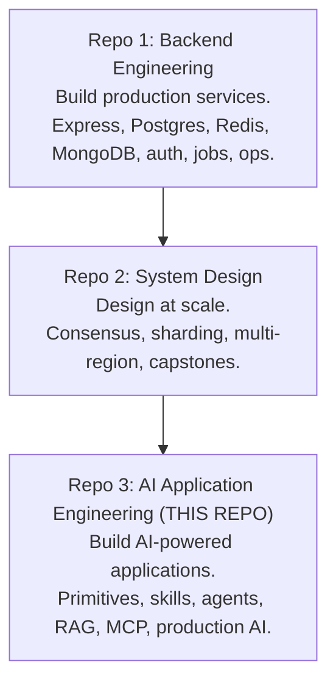
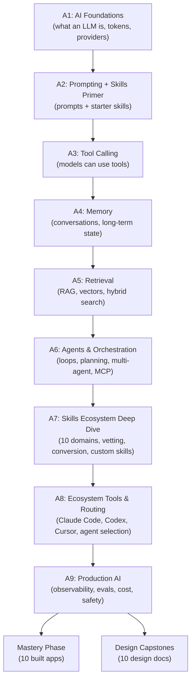

# AI Application Engineering

> A linear, capability-based curriculum for building and using AI-powered applications.
> Covers LLM APIs, prompting, tool calling, memory, retrieval, agents, skills, ecosystem tools, and production AI.
> **Third repo** in the learning system. Assumes completion of **Backend Engineering** and **System Design**.

---

## 1. What This Curriculum Is

A hands-on path from "I can build production services and design distributed systems" to "I can build, extend, and operate AI-powered applications using the modern ecosystem."

**Core principle**: every topic is one of five modes:

- **BUILD** — implement from scratch (raw provider SDK, own agent loop, own memory store)
- **USE** — consume a tool or skill correctly
- **KNOW** — awareness of a concept, framework, or algorithm
- **CONVERT** — take a skill/tool from one agent ecosystem and adapt it to another
- **EVALUATE** — apply the evaluation framework to assess a tool/skill/model

**Non-goals**:

- This is _not_ ML theory. No backpropagation, no training, no transformer math.
- This is _not_ framework-first. LangGraph, CrewAI, Mastra, AutoGen are awareness-level.
- This is _not_ paid-only. Every tool and provider has a free-tier or local path.

---

## 2. The Three-Repo Family



**Build order**: Backend → System Design → AI Engineering. This repo assumes both.

**What this repo assumes you already know** (from Backend + System Design):

- HTTP, async, streams, backpressure
- Postgres, Redis, MongoDB
- Auth, idempotency, rate limiting, secrets
- Job queues, WebSockets, observability
- Distributed systems fundamentals (CAP, consistency, retries, circuit breakers)
- Design docs, mock defenses, capacity math

**What this repo adds**: everything specific to building and operating AI applications on top of those foundations.

---

## 3. The 9 Tiers

| Tier   | Name                            | Capability                                                                                     | Anchored Artifact                         |
| ------ | ------------------------------- | ---------------------------------------------------------------------------------------------- | ----------------------------------------- |
| **A1** | AI Foundations                  | Understand what an LLM is, how to call one, cost/latency/token mechanics, provider abstraction | Multi-provider CLI                        |
| **A2** | Prompting + Skills Primer       | Engineer prompts, get typed outputs, install and use skills to accelerate work                 | Prompt library + starter skill stack      |
| **A3** | Tool Calling & Function Schemas | Give models tools, execute safely, handle errors                                               | Tool-calling agent service                |
| **A4** | Memory & Context Engineering    | Conversation state, long-term memory, context window management                                | Chat service with persistent memory       |
| **A5** | Retrieval & Knowledge Systems   | RAG, embeddings, vector DBs, hybrid search, reranking                                          | Document Q&A service                      |
| **A6** | Agents & Orchestration          | Agent loops, planning, workflows, multi-agent patterns, MCP                                    | Multi-agent research assistant            |
| **A7** | Skills Ecosystem Deep Dive      | 10 domains, vetting, composition, conversion between agents, building your own                 | Custom skill + conversion tooling         |
| **A8** | Ecosystem Tools & Agent Routing | Claude Code, Codex, Cursor, Antigravity, MCP servers, code review tools, agent selection       | Personal AI workflow + routing cheatsheet |
| **A9** | Production AI Systems           | Observability, evals, cost control, safety, security, deployment                               | Production AI platform                    |

**Plus**: Mastery Phase (10 built apps), Design Capstones (10 design docs), two vaults, two living files.

---

## 4. Learning Flow



**Tiers A1–A6**: build primitives from scratch. Understand how LLMs work before abstracting.
**Tier A2 (Skills Primer)**: light introduction — install Antigravity, use skills to accelerate work while learning primitives.
**Tier A7 (Skills Deep Dive)**: full skills ecosystem — 10 domains, vetting, conversion, composition, building your own.
**Tier A8**: ecosystem tools and agent routing — Claude Code, Codex, Cursor, MCP servers.
**Tier A9**: production AI — observability, evals, cost, safety.

**Why the skills split**: A2 makes you a **user** of skills. A7 makes you an **operator and creator**. Use first, understand deeply later — same pattern as Backend Engineering.

---

## 5. The 13-Tag Legend

Every topic carries these tags. Format is compact — two lines per topic.

| Tag                                                   | Meaning                                                   |
| ----------------------------------------------------- | --------------------------------------------------------- |
| `BUILD` / `USE` / `KNOW` / `CONVERT` / `EVALUATE`     | Depth mode                                                |
| `Anchor: <tier-name>`                                 | The artifact this topic feeds                             |
| `Deps: <topics>`                                      | What must come before                                     |
| `Fails: <symptom>`                                    | What breaks in production if you don't know this          |
| `Interview: Y/N/S`                                    | Frequently asked in AI engineer interviews                |
| `Artifact: <file>`                                    | The written or built output proving you learned it        |
| `Mistake: <trap>`                                     | Common misconception                                      |
| `Ref: <tier>`                                         | Where this is reused _within this repo_                   |
| `Ref: Backend <tier>.<topic>`                         | Points to Backend Engineering coverage — skip re-teaching |
| `Ref: System Design <tier>.<topic>`                   | Points to System Design coverage — skip re-teaching       |
| `Theory X / Practice Y`                               | Weight split for this topic                               |
| `Cost: free` / `Cost: local` / `Cost: paid-awareness` | Free-tier or local viability                              |
| `Skill: <name>`                                       | Relevant ecosystem skill, if any                          |

**Example** (topic + tags):

```
- **Provider abstraction**: one interface, multiple providers (Gemini, Groq, Ollama)
  `BUILD` · `Anchor: A1-cli` · `Deps: A1 provider-apis` · `Fails: vendor lock-in; can't swap when free tier exhausts` · `Interview: Y` · `Artifact: provider-abstraction.ts` · `Mistake: hardcoding SDK-specific types into business logic` · `Ref: A3, A4, A5, A6, A9` · `Cost: free` · `Theory 30/Practice 70` · `Local`
```

---

## 6. Free-Tier Discipline

Every provider, tool, or service recommended in this curriculum has a **free-tier or local path**. No paid-only dependencies anywhere.

**Free-tier AI providers** used throughout:

| Provider                       | What's Free                    | Limits                   |
| ------------------------------ | ------------------------------ | ------------------------ |
| **Google AI Studio (Gemini)**  | Gemini 2.0/2.5 Flash + Pro     | Rate-limited             |
| **Groq**                       | Llama, Mixtral, Qwen, DeepSeek | Rate-limited, fast       |
| **OpenRouter**                 | `:free` model variants         | Rate-limited             |
| **Cerebras**                   | Hosted open models             | Rate-limited             |
| **Hugging Face Inference API** | Many open models               | Rate-limited             |
| **Ollama**                     | Any model, local               | Depends on your hardware |
| **llama.cpp**                  | Any model, local               | Slower, minimal hardware |

**Free-tier dev tools**:

| Tool            | What's Free                          |
| --------------- | ------------------------------------ |
| **Antigravity** | Via Jio subscription — primary agent |
| **Codex CLI**   | Generous free tier — secondary       |
| **Cursor**      | Generous free tier — secondary       |
| **CodeRabbit**  | Free for public repos                |
| **Snyk**        | Free tier                            |
| **Semgrep**     | Open source                          |
| **Perplexity**  | Free tier                            |
| **DeepWiki**    | Free                                 |

**Every tier file's topics will carry `Cost: free` or `Cost: local`.** If a topic requires paid infrastructure (rare), it will be flagged `Cost: paid-awareness` and a free alternative provided.

---

## 7. The Agent Assumption

The learner uses **Antigravity** as their primary AI agent (via Jio subscription). Codex CLI and Cursor are secondary paths. Claude Code and other agents are awareness-level.

**All practical guidance is Antigravity-first.** Where agents differ, the differences are noted:

- Skill locations (`~/.claude/skills/` vs `.codex/skills/` vs Antigravity's path)
- Config files (`CLAUDE.md` vs `AGENTS.md` vs Antigravity's equivalent)
- MCP configuration
- Tool availability

**Skill portability is a first-class topic** (in A7). You already proved this works — converting a Claude skill to run in Antigravity. The curriculum teaches the pattern explicitly.

---

## 8. Mastery Phase + Design Capstones

### Mastery Phase — 10 built apps

Mirrors Backend Engineering's Mastery Phase (10D — brief spec, blind build, reference reveal).

1. Multi-provider chatbot
2. PDF Q&A with citations
3. Codebase Q&A assistant
4. Customer support agent
5. Email triage assistant
6. Research assistant (multi-agent)
7. Personal knowledge base
8. Coding assistant with MCP
9. Voice assistant
10. Production AI platform

### Design Capstones — 10 design docs

Mirrors System Design T5 (7-part design doc + mock defense).

1. ChatGPT-style conversational assistant
2. GitHub Copilot-style coding assistant
3. Perplexity-style search + retrieval engine
4. Cursor-style autonomous coding agent
5. Notion AI-style document Q&A + extraction
6. Customer support agent at scale
7. Multi-agent research system
8. MCP-based tool ecosystem
9. Voice agent at scale
10. Production AI platform (design + capacity math)

**Both portfolios**: 10 built apps + 10 design docs + 10 defense transcripts = 30 artifacts.

---

## 9. The Two Vaults

### Papers Vault (`12-papers-vault.md`)

10 foundational papers — architecture-level, no math:

- Attention Is All You Need (2017)
- RAG paper (2020)
- ReAct (2022)
- Chain-of-Thought (2022)
- Toolformer (2023)
- Constitutional AI (2022)
- Self-Refine (2023)
- Mixture of Experts (2022)
- MCP specification (2024)
- Whatever emerges as canonically important as the field evolves

Read inline as the tier where they matter arrives.

### Case Studies Vault (`13-case-studies-vault.md`)

10 real AI product breakdowns:

- Claude Code architecture
- Cursor (indexing + Composer)
- GitHub Copilot
- Perplexity (retrieval + reranking)
- v0 (component generation)
- Notion AI (document understanding)
- Devin / Cognition
- ChatGPT Memory
- Character.AI
- Segment + OpenAI integration patterns

Read on demand — never proactively suggested.

---

## 10. The Two Living Files

### `17-ai-landscape.md`

A living document tracking the current state of the AI ecosystem:

- Tool categories (terminal agents, IDEs, code review, research, etc.)
- Skill ecosystem (curated lists, categories, top skills)
- MCP server ecosystem
- Model families and pricing
- Protocol standards (MCP, A2A, etc.)

**Update protocol**: the AI updates it when a new tool, protocol, or model family surfaces during a session. The learner reviews periodically.

### `18-evaluation-framework.md`

The 5-minute assessment checklist for any new tool, skill, or model:

- Does it solve a real problem I have?
- Does it fit my stack?
- Is there a free tier or local path?
- What's the lock-in?
- Is it actively maintained?
- Green flags / red flags / verdict

Used explicitly in A7, A8, A9. Available as a reference throughout.

---

## 11. IN / OUT Boundary

### ✅ IN (AI Application Engineering)

- LLM APIs, provider abstraction, cost/latency mechanics
- Prompt engineering, structured output, evaluation
- Tool calling, function schemas, MCP
- Memory architectures, context engineering
- RAG, embeddings, vector DBs, hybrid search, reranking
- Agent loops, planning, multi-agent patterns, orchestration
- Skills ecosystem — discovery, vetting, composition, conversion, building
- Ecosystem tools — terminal agents, IDEs, code review, research, UI tools
- Production AI — observability, evals, cost control, safety, security
- Design capstones at scale
- Mastery apps

### ❌ OUT

- **ML theory** — training, backprop, gradient descent (awareness only)
- **Transformer internals** — attention math, positional encoding details (high-level only)
- **Model fine-tuning** — beyond LoRA/QLoRA awareness (Backend doesn't cover this)
- **Inference engine internals** — vLLM, TensorRT internals (awareness only)
- **CUDA / GPU programming** — out of scope entirely
- **Research-level topics** — alignment theory, interpretability (awareness only)

**Rule of thumb**: if a topic is about _using_, _composing_, or _operating_ AI systems, it's IN. If it's about _building_ models or _researching_ AI, it's OUT.

---

## 12. Cross-Repo References

This repo cross-references the other two repos via `Ref: Backend <tier>.<topic>` and `Ref: System Design <tier>.<topic>` tags.

**Common cross-references**:

| AI topic                            | Backend coverage    | System Design coverage |
| ----------------------------------- | ------------------- | ---------------------- |
| Rate limiting AI providers          | Backend T3c.5, T4.6 | System Design T3.5.2   |
| Caching (semantic, prompt)          | Backend T3c.6, T5.5 | System Design T3.5.1   |
| Vector DBs (pgvector)               | Backend T3a         | —                      |
| Multi-tenancy for AI apps           | Backend T7.7        | —                      |
| Observability (tracing, metrics)    | Backend T6.6        | System Design T3.5.9   |
| Idempotency (safe AI retries)       | Backend T4.7, T5.1  | System Design T3.2     |
| Streaming (SSE, WS)                 | Backend T7.5        | —                      |
| Job queues (agent orchestration)    | Backend T5.2        | System Design T3.5.3   |
| Secrets management (API keys)       | Backend T4.7        | System Design T3.5.10  |
| Deployments (canary, feature flags) | Backend T6.5        | —                      |

**When a topic has a cross-repo tag**: the AI instructor skips the basic explanation and focuses only on the AI-specific layer.

---

## 13. File Layout

```
ai_engineering/
├── SESSION-START.md
├── 00-overview.md
├── 01-tier-a1-foundations.md
├── 02-tier-a2-prompting-skills-primer.md
├── 03-tier-a3-tool-calling.md
├── 04-tier-a4-memory-context.md
├── 05-tier-a5-retrieval.md
├── 06-tier-a6-agents-orchestration.md
├── 07-tier-a7-skills-ecosystem.md
├── 08-tier-a8-ecosystem-tools.md
├── 09-tier-a9-production-ai.md
├── 10-mastery-projects.md
├── 11-design-capstones.md
├── 12-papers-vault.md
├── 13-case-studies-vault.md
├── 14-progress-tracker.md
├── 15-problems-patterns-index.md
├── 16-error-journal.md
├── 17-ai-landscape.md
├── 18-evaluation-framework.md
├── instructor-rules.md
├── deep-dives/
│   ├── 01-tier-a1/
│   ├── 02-tier-a2/
│   ├── 03-tier-a3/
│   ├── 04-tier-a4/
│   ├── 05-tier-a5/
│   ├── 06-tier-a6/
│   ├── 07-tier-a7/
│   ├── 08-tier-a8/
│   └── 09-tier-a9/
├── design-docs/
├── defense-transcripts/
├── paper-deep-dives/
├── case-study-deep-dives/
└── projects/
    ├── 01-multi-provider-chatbot/
    ├── 02-pdf-qa/
    ├── 03-codebase-qa/
    ├── 04-customer-support/
    ├── 05-email-triage/
    ├── 06-research-assistant/
    ├── 07-personal-kb/
    ├── 08-coding-assistant-mcp/
    ├── 09-voice-assistant/
    └── 10-production-ai-platform/
```

**The ENTRY POINT is `SESSION-START.md`.** Every session begins there.

---

## 14. How to Use This Repo

You are working with an AI instructor (Antigravity) that reads and writes files directly.

**Every session:**

1. Open the repo in Antigravity.
2. Say: **"Read SESSION-START.md and start."**
3. The AI reads `SESSION-START.md`, `instructor-rules.md`, `14-progress-tracker.md`, the current tier file, and (if in A7–A9) `18-evaluation-framework.md`.
4. The AI restates your position and waits for confirmation.
5. You confirm. Session begins.
6. When done, say **"that's enough for today."** The AI updates the tracker, error journal, tier retrospective, and (if relevant) the AI Landscape file.

**You don't paste anything.** The AI reads from disk. It writes deep-dive files, design docs (in capstones), tracker updates, and journal entries directly to disk and shows you a diff.

**Reference files** (`12-papers-vault.md`, `13-case-studies-vault.md`, `17-ai-landscape.md`, `18-evaluation-framework.md`) — read only when relevant.

---

## 15. What "Done" Looks Like

You've completed this curriculum when:

- All A1–A9 topics are engaged with in order
- Mastery Phase: 10 apps are built, tested, documented, and deployed
- Design Capstones: 10 design docs + 10 defense transcripts are complete
- You can look at any new AI tool/skill/model and evaluate it in 5 minutes
- You can install, vet, use, convert, and build skills across agent ecosystems
- You can build an AI-powered application end-to-end with observability, evals, and cost controls
- You know when to reach for which AI agent (Antigravity vs Codex vs Cursor) and why

The portfolio (10 built apps + 10 design docs + 10 defense transcripts) is what you show interviewers and collaborators.
