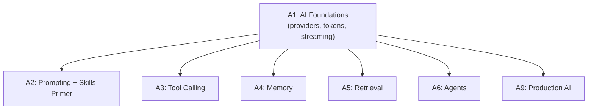

# Tier A1 — AI Foundations

> Understand what an LLM actually is, how to call one, and how cost, latency, and provider choice shape everything that follows.

---

## Purpose

By the end of A1, you can:

- Explain what an LLM is at a level sufficient to reason about design decisions
- Call any major provider API with a unified abstraction
- Reason about tokens, context windows, cost, and latency
- Handle streaming responses correctly
- Choose between free-tier providers (Gemini, Groq, OpenRouter), local models (Ollama), and paid providers
- Handle rate limits, timeouts, retries, and provider fallbacks

A1 is where "the LLM is a magic black box" becomes "the LLM is a service I can reason about like any other."

---

## Anchored Project

**A1: Multi-provider CLI**

A command-line tool that:

1. Takes a prompt from stdin or argv
2. Sends it to any of: Gemini (free), Groq (free), OpenRouter (free tier), or Ollama (local)
3. Streams the response token-by-token to the terminal
4. Reports tokens used, latency, and cost (if applicable)
5. Falls back to another provider on error or rate limit
6. Reads provider config from `.env` (API keys) + a provider selection flag

**What it proves**: you can abstract across providers from day one. This abstraction becomes the pattern for every service in later tiers.

**Deliverables**:

- `projects/01-multi-provider-chatbot/` — full repo
- Provider abstraction library (reusable in later tiers)
- README with provider comparison notes (free tier limits, model quality)

---

## How A1 Fits the Architecture

**What it produces**: the provider abstraction used by every later tier.

---

## Topics (Linear Spine)

### A1.1 — What an LLM Is (Conceptual)

- **What an LLM is**: next-token prediction, trained on text, no "understanding" — but emergent behavior
  `KNOW` · `Anchor: A1-cli` · `Deps: —` · `Fails: treating LLMs as databases; expecting factual recall without grounding` · `Interview: Y` · `Artifact: —` · `Mistake: anthropomorphizing the model` · `Ref: A3, A5` · `Theory 80/Practice 20` · `Cost: free` · `Reading: 30 min`

- **Tokens**: text is split into tokens, not words; cost and context measured in tokens
  `KNOW` · `Anchor: A1-cli` · `Deps: A1.1 llm` · `Fails: underestimating cost; exceeding context limits unexpectedly` · `Interview: Y` · `Artifact: —` · `Mistake: assuming 1 token = 1 word` · `Ref: A1.4 cost` · `Theory 60/Practice 40` · `Cost: free` · `Reading: 25 min`

- **Context window**: the model's working memory; both input and output count against it
  `KNOW` · `Anchor: A1-cli` · `Deps: A1.1 tokens` · `Fails: truncation errors; lost conversation history` · `Interview: Y` · `Artifact: —` · `Mistake: assuming long context is always better (it costs more and can lose focus)` · `Ref: A2, A4` · `Theory 60/Practice 40` · `Cost: free` · `Reading: 25 min`

- **Reasoning models vs fast models**: when 30x cost/latency is worth it
  `KNOW` · `Anchor: A1-cli` · `Deps: A1.1 context` · `Fails: using slow reasoning models for simple tasks; using fast models for complex reasoning` · `Interview: Y` · `Artifact: model-comparison.md` · `Mistake: defaulting to the biggest model` · `Ref: A8 agent-routing` · `Theory 50/Practice 50` · `Cost: free` · `Reading: 30 min`

- **Model families**: GPT, Claude, Gemini, Llama, Qwen, Mistral, DeepSeek — strengths and trade-offs
  `KNOW` · `Anchor: A1-cli` · `Deps: A1.1 reasoning` · `Fails: choosing a model without understanding its trade-offs` · `Interview: Y` · `Artifact: —` · `Mistake: assuming any model works for any task` · `Ref: A8` · `Theory 70/Practice 30` · `Cost: free` · `Reading: 35 min`

- **What LLMs cannot do**: no reliable factual recall without grounding; no persistent memory; no true multi-step reasoning without scaffolding
  `KNOW` · `Anchor: A1-cli` · `Deps: A1.1 llm` · `Fails: designing systems that require capabilities the model lacks` · `Interview: Y` · `Artifact: —` · `Mistake: assuming the model can do arithmetic, search, or remember` · `Ref: A3, A4, A5` · `Theory 70/Practice 30` · `Cost: free` · `Reading: 25 min`

**Deep-dive candidates**: LLM capabilities and limits — generate on demand.

---

### A1.2 — Provider APIs

- **OpenAI API**: `chat.completions`, `responses`, streaming, JSON mode
  `USE` · `Anchor: A1-cli` · `Deps: A1.1 llm` · `Fails: misusing SDK; ignoring rate limits` · `Interview: Y` · `Artifact: openai-client.ts` · `Mistake: hardcoding model names` · `Ref: A3, A9` · `Theory 30/Practice 70` · `Cost: paid-awareness` · `Reading: 30 min`

- **Anthropic API**: Messages API, system prompts, streaming, tool use
  `USE` · `Anchor: A1-cli` · `Deps: A1.1 llm` · `Fails: misusing system prompt structure` · `Interview: S` · `Artifact: anthropic-client.ts` · `Mistake: treating system prompt like OpenAI's` · `Ref: A3` · `Theory 30/Practice 70` · `Cost: paid-awareness` · `Reading: 25 min`

- **Google AI Studio (Gemini)**: free tier, `@google/generative-ai` SDK, streaming
  `USE` · `Anchor: A1-cli` · `Deps: A1.1 llm` · `Fails: not exploiting generous free tier` · `Interview: S` · `Artifact: gemini-client.ts` · `Mistake: using paid OpenAI when Gemini free would work` · `Ref: A9` · `Theory 20/Practice 80` · `Cost: free` · `Reading: 30 min`

- **Groq**: fastest inference, `groq-sdk`, free tier with rate limits
  `USE` · `Anchor: A1-cli` · `Deps: A1.1 llm` · `Fails: missing speed advantage for real-time use cases` · `Interview: N` · `Artifact: groq-client.ts` · `Mistake: using Groq for tasks needing stronger reasoning` · `Ref: A9` · `Theory 20/Practice 80` · `Cost: free` · `Reading: 25 min`

- **OpenRouter**: unified interface to many models, free `:free` variants
  `USE` · `Anchor: A1-cli` · `Deps: A1.1 llm` · `Fails: not exploiting multi-provider routing` · `Interview: S` · `Artifact: openrouter-client.ts` · `Mistake: assuming free models are production-grade` · `Ref: A8` · `Theory 25/Practice 75` · `Cost: free` · `Reading: 25 min`

- **Ollama (local)**: run open models locally, zero cost, no rate limits
  `USE` · `Anchor: A1-cli` · `Deps: A1.1 llm` · `Fails: dependent on cloud free tiers; no offline capability` · `Interview: S` · `Artifact: ollama-client.ts` · `Mistake: expecting frontier-model quality from small local models` · `Ref: A9` · `Theory 20/Practice 80` · `Cost: local` · `Reading: 35 min`

- **Hugging Face Inference API**: free tier for many open models
  `USE` · `Anchor: A1-cli` · `Deps: A1.1 llm` · `Fails: missing an option when other free tiers are exhausted` · `Interview: N` · `Artifact: hf-client.ts` · `Mistake: not checking per-model availability` · `Ref: A9` · `Theory 20/Practice 80` · `Cost: free` · `Reading: 20 min`

**Deep-dive candidates**: Gemini free tier deep dive, Ollama setup — generate on demand.

---

### A1.3 — Provider Abstraction

- **Why abstract**: free tiers exhaust; models get deprecated; pricing changes; some tasks need specific models
  `KNOW` · `Anchor: A1-cli` · `Deps: A1.2 providers` · `Fails: vendor lock-in; every provider change rewrites business logic` · `Interview: Y` · `Artifact: —` · `Mistake: SDK-specific types leak into service code` · `Ref: A3, A4, A5, A6, A9` · `Theory 50/Practice 50` · `Cost: free` · `Reading: 25 min`

- **The unified interface**: a single `LLM` type with `complete(prompt, options) → AsyncIterable<chunk>`
  `BUILD` · `Anchor: A1-cli` · `Deps: A1.3 why` · `Fails: inconsistent APIs across providers; bugs when adding a new provider` · `Interview: Y` · `Artifact: llm-interface.ts` · `Mistake: exposing provider-specific options that break abstraction` · `Ref: A3, A4` · `Theory 30/Practice 70` · `Cost: free` · `Reading: 40 min`

- **Adapter pattern for each provider**: OpenAI, Anthropic, Gemini, Groq, OpenRouter, Ollama
  `BUILD` · `Anchor: A1-cli` · `Deps: A1.3 interface` · `Fails: duplicated logic per provider` · `Interview: Y` · `Artifact: adapters/` · `Mistake: trying to fit all providers into one strict shape (they differ)` · `Ref: A9` · `Theory 20/Practice 80` · `Cost: free` · `Reading: 60 min`

- **Capability flags**: which providers support streaming, JSON mode, tool calling, vision, long context
  `BUILD` · `Anchor: A1-cli` · `Deps: A1.3 adapters` · `Fails: sending unsupported options; silent failures` · `Interview: S` · `Artifact: capabilities.ts` · `Mistake: assuming all providers support all features` · `Ref: A3, A9` · `Theory 30/Practice 70` · `Cost: free` · `Reading: 30 min`

- **Streaming abstraction**: unified streaming interface across providers
  `BUILD` · `Anchor: A1-cli` · `Deps: A1.3 adapters` · `Fails: different streaming formats break clients` · `Interview: Y` · `Artifact: streaming.ts` · `Mistake: leaking provider-specific stream events` · `Ref: A9` · `Theory 30/Practice 70` · `Cost: free` · `Reading: 45 min`

**Deep-dive candidates**: adapter pattern implementation, streaming across providers — generate on demand.

---

### A1.4 — Cost, Latency, and Reliability

- **How pricing works**: input tokens, output tokens, per-model rates; reasoning models cost 10–30x
  `KNOW` · `Anchor: A1-cli` · `Deps: A1.1 tokens` · `Fails: surprise bills; free tiers exhausted fast` · `Interview: Y` · `Artifact: —` · `Mistake: not tracking token usage from day one` · `Ref: A9 cost` · `Theory 50/Practice 50` · `Cost: free` · `Reading: 30 min`

- **Token counting**: `tiktoken` (OpenAI), provider-specific tokenizers, approximations
  `BUILD` · `Anchor: A1-cli` · `Deps: A1.4 pricing` · `Fails: context overflow; unexpected costs` · `Interview: S` · `Artifact: token-counting.ts` · `Mistake: assuming character counts approximate tokens` · `Ref: A4, A9` · `Theory 30/Practice 70` · `Cost: free` · `Reading: 30 min`

- **Latency profile**: time-to-first-token (TTFT) vs total latency; streaming changes UX
  `BUILD` · `Anchor: A1-cli` · `Deps: A1.3 streaming` · `Fails: slow perceived performance despite fast total time` · `Interview: S` · `Artifact: latency-tracking.ts` · `Mistake: not measuring TTFT separately` · `Ref: A9 observability` · `Theory 40/Practice 60` · `Cost: free` · `Reading: 25 min`

- **Rate limits and quotas**: per-minute, per-day, per-token, per-provider
  `BUILD` · `Anchor: A1-cli` · `Deps: A1.2 providers` · `Fails: hard failures under load; free tier exhausted mid-task` · `Interview: Y` · `Artifact: rate-limit-handling.ts` · `Mistake: no backoff on 429; no fallback` · `Ref: Backend T3c.5, T4.6, A9` · `Theory 40/Practice 60` · `Cost: free` · `Reading: 35 min`

- **Timeouts and retries**: per-request timeout; retry with exponential backoff + jitter
  `BUILD` · `Anchor: A1-cli` · `Deps: A1.4 rate-limits` · `Fails: hanging requests; retry storms` · `Interview: Y` · `Artifact: retries.ts` · `Mistake: retrying non-retryable errors (auth failures)` · `Ref: Backend T5.4, A9` · `Theory 30/Practice 70` · `Cost: free` · `Reading: 30 min`

- **Fallback providers**: on rate limit or error, try next provider
  `BUILD` · `Anchor: A1-cli` · `Deps: A1.3 adapters, A1.4 retries` · `Fails: service unavailable when one provider is down` · `Interview: Y` · `Artifact: fallback.ts` · `Mistake: silently falling back to a worse model without logging` · `Ref: A9 production` · `Theory 30/Practice 70` · `Cost: free` · `Reading: 40 min`

- **Cost tracking and budgeting**: per-request cost logging; per-user budgets
  `BUILD` · `Anchor: A1-cli` · `Deps: A1.4 pricing` · `Fails: runaway costs; no visibility into usage` · `Interview: S` · `Artifact: cost-tracker.ts` · `Mistake: no budget enforcement` · `Ref: A9 cost-control` · `Theory 40/Practice 60` · `Cost: free` · `Reading: 35 min`

**Deep-dive candidates**: fallback architecture, cost tracking patterns — generate on demand.

---

### A1.5 — Streaming Responses

- **Why streaming matters**: perceived latency; user experience; tool-calling patterns
  `KNOW` · `Anchor: A1-cli` · `Deps: A1.3 streaming` · `Fails: users wait for full response; poor UX for long generations` · `Interview: S` · `Artifact: —` · `Mistake: buffering the whole response before showing anything` · `Ref: A9, Backend T7.5` · `Theory 40/Practice 60` · `Cost: free` · `Reading: 20 min`

- **Server-Sent Events (SSE)**: the standard for LLM streaming
  `BUILD` · `Anchor: A1-cli` · `Deps: A1.5 why-streaming` · `Fails: incompatible streaming protocols; client breakage` · `Interview: Y` · `Artifact: sse.ts` · `Mistake: not handling SSE reconnection or errors` · `Ref: Backend T7.5, A9` · `Theory 40/Practice 60` · `Cost: free` · `Reading: 40 min`

- **Handling partial JSON in streams**: tokens arrive mid-JSON; need incremental parsing
  `BUILD` · `Anchor: A1-cli` · `Deps: A1.5 sse` · `Fails: broken JSON parsing on structured outputs` · `Interview: S` · `Artifact: partial-json.ts` · `Mistake: awaiting full response before parsing` · `Ref: A2 structured-output` · `Theory 40/Practice 60` · `Cost: free` · `Reading: 40 min`

- **Cancellation and abort**: user cancels mid-stream; propagate through layers
  `BUILD` · `Anchor: A1-cli` · `Deps: A1.5 sse` · `Fails: wasted tokens; provider still billed for cancelled requests` · `Interview: S` · `Artifact: abort.ts` · `Mistake: no signal propagation; resources leak` · `Ref: Backend T1.2 AbortController, A9` · `Theory 40/Practice 60` · `Cost: free` · `Reading: 30 min`

**Deep-dive candidates**: SSE implementation, partial JSON parsing — generate on demand.

---

## Exit Criteria

You've completed A1 when you can:

- Explain what an LLM is, what tokens are, and why context windows matter
- Call any major provider API through your own abstraction
- Reason about cost, latency, and rate limits before writing code
- Stream responses correctly, including partial JSON
- Fall back between providers when one fails
- Track token usage and cost from day one

---

## Cross-Tier References

**Depends on**: Backend T1 (async, streams), T2 (HTTP client patterns).

**Depended on by**:

- A2 — prompting relies on provider abstraction
- A3 — tool calling builds on the streaming/abstraction layer
- A4–A6 — every tier uses the abstraction
- A9 — production AI builds on cost/latency/fallback handling

---

## Common Failure Modes for the Tier as a Whole

- **Assuming LLMs are databases**: no factual recall without grounding.
- **Not tracking tokens from day one**: surprise costs and context overflow.
- **Hardcoding model names**: migration pain when models change.
- **No fallback provider**: one provider outage takes down the service.
- **No streaming**: users wait; perceived performance suffers.
- **Not handling 429s properly**: hard failures under load.
- **SDK types leaking into business logic**: provider lock-in.
- **Ignoring free-tier limits**: free tier exhausted mid-task.

---

## Why Not?

### Why Gemini Free Tier + Groq + Ollama as Primary?

- **Gemini (Google AI Studio)** — most generous free tier for frontier models. Gemini 2.5 Flash is fast; Pro is powerful.
- **Groq** — fastest inference on free tier for open models.
- **Ollama** — local, zero cost, no rate limits; quality depends on your hardware.
- **OpenRouter free tier** — access to many models behind one API.
- **Hugging Face Inference** — fallback for specific open models.

**Why not OpenAI/Anthropic as primary**: excellent models, but no genuine free tier. Awareness-level in this curriculum (mentioned, never required). If the learner has credits, use them as a bonus.

### Why Build an Abstraction Layer Instead of Using Vercel AI SDK or LangChain's `ChatModel`?

- **Vercel AI SDK / LangChain** — provide provider abstraction, but hide the specifics.
- **The abstraction you build** — teaches you what each provider SDK actually does. When Vercel AI SDK changes, you understand what's underneath.
- **The rule**: build the primitive first, use the framework when the abstraction becomes genuinely painful. Same philosophy as Backend Engineering's manual DI before containers.

### Why Streaming by Default?

- **Buffered** — user waits for full generation. 5–30 seconds of silence.
- **Streamed** — user sees tokens immediately. Perceived performance 10x better.
- **Cost**: same. **Complexity**: slightly higher (SSE, partial parsing).
- **Rule**: stream unless there's a specific reason not to.

### Why Provider Fallback Rather Than Just Retrying One?

- **Retry one provider** — works for transient errors. Fails when the provider is genuinely down or rate-limited.
- **Fallback to another provider** — keeps the service available. Cost: response quality may vary, code complexity.
- **Rule**: retry first. On repeated failures, fall back. Log fallback events (you need to know when this happens).

### Why Not Use LangChain or Vercel AI SDK From Day One?

- You'll learn provider SDKs properly, understand the abstraction cost, and only then appreciate the framework — same pattern as Backend Engineering.
