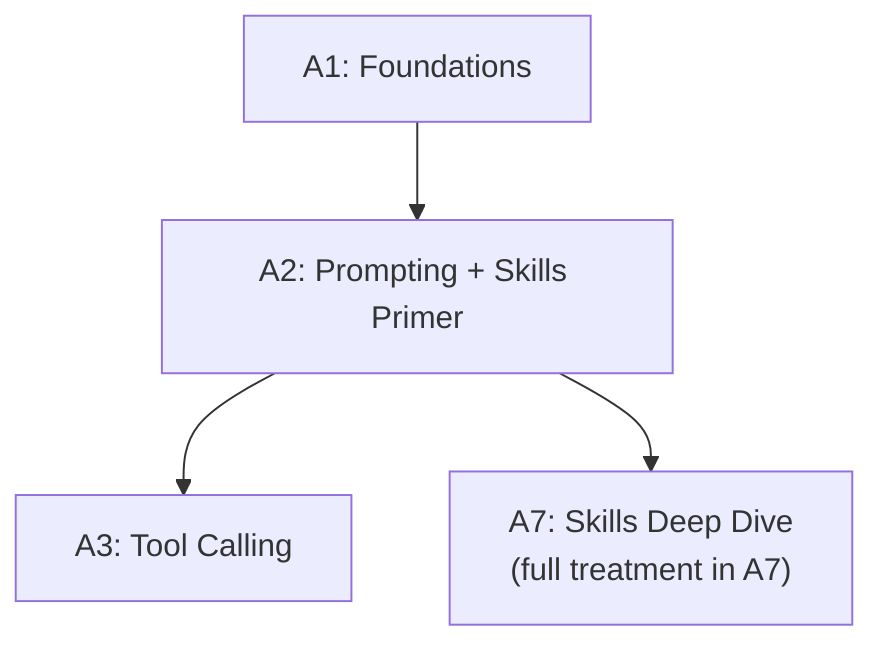

# Tier A2 — Prompting + Skills Primer

> Engineer prompts that reliably produce useful outputs; install and use skills to accelerate work.

---

## Purpose

By the end of A2, you can:

- Structure prompts (system, user, few-shot) that produce consistent results
- Get structured output (JSON, Zod-validated) from any provider
- Version and evaluate prompts systematically
- Install and use skills in Antigravity to accelerate work
- Understand progressive disclosure at a surface level
- Recognize and defend against prompt injection

A2 is where you go from "I can call an LLM" to "I can make it do useful work reliably." The skills primer at the end gives you immediate productivity while you continue building primitives.

---

## Anchored Project

**A2: Prompt library + starter skill stack**

Two artifacts:

1. **A prompt library** — a git-tracked collection of prompts, versioned, tagged by use case (summarization, extraction, classification, generation). Each prompt has an evaluation script that runs against a fixed test set.
2. **A starter skill stack** — 5–8 skills installed in Antigravity covering: frontend design, code review, security scanning, documentation, and one workflow skill. Vetted via `openclaw-skill-vetter-mcp`.

**What it proves**: you can engineer reliable prompts and immediately boost your daily productivity with a curated skill stack.

**Deliverables**:

- `projects/02-pdf-qa/` — this project scaffold also holds the prompt library
- `prompts/` — versioned prompt files
- `evals/` — test cases + evaluation scripts
- `skills-installed.md` — the vetted starter stack, with vetting results

---

## How A2 Fits the Architecture

**What it produces**: the prompting discipline used everywhere; the starter skill stack for daily use.

---

## Topics (Linear Spine)

### A2.1 — Prompt Structure

- **System vs user vs assistant roles**: what each is for; how providers differ
  `KNOW` · `Anchor: A2-prompt-lib` · `Deps: A1` · `Fails: system prompt ignored by some models; role confusion` · `Interview: Y` · `Artifact: —` · `Mistake: putting instructions in user message when system is better` · `Ref: A3` · `Theory 40/Practice 60` · `Cost: free` · `Reading: 25 min`

- **Delimiters and structure**: XML tags, markdown headers, triple backticks — helping the model parse
  `KNOW` · `Anchor: A2-prompt-lib` · `Deps: A2.1 roles` · `Fails: model ignores sections; inconsistent parsing` · `Interview: S` · `Artifact: —` · `Mistake: assuming all models parse structure equally` · `Ref: A3` · `Theory 50/Practice 50` · `Cost: free` · `Reading: 25 min`

- **Instruction ordering**: what comes first, what comes last; primacy and recency
  `KNOW` · `Anchor: A2-prompt-lib` · `Deps: A2.1 delimiters` · `Fails: instructions ignored; unexpected outputs` · `Interview: S` · `Artifact: —` · `Mistake: burying key instructions in the middle` · `Ref: A4 context` · `Theory 60/Practice 40` · `Cost: free` · `Reading: 20 min`

- **Temperature and sampling**: when to use which settings
  `KNOW` · `Anchor: A2-prompt-lib` · `Deps: A1 temperature` · `Fails: non-deterministic outputs when you need consistency` · `Interview: Y` · `Artifact: —` · `Mistake: assuming temperature=0 gives deterministic output (it doesn't)` · `Ref: A9` · `Theory 60/Practice 40` · `Cost: free` · `Reading: 25 min`

**Deep-dive candidates**: prompt structure patterns — generate on demand.

---

### A2.2 — Prompting Techniques

- **Zero-shot, one-shot, few-shot**: when each works; when to provide examples
  `BUILD` · `Anchor: A2-prompt-lib` · `Deps: A2.1 roles` · `Fails: poor output quality when examples would help` · `Interview: Y` · `Artifact: few-shot-examples.md` · `Mistake: too many examples (context bloat)` · `Ref: A9` · `Theory 30/Practice 70` · `Cost: free` · `Reading: 30 min`

- **Chain of thought**: reasoning models vs CoT prompting; when to use which
  `BUILD` · `Anchor: A2-prompt-lib` · `Deps: A2.2 few-shot` · `Fails: missing reasoning steps; wrong answers on complex tasks` · `Interview: Y` · `Artifact: cot.ts` · `Mistake: CoT on reasoning models (redundant)` · `Ref: A6 agent-planning` · `Theory 40/Practice 60` · `Cost: free` · `Reading: 35 min`

- **Role prompting**: personas, constraints, output format
  `BUILD` · `Anchor: A2-prompt-lib` · `Deps: A2.1 roles` · `Fails: generic outputs; no consistent voice` · `Interview: S` · `Artifact: role-prompts.ts` · `Mistake: overly dramatic personas that hurt output` · `Ref: A9` · `Theory 30/Practice 70` · `Cost: free` · `Reading: 25 min`

- **Prompt chaining**: breaking complex tasks into steps, output of one as input to next
  `BUILD` · `Anchor: A2-prompt-lib` · `Deps: A2.2 cot` · `Fails: single-prompt complexity caps quality` · `Interview: Y` · `Artifact: chain.ts` · `Mistake: over-chaining (adds latency, cost)` · `Ref: A6 orchestration` · `Theory 30/Practice 70` · `Cost: free` · `Reading: 40 min`

- **Self-critique and refinement**: ask the model to review and improve its own output
  `BUILD` · `Anchor: A2-prompt-lib` · `Deps: A2.2 chain` · `Fails: first-pass outputs aren't final quality` · `Interview: S` · `Artifact: refine.ts` · `Mistake: infinite refinement loops` · `Ref: A6 reflection` · `Theory 40/Practice 60` · `Cost: free` · `Reading: 30 min`

- **Context engineering**: what to include, what to omit, what order
  `BUILD` · `Anchor: A2-prompt-lib` · `Deps: A2.2 chaining` · `Fails: context bloat; important info buried` · `Interview: Y` · `Artifact: context-eng.ts` · `Mistake: including everything "just in case"` · `Ref: A4 memory, A5 retrieval` · `Theory 50/Practice 50` · `Cost: free` · `Reading: 40 min`

**Deep-dive candidates**: chain-of-thought patterns, context engineering — generate on demand.

---

### A2.3 — Structured Output

- **Why structured output**: reliable parsing; type safety; downstream integration
  `KNOW` · `Anchor: A2-prompt-lib` · `Deps: A2.2 prompts` · `Fails: brittle regex parsing; silent failures` · `Interview: Y` · `Artifact: —` · `Mistake: parsing free-text outputs with regex` · `Ref: A3 tool-calling` · `Theory 40/Practice 60` · `Cost: free` · `Reading: 25 min`

- **JSON mode**: provider-specific modes for guaranteed valid JSON
  `BUILD` · `Anchor: A2-prompt-lib` · `Deps: A2.3 why` · `Fails: invalid JSON in outputs; parse errors` · `Interview: Y` · `Artifact: json-mode.ts` · `Mistake: assuming JSON mode always works (it doesn't on all providers)` · `Ref: A3` · `Theory 30/Practice 70` · `Cost: free` · `Reading: 30 min`

- **Zod schemas for validation**: define schema; validate model output; retry on failure
  `BUILD` · `Anchor: A2-prompt-lib` · `Deps: A2.3 json-mode` · `Fails: type drift; runtime errors` · `Interview: Y` · `Artifact: zod-output.ts` · `Mistake: no retry on validation failure` · `Ref: Backend T2.3 Zod, A3` · `Theory 30/Practice 70` · `Cost: free` · `Reading: 40 min`

- **Function calling for schemas**: use tool schemas to enforce output shape (covered fully in A3)
  `USE` · `Anchor: A2-prompt-lib` · `Deps: A2.3 zod` · `Fails: reinventing schema enforcement` · `Interview: Y` · `Artifact: —` · `Mistake: not knowing tool-calling is often the best schema enforcement` · `Ref: A3` · `Theory 30/Practice 70` · `Cost: free` · `Reading: 30 min`

- **Retry strategies for validation failures**: exponential backoff, clearer instructions
  `BUILD` · `Anchor: A2-prompt-lib` · `Deps: A2.3 zod` · `Fails: giving up on validation failures; silent errors` · `Interview: S` · `Artifact: retry.ts` · `Mistake: retrying without improving the prompt` · `Ref: A1 retries, A9` · `Theory 30/Practice 70` · `Cost: free` · `Reading: 30 min`

- **Streaming structured output**: partial parsing; final validation
  `BUILD` · `Anchor: A2-prompt-lib` · `Deps: A2.3 json-mode, A1.5 partial-json` · `Fails: users wait for full structured output` · `Interview: S` · `Artifact: stream-structured.ts` · `Mistake: parsing partial output as final` · `Ref: A9` · `Theory 40/Practice 60` · `Cost: free` · `Reading: 35 min`

**Deep-dive candidates**: Zod output validation, partial streaming — generate on demand.

---

### A2.4 — Prompt Versioning & Evaluation

- **Why version prompts**: prompts are code; they need git tracking, review, rollback
  `KNOW` · `Anchor: A2-prompt-lib` · `Deps: A2.3 structured` · `Fails: no way to roll back a bad prompt; no A/B testing` · `Interview: Y` · `Artifact: —` · `Mistake: editing prompts in place with no history` · `Ref: A9 prompt-versioning` · `Theory 40/Practice 60` · `Cost: free` · `Reading: 25 min`

- **Prompt file structure**: templates, variables, metadata
  `BUILD` · `Anchor: A2-prompt-lib` · `Deps: A2.4 why` · `Fails: prompts embedded in code; hard to update` · `Interview: S` · `Artifact: prompts/` · `Mistake: no variable system` · `Ref: A9` · `Theory 30/Practice 70` · `Cost: free` · `Reading: 30 min`

- **Evaluation sets**: fixed inputs + expected outputs; run on every prompt change
  `BUILD` · `Anchor: A2-prompt-lib` · `Deps: A2.4 file-structure` · `Fails: prompt changes break behavior silently` · `Interview: Y` · `Artifact: evals/` · `Mistake: small eval sets that don't catch regressions` · `Ref: A9 evals` · `Theory 40/Practice 60` · `Cost: free` · `Reading: 45 min`

- **Metrics**: exact match, semantic similarity, LLM-as-judge, human review
  `BUILD` · `Anchor: A2-prompt-lib` · `Deps: A2.4 eval-sets` · `Fails: no way to measure prompt quality` · `Interview: Y` · `Artifact: metrics.ts` · `Mistake: relying on exact match for generative tasks` · `Ref: A9 evaluation` · `Theory 40/Practice 60` · `Cost: free` · `Reading: 45 min`

- **A/B testing prompts in production**: split traffic, measure outcomes
  `KNOW` · `Anchor: A2-prompt-lib` · `Deps: A2.4 metrics` · `Fails: no way to validate prompt changes with real users` · `Interview: S` · `Artifact: —` · `Mistake: A/B testing without proper metrics` · `Ref: A9` · `Theory 50/Practice 50` · `Cost: free` · `Reading: 30 min`

**Deep-dive candidates**: prompt eval design, LLM-as-judge patterns — generate on demand.

---

### A2.5 — Prompt Injection & Guardrails

- **What prompt injection is**: user input that overrides your instructions
  `KNOW` · `Anchor: A2-prompt-lib` · `Deps: A2.3 structured` · `Fails: jailbreaks; data exfiltration; unintended actions` · `Interview: Y` · `Artifact: —` · `Mistake: assuming a strong system prompt prevents injection` · `Ref: A9 safety` · `Theory 60/Practice 40` · `Cost: free` · `Reading: 35 min`

- **Direct vs indirect injection**: user input vs retrieved content (RAG documents, web pages)
  `KNOW` · `Anchor: A2-prompt-lib` · `Deps: A2.5 what` · `Fails: RAG documents containing hidden instructions` · `Interview: Y` · `Artifact: —` · `Mistake: trusting retrieved content` · `Ref: A5 retrieval` · `Theory 60/Practice 40` · `Cost: free` · `Reading: 30 min`

- **Defense strategies**: input sanitization, output validation, sandboxed tools, privilege separation
  `BUILD` · `Anchor: A2-prompt-lib` · `Deps: A2.5 direct-indirect` · `Fails: successful injection attacks` · `Interview: Y` · `Artifact: guardrails.ts` · `Mistake: single-layer defense (layering is essential)` · `Ref: A3 tools, A9 safety` · `Theory 50/Practice 50` · `Cost: free` · `Reading: 45 min`

- **Output filtering**: PII detection, content moderation, format validation
  `BUILD` · `Anchor: A2-prompt-lib` · `Deps: A2.5 defenses` · `Fails: unsafe outputs; compliance violations` · `Interview: S` · `Artifact: output-filter.ts` · `Mistake: relying on the model to filter its own output` · `Ref: A9 safety` · `Theory 40/Practice 60` · `Cost: free` · `Reading: 35 min`

- **Detection and logging**: flag suspicious inputs; log for review
  `BUILD` · `Anchor: A2-prompt-lib` · `Deps: A2.5 output-filter` · `Fails: no visibility into attack attempts` · `Interview: N` · `Artifact: injection-logging.ts` · `Mistake: no monitoring` · `Ref: A9 observability` · `Theory 30/Practice 70` · `Cost: free` · `Reading: 30 min`

**Deep-dive candidates**: injection defense patterns, RAG-specific injection — generate on demand.

---

### A2.6 — Skills Primer

- **What skills are**: folders with `SKILL.md` + optional reference files + scripts; loaded on demand by the agent
  `KNOW` · `Anchor: A2-skills` · `Deps: —` · `Fails: unaware of the ecosystem's acceleration` · `Interview: S` · `Artifact: —` · `Mistake: assuming skills are just prompts` · `Ref: A7 deep-dive` · `Theory 50/Practice 50` · `Cost: free` · `Reading: 30 min`

- **SKILL.md format**: YAML frontmatter (`name`, `description`), body with instructions
  `KNOW` · `Anchor: A2-skills` · `Deps: A2.6 what` · `Fails: unable to install or modify skills` · `Interview: S` · `Artifact: —` · `Mistake: not understanding the frontmatter drives loading` · `Ref: A7` · `Theory 40/Practice 60` · `Cost: free` · `Reading: 25 min`

- **Progressive disclosure (surface)**: agent loads only name+description at startup; full content on invocation
  `KNOW` · `Anchor: A2-skills` · `Deps: A2.6 skill-md` · `Fails: confusion about why 50 skills don't slow the agent` · `Interview: Y` · `Artifact: —` · `Mistake: thinking all skills are always loaded` · `Ref: A7` · `Theory 60/Practice 40` · `Cost: free` · `Reading: 25 min`

- **Installing skills in Antigravity**: paths, configuration
  `USE` · `Anchor: A2-skills` · `Deps: A2.6 skill-md` · `Fails: skills not loading; config errors` · `Interview: N` · `Artifact: skills-installed.md` · `Mistake: wrong directory; missing frontmatter` · `Ref: A7, A8` · `Theory 20/Practice 80` · `Cost: free` · `Reading: 30 min`

- **Skill vetting is mandatory**: install `openclaw-skill-vetter-mcp` first; scan every skill before install
  `USE` · `Anchor: A2-skills` · `Deps: A2.6 installing` · `Fails: supply-chain attacks via malicious skills` · `Interview: N` · `Artifact: vetting-log.md` · `Mistake: installing skills from unvetted sources` · `Ref: A7 vetting, A8` · `Theory 40/Practice 60` · `Cost: free` · `Reading: 30 min`

- **The starter stack**: install a curated 5–8 skills covering frontend, code review, security, docs, workflow
  `USE` · `Anchor: A2-skills` · `Deps: A2.6 vetting` · `Fails: no immediate productivity boost` · `Interview: N` · `Artifact: starter-stack.md` · `Mistake: installing 50 skills on day one (overlap, context bloat)` · `Ref: A7 layered-stack` · `Theory 20/Practice 80` · `Cost: free` · `Reading: 40 min`

**Deep-dive candidates**: SKILL.md authoring basics, the starter stack — generate on demand.

---

## Exit Criteria

You've completed A2 when you can:

- Write structured prompts (system + user + few-shot) that consistently produce correct outputs
- Get Zod-validated structured output from any provider
- Version and evaluate prompts against a fixed test set
- Recognize and defend against prompt injection
- Install, vet, and use skills in Antigravity
- Have a starter skill stack that meaningfully accelerates your daily work

---

## Cross-Tier References

**Depends on**: A1 (provider abstraction, streaming), Backend T2.3 (Zod), T4 (input validation).

**Depended on by**:

- A3 — tool calling uses schemas and prompt structure
- A4 — memory relies on prompt engineering
- A5 — RAG uses structured outputs for citations
- A6 — agents use prompting primitives
- A7 — full skills treatment

---

## Common Failure Modes for the Tier as a Whole

- **Burying key instructions**: model ignores them.
- **No structured output**: brittle regex parsing.
- **Not versioning prompts**: no rollback, no A/B testing.
- **No evaluation sets**: prompt changes silently regress.
- **Assuming system prompt prevents injection**: it doesn't.
- **Installing skills without vetting**: supply-chain risk.
- **Installing 50 overlapping skills**: context bloat, conflicts.
- **Not using few-shot when needed**: quality suffers.

---

## Why Not?

### Why Build a Prompt Library Instead of Using a Prompt Framework?

- **Prompt frameworks** (PromptHub, LangSmith Prompt Hub) — hosted, easy, but vendor lock-in.
- **Git-tracked prompts** — you own them; they version with code; they run in CI.
- **Rule**: build the primitive first. Move to a hosted system only when the git approach genuinely becomes painful.

### Why Zod Instead of Hand-Written Parsing?

- **Hand parsing** — regex, manual type checks, brittle.
- **Zod** — declarative schema; runtime validation; TypeScript inference; works with any provider.
- **Rule**: if the output has structure, validate it with Zod. If it fails, retry with feedback.

### Why LLM-as-Judge for Evaluation?

- **Exact match** — works for classification, not generation.
- **Semantic similarity** — better, but doesn't catch reasoning quality.
- **LLM-as-judge** — a second model evaluates the first's output against criteria. Not perfect, but pragmatic.
- **Rule**: combine metrics. Exact match where possible. LLM-as-judge for quality. Human review for high-stakes.

### Why Vetting Is Mandatory Before Installing Skills?

- **Skills are code** — they can execute scripts, make network calls, read files.
- **Supply chain** — malicious skills are a real attack vector (OWASP AST02).
- **`openclaw-skill-vetter-mcp`** — scans for 41 attack patterns; returns a risk score.
- **Rule**: vet every skill, even popular ones. It's 30 seconds of overhead.

### Why a Starter Stack Instead of Installing Everything?

- **Context efficiency** — every installed skill adds to the agent's description context.
- **Overlap** — many skills solve the same problem; installing all creates conflicts.
- **Focus** — 5–8 skills you actually use beats 50 you don't.
- **Rule**: start small. Add only when you find a gap.
