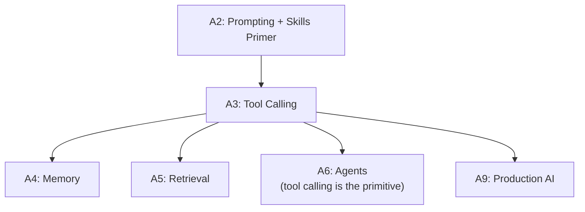

# Tier A3 — Tool Calling & Function Schemas

> Give models the ability to call functions, execute safely, handle errors. This is where AI stops being a chatbot.

---

## Purpose

By the end of A3, you can:

- Define tool schemas (JSON Schema, Zod) that models understand
- Build a tool-execution loop from scratch
- Handle tool errors, retries, and model-visible error messages
- Execute tools safely (sandboxing, timeouts, permissions)
- Support parallel tool calls
- Build a custom MCP server exposing your own tools
- Secure tool execution against injection and unauthorized use

A3 is where the model stops being a text generator and becomes a component in a system.

---

## Anchored Project

**A3: Tool-calling agent service**

A service that:

1. Exposes 5–8 tools to the model: query Postgres, fetch URL, execute shell command (safe), read file, write file, search the web (via a free API)
2. Runs a tool-calling loop: model decides, service executes, result fed back to model
3. Handles errors: retryable vs non-retryable; feeding error messages back to the model
4. Supports parallel tool calls
5. Sandboxes shell execution (Docker, allowlist of commands)
6. Logs every tool call with parameters, result, and duration
7. Enforces per-tool rate limits

**What it proves**: you can build a safe, observable tool-execution layer that any model can drive.

**Deliverables**:

- `projects/08-coding-assistant-mcp/` — this project scaffold also holds the tool service
- Tool definitions with schemas
- Tool execution layer with sandboxing
- MCP server exposing the tools
- README with security notes

---

## How A3 Fits the Architecture

**What it produces**: the tool-execution layer that agents (A6) are built on.

---

## Topics (Linear Spine)

### A3.1 — Tool Calling Fundamentals

- **What tool calling is**: model outputs structured "I want to call X with args Y"; your code executes; result fed back
  `KNOW` · `Anchor: A3-tools` · `Deps: A2` · `Fails: confusion about how tools work; no execution loop` · `Interview: Y` · `Artifact: —` · `Mistake: thinking the model executes tools (it doesn't)` · `Ref: A6 agent-loop` · `Theory 50/Practice 50` · `Cost: free` · `Reading: 30 min`

- **How the model decides**: tool descriptions, system prompt, task context
  `KNOW` · `Anchor: A3-tools` · `Deps: A3.1 what` · `Fails: model picks wrong tool; hallucinated tools` · `Interview: Y` · `Artifact: —` · `Mistake: unclear tool descriptions` · `Ref: A6` · `Theory 60/Practice 40` · `Cost: free` · `Reading: 30 min`

- **Provider differences**: OpenAI, Anthropic, Gemini all support tool calling but with different APIs
  `KNOW` · `Anchor: A3-tools` · `Deps: A3.1 what` · `Fails: provider-specific tool code scattered` · `Interview: S` · `Artifact: —` · `Mistake: assuming identical behavior across providers` · `Ref: A1 adapters` · `Theory 50/Practice 50` · `Cost: free` · `Reading: 25 min`

- **Tools vs functions vs actions**: terminology; they mean the same thing
  `KNOW` · `Anchor: A3-tools` · `Deps: A3.1 what` · `Fails: confusion when reading provider docs` · `Interview: N` · `Artifact: —` · `Mistake: over-thinking the terminology` · `Ref: A6` · `Theory 80/Practice 20` · `Cost: free` · `Reading: 15 min`

**Deep-dive candidates**: tool-calling internals, provider comparison — generate on demand.

---

### A3.2 — Tool Schemas

- **JSON Schema for tools**: `name`, `description`, `parameters` (JSON Schema)
  `BUILD` · `Anchor: A3-tools` · `Deps: A3.1 what` · `Fails: model can't call tools; invalid arguments` · `Interview: Y` · `Artifact: schemas.ts` · `Mistake: vague parameter descriptions` · `Ref: A2 structured-output` · `Theory 30/Practice 70` · `Cost: free` · `Reading: 40 min`

- **Zod → JSON Schema conversion**: define with Zod, convert for the provider
  `BUILD` · `Anchor: A3-tools` · `Deps: A3.2 json-schema` · `Fails: manual schema duplication; drift` · `Interview: Y` · `Artifact: zod-to-schema.ts` · `Mistake: hand-maintaining JSON Schema` · `Ref: Backend T2.3 Zod` · `Theory 30/Practice 70` · `Cost: free` · `Reading: 35 min`

- **Tool descriptions matter**: how the description shapes model behavior
  `BUILD` · `Anchor: A3-tools` · `Deps: A3.2 json-schema` · `Fails: model picks wrong tool; ignores tools` · `Interview: Y` · `Artifact: descriptions.md` · `Mistake: one-line descriptions` · `Ref: A6 tool-routing` · `Theory 40/Practice 60` · `Cost: free` · `Reading: 30 min`

- **Parameter design**: required vs optional; enums; nested objects
  `BUILD` · `Anchor: A3-tools` · `Deps: A3.2 json-schema` · `Fails: model omits required params; passes invalid values` · `Interview: S` · `Artifact: schemas.ts` · `Mistake: too many required params` · `Ref: A6` · `Theory 30/Practice 70` · `Cost: free` · `Reading: 30 min`

- **Tool result schemas**: how to format results back to the model
  `BUILD` · `Anchor: A3-tools` · `Deps: A3.2 json-schema` · `Fails: model can't parse results; wrong follow-up actions` · `Interview: S` · `Artifact: result-formats.ts` · `Mistake: unstructured results` · `Ref: A3.3 execution` · `Theory 40/Practice 60` · `Cost: free` · `Reading: 30 min`

**Deep-dive candidates**: Zod → JSON Schema, tool description patterns — generate on demand.

---

### A3.3 — Tool Execution Loop

- **The loop**: send prompt + tools → parse tool calls → execute → send results → repeat until no tool calls
  `BUILD` · `Anchor: A3-tools` · `Deps: A3.2 schemas` · `Fails: no tool execution; single-shot responses` · `Interview: Y` · `Artifact: loop.ts` · `Mistake: infinite loops without max iterations` · `Ref: A6 agent-loop` · `Theory 40/Practice 60` · `Cost: free` · `Reading: 45 min`

- **Parsing tool calls**: provider-specific response formats
  `BUILD` · `Anchor: A3-tools` · `Deps: A3.3 loop` · `Fails: missed tool calls; parse errors` · `Interview: S` · `Artifact: parser.ts` · `Mistake: assuming all providers return the same shape` · `Ref: A1 adapters` · `Theory 30/Practice 70` · `Cost: free` · `Reading: 30 min`

- **Feeding results back**: message format for tool results (provider-specific)
  `BUILD` · `Anchor: A3-tools` · `Deps: A3.3 parsing` · `Fails: model doesn't understand results; repeats tool calls` · `Interview: S` · `Artifact: result-feed.ts` · `Mistake: incorrect message role/structure` · `Ref: A1 adapters` · `Theory 30/Practice 70` · `Cost: free` · `Reading: 30 min`

- **Stopping criteria**: when the model stops calling tools (no more tool calls in output)
  `BUILD` · `Anchor: A3-tools` · `Deps: A3.3 loop` · `Fails: infinite loops; runaway costs` · `Interview: Y` · `Artifact: stopping.ts` · `Mistake: no max iteration cap` · `Ref: A6 stopping` · `Theory 40/Practice 60` · `Cost: free` · `Reading: 30 min`

- **Streaming tool calls**: when model streams tool call args before deciding
  `KNOW` · `Anchor: A3-tools` · `Deps: A3.3 parsing` · `Fails: poor UX for long tool calls` · `Interview: N` · `Artifact: —` · `Mistake: assuming tools are always non-streamed` · `Ref: A1.5 streaming` · `Theory 50/Practice 50` · `Cost: free` · `Reading: 25 min`

- **Parallel tool calls**: model may call multiple tools in one turn
  `BUILD` · `Anchor: A3-tools` · `Deps: A3.3 loop` · `Fails: sequential execution when parallel is possible` · `Interview: Y` · `Artifact: parallel.ts` · `Mistake: tools with side effects executed in parallel unintentionally` · `Ref: A6` · `Theory 40/Practice 60` · `Cost: free` · `Reading: 40 min`

**Deep-dive candidates**: tool loop implementation, parallel tool execution — generate on demand.

---

### A3.4 — Tool Errors & Recovery

- **Retryable vs non-retryable errors**: network errors retry; validation errors don't
  `BUILD` · `Anchor: A3-tools` · `Deps: A3.3 loop` · `Fails: retry storms; giving up on transient failures` · `Interview: Y` · `Artifact: error-classification.ts` · `Mistake: retrying 401s and 400s` · `Ref: A1 retries, Backend T5.4` · `Theory 40/Practice 60` · `Cost: free` · `Reading: 30 min`

- **Feeding errors back to the model**: model can learn from error messages and retry with different args
  `BUILD` · `Anchor: A3-tools` · `Deps: A3.4 retryable` · `Fails: model repeats the same failing call` · `Interview: Y` · `Artifact: error-feedback.ts` · `Mistake: hiding errors from the model` · `Ref: A6 error-recovery` · `Theory 40/Practice 60` · `Cost: free` · `Reading: 35 min`

- **Fallback tools**: when a tool fails, alternate tools
  `BUILD` · `Anchor: A3-tools` · `Deps: A3.4 error-feedback` · `Fails: single tool failure blocks the task` · `Interview: S` · `Artifact: fallback-tools.ts` · `Mistake: silent fallbacks without logging` · `Ref: A1 fallback, A6` · `Theory 30/Practice 70` · `Cost: free` · `Reading: 30 min`

- **Retry budget**: cap total retries per task
  `BUILD` · `Anchor: A3-tools` · `Deps: A3.4 retryable` · `Fails: runaway retries; cost blowup` · `Interview: S` · `Artifact: retry-budget.ts` · `Mistake: unlimited retries on failure` · `Ref: Backend T5.4 retry-budget` · `Theory 30/Practice 70` · `Cost: free` · `Reading: 25 min`

- **Tool timeout**: per-tool timeouts; abort long-running tools
  `BUILD` · `Anchor: A3-tools` · `Deps: A3.3 loop` · `Fails: hanging tools block the loop` · `Interview: Y` · `Artifact: timeouts.ts` · `Mistake: no timeout (infinite hang)` · `Ref: A1 timeouts` · `Theory 30/Practice 70` · `Cost: free` · `Reading: 25 min`

**Deep-dive candidates**: model-visible error patterns, retry budgeting — generate on demand.

---

### A3.5 — Safe Tool Execution

- **Why safety matters**: tools execute arbitrary code; sandboxing prevents damage
  `KNOW` · `Anchor: A3-tools` · `Deps: A3.4 errors` · `Fails: code execution attacks; filesystem damage` · `Interview: Y` · `Artifact: —` · `Mistake: executing shell commands directly` · `Ref: A9 safety` · `Theory 60/Practice 40` · `Cost: free` · `Reading: 30 min`

- **Sandboxing shell execution**: Docker, Firecracker, gVisor, `nsjail`; allowlist of commands
  `BUILD` · `Anchor: A3-tools` · `Deps: A3.5 safety` · `Fails: arbitrary command execution` · `Interview: Y` · `Artifact: sandbox.ts` · `Mistake: `child_process.exec` with unsanitized args` · `Ref: A9 safety, Backend T5.9` · `Theory 40/Practice 60` · `Cost: local` · `Reading: 60 min`

- **Filesystem permissions**: restrict file access to a directory; no `/etc/passwd` reads
  `BUILD` · `Anchor: A3-tools` · `Deps: A3.5 sandboxing` · `Fails: sensitive file access` · `Interview: S` · `Artifact: fs-permissions.ts` · `Mistake: no path validation (path traversal)` · `Ref: A9 safety` · `Theory 30/Practice 70` · `Cost: free` · `Reading: 40 min`

- **Network restrictions**: allowlist domains; no arbitrary network calls
  `BUILD` · `Anchor: A3-tools` · `Deps: A3.5 sandboxing` · `Fails: data exfiltration; SSRF` · `Interview: S` · `Artifact: network-restrictions.ts` · `Mistake: unrestricted HTTP client in tools` · `Ref: Backend T4.6 SSRF` · `Theory 40/Practice 60` · `Cost: free` · `Reading: 35 min`

- **Secret management**: tools need API keys; keep them out of model context
  `BUILD` · `Anchor: A3-tools` · `Deps: A3.5 network` · `Fails: keys leaked via tool args or outputs` · `Interview: Y` · `Artifact: secrets.ts` · `Mistake: passing secrets as tool parameters` · `Ref: Backend T4.7 secrets` · `Theory 40/Practice 60` · `Cost: free` · `Reading: 40 min`

- **Per-tool permissions**: tools have scopes; user grants them explicitly
  `BUILD` · `Anchor: A3-tools` · `Deps: A3.5 secrets` · `Fails: over-privileged tools; unauthorized actions` · `Interview: S` · `Artifact: permissions.ts` · `Mistake: all tools always enabled` · `Ref: A9 safety` · `Theory 40/Practice 60` · `Cost: free` · `Reading: 40 min`

- **Tool output sanitization**: model outputs derived from tool results; sanitize for downstream use
  `BUILD` · `Anchor: A3-tools` · `Deps: A3.5 permissions` · `Fails: injection via tool output` · `Interview: S` · `Artifact: output-sanitize.ts` · `Mistake: trusting tool outputs` · `Ref: A2.5 injection` · `Theory 40/Practice 60` · `Cost: free` · `Reading: 30 min`

**Deep-dive candidates**: sandboxing with Docker, permission models — generate on demand.

---

### A3.6 — MCP (Model Context Protocol)

- **What MCP is**: an open standard for connecting agents to external tools, resources, and prompts
  `KNOW` · `Anchor: A3-mcp` · `Deps: A3.5 safe` · `Fails: custom integrations per tool; no interoperability` · `Interview: Y` · `Artifact: —` · `Mistake: not knowing MCP exists` · `Ref: A7 skills, A8 tools` · `Theory 60/Practice 40` · `Cost: free` · `Reading: 35 min`

- **MCP architecture**: hosts (agents), clients, servers; tools, resources, prompts
  `KNOW` · `Anchor: A3-mcp` · `Deps: A3.6 what` · `Fails: confusion about MCP components` · `Interview: Y` · `Artifact: —` · `Mistake: conflating MCP with tool calling` · `Ref: A6` · `Theory 60/Practice 40` · `Cost: free` · `Reading: 40 min`

- **MCP vs tool calling**: MCP standardizes what tool calling does ad-hoc; MCP servers are reusable across agents
  `KNOW` · `Anchor: A3-mcp` · `Deps: A3.6 architecture` · `Fails: building custom tool integrations when MCP servers exist` · `Interview: Y` · `Artifact: —` · `Mistake: reinventing MCP servers` · `Ref: A8 mcp-servers` · `Theory 50/Practice 50` · `Cost: free` · `Reading: 30 min`

- **Building a custom MCP server**: expose your own tools; HTTP and stdio transports
  `BUILD` · `Anchor: A3-mcp` · `Deps: A3.6 architecture` · `Fails: tools not reusable across agents` · `Interview: Y` · `Artifact: mcp-server/` · `Mistake: insecure MCP servers` · `Ref: A7, A8` · `Theory 30/Practice 70` · `Cost: free` · `Reading: 60 min`

- **Using MCP servers in Antigravity/Codex/Cursor**: configuration, auth, transport
  `USE` · `Anchor: A3-mcp` · `Deps: A3.6 building` · `Fails: can't use the MCP ecosystem` · `Interview: S` · `Artifact: mcp-config.md` · `Mistake: wrong config path per agent` · `Ref: A8` · `Theory 20/Practice 80` · `Cost: free` · `Reading: 40 min`

- **MCP security**: authentication, permission scoping, tool poisoning
  `BUILD` · `Anchor: A3-mcp` · `Deps: A3.6 using` · `Fails: MCP servers as attack vectors` · `Interview: S` · `Artifact: mcp-security.md` · `Mistake: installing MCP servers without vetting` · `Ref: A7 vetting, A9 safety` · `Theory 50/Practice 50` · `Cost: free` · `Reading: 40 min`

**Deep-dive candidates**: building your first MCP server, MCP security patterns — generate on demand.

---

## Exit Criteria

You've completed A3 when you can:

- Define tool schemas (Zod → JSON Schema) that models understand and use correctly
- Build a tool-execution loop with iteration caps and stopping criteria
- Handle tool errors, feeding them back to the model for recovery
- Sandbox shell execution, restrict filesystem access, allowlist network calls
- Support parallel tool calls safely
- Build and use MCP servers to expose your own tools
- Secure tool execution against injection and over-privilege

---

## Cross-Tier References

**Depends on**: A1 (providers, streaming), A2 (structured output, Zod), Backend T4.6 (SSRF), T4.7 (secrets), T5.4 (retries, circuit breakers).

**Depended on by**:

- A4 — memory uses tools for persistence
- A5 — RAG uses tools for retrieval
- A6 — agents are tool-calling loops
- A7 — skills may declare tools
- A9 — production AI secures tools at scale

---

## Common Failure Modes for the Tier as a Whole

- **Thinking the model executes tools**: it only proposes; you execute.
- **No stopping criteria**: infinite loops, cost blowup.
- **No iteration cap**: runaway agents.
- **Executing shell commands directly**: arbitrary code execution.
- **No path validation**: path traversal attacks.
- **Unrestricted network access**: SSRF, exfiltration.
- **Passing secrets as tool parameters**: leaked to model context.
- **Silent fallbacks**: failures hidden; hard to debug.
- **No tool timeouts**: hung tools block the loop.
- **Parallel tool calls with side effects**: race conditions.
- **Not vetting MCP servers**: supply-chain attacks.
- **No output sanitization**: injection via tool output.

---

## Why Not?

### Why Build the Tool Loop from Scratch Instead of Using LangChain / Vercel AI SDK?

- **Frameworks** — provide tool calling, agent loops, streaming. Convenient.
- **Building from scratch** — teaches you the loop, the parsing, the error handling. When frameworks change, you understand what's underneath.
- **Rule**: build the primitive first. Move to frameworks when you need features (LangGraph for state machines, etc.). Same as Backend Engineering's manual DI before containers.

### Why Zod → JSON Schema Instead of Hand-Written Schemas?

- **Hand-written** — verbose, drifts from runtime validation, error-prone.
- **Zod** — declarative; runtime validation; automatic JSON Schema conversion; TypeScript types for free.
- **Rule**: one source of truth. Zod for validation, JSON Schema for the model.

### Why Sandbox in Docker Instead of Running Tools Directly?

- **Direct execution** — arbitrary code runs with your server's privileges. One mistake = compromised server.
- **Docker sandbox** — isolated filesystem, no network by default, resource limits. Compromise = contained.
- **Firecracker/gVisor** — even stronger isolation (VM-level, syscall filtering).
- **Rule**: sandbox shell execution. Always. No exceptions.

### Why Allowlist Network Domains Instead of Open Access?

- **Open access** — SSRF attacks, data exfiltration, model-driven abuse.
- **Allowlist** — tools can only reach known domains; unknown requests blocked.
- **Rule**: default deny. Explicit allow. Log every request.

### Why MCP Over Custom Tool Integration?

- **Custom integration** — works for your agent; not reusable; reinvents the wheel.
- **MCP** — standard protocol; servers work across agents (Antigravity, Codex, Cursor, Claude Code); growing ecosystem.
- **Rule**: for anything reusable, prefer MCP. For one-off, custom tools are fine.

### Why Parallel Tool Calls Need Care?

- **Read-only tools** — safe to parallelize (fetch URL, query DB, read file).
- **Side-effecting tools** — dangerous in parallel (send email, write file, execute shell).
- **Rule**: parallelize read-only by default. Serialize side-effecting unless proven idempotent.
