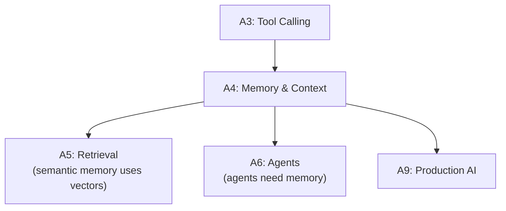

# Tier A4 — Memory & Context Engineering

> Build services that remember conversations, persist knowledge, and manage context windows efficiently.

---

## Purpose

By the end of A4, you can:

- Design memory architectures (short-term, long-term, semantic)
- Persist conversation state across sessions
- Compress, summarize, and forget strategically
- Manage context windows (what to include, in what order)
- Decide what lives in Redis vs Postgres vs vector DB
- Handle multi-user, multi-session context correctly

A4 is where "the model forgets everything after each call" becomes "the model has persistent, meaningful memory."

---

## Anchored Project

**A4: Chat service with persistent memory**

A service that:

1. Maintains conversation state across multiple sessions
2. Persists short-term memory (current conversation) in Redis
3. Persists long-term facts (user preferences, prior decisions) in Postgres
4. Uses semantic recall (vector search over past conversations) for relevant history
5. Compresses old conversations into summaries
6. Forgets strategically (recency vs importance)
7. Handles multiple users with session isolation
8. Tracks memory retrieval costs

**What it proves**: you can build a chat service that remembers users meaningfully — not just stores every message forever.

**Deliverables**:

- `projects/07-personal-kb/` — this project scaffold also holds the memory service
- Memory architecture diagram (Mermaid)
- Retrieval strategy documented
- README with cost/latency notes

---

## How A4 Fits the Architecture

**What it produces**: the memory layer that agents (A6) and personal assistants (Mastery) rely on.

---

## Topics (Linear Spine)

### A4.1 — Why Memory Matters

- **The context window limitation**: models forget between calls; even long context isn't infinite memory
  `KNOW` · `Anchor: A4-chat` · `Deps: A1 context-window` · `Fails: repeated questions; user frustration` · `Interview: Y` · `Artifact: —` · `Mistake: assuming long context is a substitute for memory` · `Ref: A6 state` · `Theory 60/Practice 40` · `Cost: free` · `Reading: 25 min`

- **Types of memory**: short-term (session), long-term (persistent facts), semantic (retrieval-based), episodic (events)
  `KNOW` · `Anchor: A4-chat` · `Deps: A4.1 why` · `Fails: one-size-fits-all memory that doesn't work` · `Interview: Y` · `Artifact: memory-types.md` · `Mistake: conflating storage with memory` · `Ref: A5, A6` · `Theory 60/Practice 40` · `Cost: free` · `Reading: 30 min`

- **Memory vs context**: memory is stored externally; context is what's in the current prompt
  `KNOW` · `Anchor: A4-chat` · `Deps: A4.1 types` · `Fails: confusion about where memory lives` · `Interview: S` · `Artifact: —` · `Mistake: thinking memory is automatic` · `Ref: A4.4 context` · `Theory 60/Practice 40` · `Cost: free` · `Reading: 25 min`

**Deep-dive candidates**: memory architecture overview — generate on demand.

---

### A4.2 — Conversation State

- **Message history**: storing and replaying messages
  `BUILD` · `Anchor: A4-chat` · `Deps: A4.1 memory-vs-context` · `Fails: no conversation continuity` · `Interview: Y` · `Artifact: message-store.ts` · `Mistake: storing too much (context bloat)` · `Ref: A1 context-window` · `Theory 30/Practice 70` · `Cost: free` · `Reading: 30 min`

- **Session management**: session IDs, TTL, cleanup
  `BUILD` · `Anchor: A4-chat` · `Deps: A4.2 message-history` · `Fails: sessions never expire; storage grows unbounded` · `Interview: S` · `Artifact: session-manager.ts` · `Mistake: no TTL on sessions` · `Ref: Backend T3c.2 Redis` · `Theory 30/Practice 70` · `Cost: free` · `Reading: 30 min`

- **Redis for session state**: fast reads, TTL-based eviction, multi-instance sharing
  `BUILD` · `Anchor: A4-chat` · `Deps: A4.2 sessions` · `Fails: in-memory sessions don't scale; sessions lost on restart` · `Interview: Y` · `Artifact: redis-sessions.ts` · `Mistake: storing full conversation in Redis without compression` · `Ref: Backend T3c.2, T3c.7` · `Theory 20/Practice 80` · `Cost: free` · `Reading: 40 min`

- **Message trimming**: keep recent messages; drop or summarize older ones
  `BUILD` · `Anchor: A4-chat` · `Deps: A4.2 redis-sessions` · `Fails: context window exceeded; cost blowup` · `Interview: Y` · `Artifact: trimming.ts` · `Mistake: dropping context without preserving key facts` · `Ref: A4.3 compression` · `Theory 40/Practice 60` · `Cost: free` · `Reading: 40 min`

- **Multi-session per user**: one user with multiple concurrent conversations
  `BUILD` · `Anchor: A4-chat` · `Deps: A4.2 redis-sessions` · `Fails: conversations leak into each other` · `Interview: S` · `Artifact: multi-session.ts` · `Mistake: single session per user` · `Ref: A9 multi-tenancy` · `Theory 30/Practice 70` · `Cost: free` · `Reading: 30 min`

**Deep-dive candidates**: Redis session patterns, message trimming strategies — generate on demand.

---

### A4.3 — Long-Term Memory

- **What to persist**: user preferences, prior decisions, facts about the user
  `KNOW` · `Anchor: A4-chat` · `Deps: A4.2 state` · `Fails: no personalization; repetitive questions` · `Interview: Y` · `Artifact: —` · `Mistake: persisting everything (noise)` · `Ref: A5 retrieval` · `Theory 50/Practice 50` · `Cost: free` · `Reading: 30 min`

- **Postgres for durable memory**: schema design for facts, conversations, summaries
  `BUILD` · `Anchor: A4-chat` · `Deps: A4.3 what-to-persist` · `Fails: losing user state on restart` · `Interview: Y` · `Artifact: memory-schema.sql` · `Mistake: no versioning of memory updates` · `Ref: Backend T3a` · `Theory 30/Practice 70` · `Cost: free` · `Reading: 40 min`

- **Extraction at write time**: use the model to extract structured facts from conversations
  `BUILD` · `Anchor: A4-chat` · `Deps: A4.3 postgres` · `Fails: unstructured memory; retrieval useless` · `Interview: Y` · `Artifact: extract-facts.ts` · `Mistake: extracting without schema (unstructured blob)` · `Ref: A2 structured-output` · `Theory 40/Practice 60` · `Cost: free` · `Reading: 45 min`

- **Fact vs preference vs event**: different memory types stored differently
  `KNOW` · `Anchor: A4-chat` · `Deps: A4.3 extraction` · `Fails: mixing ephemeral and durable data` · `Interview: S` · `Artifact: —` · `Mistake: treating all memory the same` · `Ref: A4.3 schema` · `Theory 50/Practice 50` · `Cost: free` · `Reading: 25 min`

- **Memory updates and conflicts**: user changes preference; old memory invalidated
  `BUILD` · `Anchor: A4-chat` · `Deps: A4.3 postgres` · `Fails: stale memory overrides new facts` · `Interview: S` · `Artifact: memory-updates.ts` · `Mistake: append-only memory without updates` · `Ref: A9` · `Theory 40/Practice 60` · `Cost: free` · `Reading: 35 min`

- **Memory decay**: old memories become less relevant; recency weighting
  `BUILD` · `Anchor: A4-chat` · `Deps: A4.3 updates` · `Fails: years-old facts dominate retrieval` · `Interview: S` · `Artifact: decay.ts` · `Mistake: binary delete vs keep (no gradual decay)` · `Ref: A5 retrieval` · `Theory 40/Practice 60` · `Cost: free` · `Reading: 35 min`

- **User profile vs episodic memory**: stable attributes vs past events
  `KNOW` · `Anchor: A4-chat` · `Deps: A4.3 fact-vs-preference` · `Fails: conflating profile with history` · `Interview: S` · `Artifact: —` · `Mistake: no distinction between "who they are" and "what they did"` · `Ref: A6 memory` · `Theory 50/Practice 50` · `Cost: free` · `Reading: 30 min`

**Deep-dive candidates**: fact extraction with schemas, memory decay algorithms — generate on demand.

---

### A4.4 — Context Engineering

- **What goes in the prompt**: system prompt, memory, retrieved context, user input, tools
  `KNOW` · `Anchor: A4-chat` · `Deps: A4.3 long-term` · `Fails: prompt bloat; important info buried` · `Interview: Y` · `Artifact: —` · `Mistake: including everything` · `Ref: A5 retrieval` · `Theory 50/Practice 50` · `Cost: free` · `Reading: 35 min`

- **Ordering matters**: primacy and recency effects in long contexts
  `BUILD` · `Anchor: A4-chat` · `Deps: A4.4 what-goes-in` · `Fails: model ignores middle content` · `Interview: Y` · `Artifact: ordering.ts` · `Mistake: putting critical instructions in the middle` · `Ref: A2 prompt-structure` · `Theory 50/Practice 50` · `Cost: free` · `Reading: 35 min`

- **Token budget**: allocate tokens across system, memory, context, response
  `BUILD` · `Anchor: A4-chat` · `Deps: A4.4 ordering` · `Fails: context overflow; truncation` · `Interview: S` · `Artifact: token-budget.ts` · `Mistake: no budget → unpredictable failures` · `Ref: A1.4 tokens` · `Theory 40/Practice 60` · `Cost: free` · `Reading: 35 min`

- **Compression strategies**: summarize old context, extract key facts, drop redundancy
  `BUILD` · `Anchor: A4-chat` · `Deps: A4.4 budget` · `Fails: context grows unbounded` · `Interview: Y` · `Artifact: compression.ts` · `Mistake: lossy compression losing critical info` · `Ref: A4.3 long-term` · `Theory 40/Practice 60` · `Cost: free` · `Reading: 45 min`

- **Prompt caching (provider-level)**: Anthropic/OpenAI/Gemini cache prefixes; save cost on repeated system prompts
  `KNOW` · `Anchor: A4-chat` · `Deps: A4.4 what-goes-in` · `Fails: paying full price for identical prefixes` · `Interview: S` · `Artifact: —` · `Mistake: not structuring prompt for cache hits` · `Ref: A9 cost-control` · `Theory 50/Practice 50` · `Cost: free` · `Reading: 35 min`

- **Semantic compression**: use embeddings to find redundant content; drop similar paragraphs
  `BUILD` · `Anchor: A4-chat` · `Deps: A4.4 compression` · `Fails: context has duplicate info` · `Interview: N` · `Artifact: semantic-compression.ts` · `Mistake: over-compressing distinct content` · `Ref: A5 embeddings` · `Theory 40/Practice 60` · `Cost: free` · `Reading: 40 min`

**Deep-dive candidates**: token budgeting, prompt caching — generate on demand.

---

### A4.5 — Retrieval-Based Memory

- **Semantic search over past conversations**: embeddings + vector DB
  `BUILD` · `Anchor: A4-chat` · `Deps: A4.4 compression` · `Fails: keyword search misses semantically relevant history` · `Interview: Y` · `Artifact: semantic-recall.ts` · `Mistake: retrieving too many irrelevant results` · `Ref: A5 retrieval` · `Theory 40/Practice 60` · `Cost: free` · `Reading: 45 min`

- **Hybrid memory retrieval**: recency + relevance + importance scoring
  `BUILD` · `Anchor: A4-chat` · `Deps: A4.5 semantic` · `Fails: retrieval ranking poor; irrelevant memories dominate` · `Interview: Y` · `Artifact: hybrid-retrieval.ts` · `Mistake: single-factor ranking` · `Ref: A5 hybrid-search` · `Theory 40/Practice 60` · `Cost: free` · `Reading: 45 min`

- **When to retrieve**: on every message vs when relevance detected
  `BUILD` · `Anchor: A4-chat` · `Deps: A4.5 hybrid` · `Fails: latency on every message; missing relevant context` · `Interview: S` · `Artifact: retrieval-triggers.ts` · `Mistake: always retrieve (slow) or never (forgetful)` · `Ref: A5` · `Theory 40/Practice 60` · `Cost: free` · `Reading: 35 min`

- **Memory ranking**: importance, recency, relevance, source
  `BUILD` · `Anchor: A4-chat` · `Deps: A4.5 hybrid` · `Fails: memories retrieved in wrong order` · `Interview: S` · `Artifact: ranking.ts` · `Mistake: ignoring importance signal` · `Ref: A5 reranking` · `Theory 40/Practice 60` · `Cost: free` · `Reading: 40 min`

- **Memory consolidation**: periodically summarize and compress memory
  `BUILD` · `Anchor: A4-chat` · `Deps: A4.5 ranking` · `Fails: memory grows forever; retrieval degrades` · `Interview: S` · `Artifact: consolidation.ts` · `Mistake: never consolidating` · `Ref: A6 memory` · `Theory 40/Practice 60` · `Cost: free` · `Reading: 45 min`

**Deep-dive candidates**: hybrid memory retrieval, consolidation strategies — generate on demand.

---

### A4.6 — Multi-User & Multi-Tenant Memory

- **Session isolation**: user A's memory never leaks into user B's context
  `BUILD` · `Anchor: A4-chat` · `Deps: A4.5 retrieval` · `Fails: cross-user data leaks` · `Interview: Y` · `Artifact: isolation.ts` · `Mistake: global memory store` · `Ref: Backend T7.7, A9` · `Theory 40/Practice 60` · `Cost: free` · `Reading: 35 min`

- **Per-user memory quota**: cap memory size, retrieval calls
  `BUILD` · `Anchor: A4-chat` · `Deps: A4.6 isolation` · `Fails: one user's memory affects performance for others` · `Interview: S` · `Artifact: quotas.ts` · `Mistake: unlimited memory per user` · `Ref: Backend T7.7 quotas` · `Theory 30/Practice 70` · `Cost: free` · `Reading: 35 min`

- **Team/shared memory**: multi-user contexts where team members share memory
  `KNOW` · `Anchor: A4-chat` · `Deps: A4.6 isolation` · `Fails: complex permission scenarios unhandled` · `Interview: S` · `Artifact: —` · `Mistake: treating every user as isolated` · `Ref: A9 multi-tenancy` · `Theory 50/Practice 50` · `Cost: free` · `Reading: 35 min`

- **Memory export/deletion (GDPR)**: right to access; right to be forgotten
  `BUILD` · `Anchor: A4-chat` · `Deps: A4.6 isolation` · `Fails: compliance violations` · `Interview: S` · `Artifact: gdpr.ts` · `Mistake: no deletion path` · `Ref: A9 compliance` · `Theory 40/Practice 60` · `Cost: free` · `Reading: 40 min`

**Deep-dive candidates**: multi-tenant memory patterns — generate on demand.

---

## Exit Criteria

You've completed A4 when you can:

- Design memory architecture (short-term, long-term, semantic) for a chat service
- Persist conversation state in Redis with TTL and multi-instance sharing
- Persist user facts and preferences in Postgres
- Extract structured facts from conversations using structured output
- Retrieve relevant memories using hybrid ranking
- Manage context windows with token budgets and compression
- Isolate memory correctly across users and tenants

---

## Cross-Tier References

**Depends on**: A1 (tokens, context), A2 (structured output), A3 (tools for memory persistence), Backend T3a (Postgres), T3c (Redis).

**Depended on by**:

- A5 — retrieval builds on semantic memory
- A6 — agents use memory extensively
- A9 — production AI manages memory at scale

---

## Common Failure Modes for the Tier as a Whole

- **Assuming long context = memory**: it's not persistent.
- **No TTL on sessions**: storage grows unbounded.
- **In-memory sessions**: don't scale; lost on restart.
- **No fact extraction**: unstructured memory useless.
- **Retrieval always on**: latency on every message.
- **No consolidation**: memory degrades over time.
- **Cross-user leaks**: catastrophic for trust and compliance.
- **No GDPR path**: compliance violation.

---

## Why Not?

### Why Redis + Postgres + Vector DB Instead of Just One Store?

- **Redis** — fast session state, TTL, multi-instance.
- **Postgres** — durable facts, structured queries, transactions.
- **Vector DB** — semantic retrieval over unstructured memory.
- **Rule**: each store is optimal for one purpose. Use the right tool.

### Why Structured Fact Extraction Instead of Storing Raw Conversations?

- **Raw storage** — no retrieval signal; text search only.
- **Structured facts** — queryable; ranking by importance/recency; composable with retrieval.
- **Rule**: extract structured facts at write time, store in Postgres. Keep raw conversations as backup.

### Why Hybrid Ranking (Recency + Relevance + Importance)?

- **Recency alone** — old but critical facts lost.
- **Relevance alone** — irrelevant but recent dominates.
- **Importance alone** — user's critical preferences missed.
- **Combined** — the practical compromise. Weighted scoring.

### Why Not Embed the Full Conversation History?

- **Cost** — embedding every message is expensive.
- **Signal** — most messages are noise.
- **Rule**: embed summaries and extracted facts, not raw messages.

### Why Prompt Caching Matters?

- **Without caching** — paying full token cost for identical system prompts every call.
- **With caching** — cached prefixes cost 10% of normal. Huge savings at scale.
- **Rule**: structure prompts so the system prefix is cache-eligible (stable across calls).
