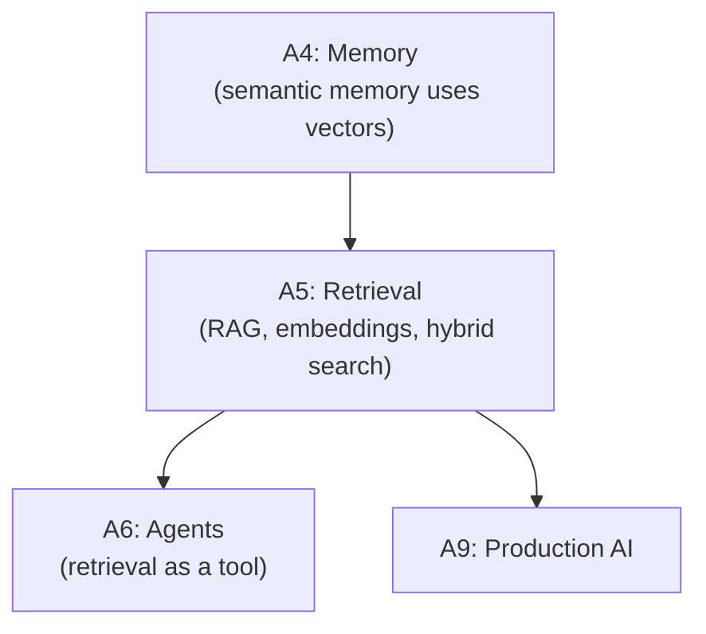

# Tier A5 — Retrieval & Knowledge Systems

> Build RAG systems that retrieve relevant knowledge and generate grounded answers with citations.

---

## Purpose

By the end of A5, you can:

- Design RAG architectures with ingestion, indexing, retrieval, and generation
- Chunk documents intelligently (semantic, sliding window, parent-child)
- Choose embeddings and vector stores (pgvector, Qdrant, etc.)
- Implement hybrid search (BM25 + vector) and reranking
- Evaluate RAG quality (faithfulness, recall, precision)
- Handle incremental indexing, deletes, and updates
- Build advanced RAG patterns (GraphRAG, agentic RAG, multi-hop)

A5 is where "the model only knows training data" becomes "the model knows your documents."

---

## Anchored Project

**A5: Document Q&A service**

A service that:

1. Ingests PDFs and markdown documents
2. Chunks intelligently (semantic + parent-child)
3. Embeds with a free-tier or local embedding model
4. Stores vectors in pgvector (free, no extra infra)
5. Supports hybrid search (BM25 + vector) with RRF fusion
6. Reranks top-K results with a cross-encoder
7. Generates answers with citations back to source documents
8. Evaluates on a fixed test set (faithfulness, recall, precision)
9. Handles incremental document updates and deletes

**What it proves**: you can build a grounded, evaluable RAG system on free infrastructure.

**Deliverables**:

- `projects/02-pdf-qa/` — full RAG service
- Document ingestion pipeline
- Hybrid search implementation
- Evaluation report
- README with architecture and cost notes

---

## How A5 Fits the Architecture

**What it produces**: the retrieval layer for RAG-powered applications.

---

## Topics (Linear Spine)

### A5.1 — Why RAG

- **What RAG is**: retrieve relevant documents, inject into prompt, generate grounded answer
  `KNOW` · `Anchor: A5-rag` · `Deps: A4 semantic` · `Fails: hallucination; no grounding` · `Interview: Y` · `Artifact: —` · `Mistake: treating RAG as a search replacement` · `Ref: A6 tool` · `Theory 50/Practice 50` · `Cost: free` · `Reading: 30 min`

- **When RAG vs fine-tuning**: RAG for knowledge; fine-tuning for style/behavior
  `KNOW` · `Anchor: A5-rag` · `Deps: A5.1 what` · `Fails: fine-tuning for knowledge (expensive, doesn't work)` · `Interview: Y` · `Artifact: —` · `Mistake: fine-tuning to add facts` · `Ref: A5.1 long-context` · `Theory 60/Practice 40` · `Cost: free` · `Reading: 30 min`

- **RAG vs long context**: when to just stuff documents into context
  `KNOW` · `Anchor: A5-rag` · `Deps: A5.1 when-rag` · `Fails: building RAG when long context would work` · `Interview: Y` · `Artifact: —` · `Mistake: assuming RAG is always right` · `Ref: A4 context-engineering` · `Theory 60/Practice 40` · `Cost: free` · `Reading: 30 min`

- **Common RAG failure modes**: retrieval misses, hallucination despite context, citation errors
  `KNOW` · `Anchor: A5-rag` · `Deps: A5.1 what` · `Fails: system looks fine in demos, fails in prod` · `Interview: Y` · `Artifact: —` · `Mistake: no eval; can't see failures` · `Ref: A5.8 evaluation` · `Theory 60/Practice 40` · `Cost: free` · `Reading: 35 min`

**Deep-dive candidates**: RAG architecture overview, when NOT to use RAG — generate on demand.

---

### A5.2 — Document Ingestion & Chunking

- **Ingestion pipeline**: fetch → parse → clean → chunk → embed → store
  `BUILD` · `Anchor: A5-rag` · `Deps: A5.1 what` · `Fails: messy input data; degraded retrieval` · `Interview: Y` · `Artifact: ingest.ts` · `Mistake: skipping parsing/cleaning` · `Ref: A5.3 embeddings` · `Theory 40/Practice 60` · `Cost: free` · `Reading: 40 min`

- **PDF parsing**: `pdf-parse`, `unpdf`, `LlamaParse` (paid), local options
  `USE` · `Anchor: A5-rag` · `Deps: A5.2 pipeline` · `Fails: PDFs with images/tables misparse` · `Interview: S` · `Artifact: pdf-parse.ts` · `Mistake: assuming text extraction is clean` · `Ref: A5.7 multimodal` · `Theory 30/Practice 70` · `Cost: free` · `Reading: 35 min`

- **Markdown/HTML parsing**: preserving structure (headers, lists, code)
  `USE` · `Anchor: A5-rag` · `Deps: A5.2 pipeline` · `Fails: structure lost; chunks meaningless` · `Interview: S` · `Artifact: markdown-parse.ts` · `Mistake: flattening to plain text` · `Ref: A5.2 chunking` · `Theory 30/Practice 70` · `Cost: free` · `Reading: 30 min`

- **Chunking strategies**: fixed-size, semantic, sliding window, parent-child
  `BUILD` · `Anchor: A5-rag` · `Deps: A5.2 pipeline` · `Fails: chunks too small (no context) or too large (noise)` · `Interview: Y` · `Artifact: chunking.ts` · `Mistake: fixed 512 tokens for everything` · `Ref: A5.3 embeddings` · `Theory 40/Practice 60` · `Cost: free` · `Reading: 50 min`

- **Chunk overlap**: preserve context across chunk boundaries
  `BUILD` · `Anchor: A5-rag` · `Deps: A5.2 chunking` · `Fails: important info split across chunks lost` · `Interview: S` · `Artifact: overlap.ts` · `Mistake: no overlap; missing edge content` · `Ref: A5.2 chunking` · `Theory 30/Practice 70` · `Cost: free` · `Reading: 25 min`

- **Metadata attachment**: source, page, section, timestamp
  `BUILD` · `Anchor: A5-rag` · `Deps: A5.2 chunking` · `Fails: no citations; no filtering` · `Interview: Y` · `Artifact: metadata.ts` · `Mistake: no metadata (can't cite or filter)` · `Ref: A5.4 hybrid-search, A5.7 evaluation` · `Theory 30/Practice 70` · `Cost: free` · `Reading: 30 min`

- **Parent-child chunking**: small chunks for retrieval, parent chunks for context
  `BUILD` · `Anchor: A5-rag` · `Deps: A5.2 metadata` · `Fails: retrieval quality vs generation context trade-off` · `Interview: Y` · `Artifact: parent-child.ts` · `Mistake: only one chunk size` · `Ref: A5.6 reranking` · `Theory 40/Practice 60` · `Cost: free` · `Reading: 40 min`

**Deep-dive candidates**: chunking strategies comparison, parent-child patterns — generate on demand.

---

### A5.3 — Embeddings

- **What embeddings are**: dense vectors capturing semantic meaning
  `KNOW` · `Anchor: A5-rag` · `Deps: A5.2 chunking` · `Fails: unclear why semantic search works` · `Interview: Y` · `Artifact: —` · `Mistake: over-thinking the math` · `Ref: A5.4` · `Theory 60/Practice 40` · `Cost: free` · `Reading: 30 min`

- **Embedding models**: OpenAI, Voyage, Cohere, BGE, Nomic, all-MiniLM (local)
  `USE` · `Anchor: A5-rag` · `Deps: A5.3 what` · `Fails: wrong model for the domain` · `Interview: Y` · `Artifact: embedding-models.md` · `Mistake: assuming all models are equivalent` · `Ref: A5.4` · `Theory 40/Practice 60` · `Cost: free` · `Reading: 40 min`

- **Free/local embedding options**: `sentence-transformers`, Ollama embeddings, HuggingFace Inference API
  `USE` · `Anchor: A5-rag` · `Deps: A5.3 models` · `Fails: paid APIs for embeddings` · `Interview: S` · `Artifact: local-embeddings.ts` · `Mistake: using paid embeddings when free works` · `Ref: A1 free-tier` · `Theory 30/Practice 70` · `Cost: free` · `Reading: 35 min`

- **Dimensionality trade-offs**: 384, 768, 1536, 3072; storage vs quality
  `KNOW` · `Anchor: A5-rag` · `Deps: A5.3 models` · `Fails: inefficient storage; slow search` · `Interview: S` · `Artifact: —` · `Mistake: defaulting to 1536 without considering size` · `Ref: A5.4 vector-db` · `Theory 50/Practice 50` · `Cost: free` · `Reading: 30 min`

- **Batch embedding**: embed many chunks at once for efficiency
  `BUILD` · `Anchor: A5-rag` · `Deps: A5.3 models` · `Fails: slow ingestion (one at a time)` · `Interview: N` · `Artifact: batch-embed.ts` · `Mistake: no batching` · `Ref: A5.2 pipeline` · `Theory 30/Practice 70` · `Cost: free` · `Reading: 25 min`

- **Caching embeddings**: don't re-embed unchanged chunks
  `BUILD` · `Anchor: A5-rag` · `Deps: A5.3 batching` · `Fails: expensive re-indexing on updates` · `Interview: S` · `Artifact: embed-cache.ts` · `Mistake: full re-index on any change` · `Ref: A5.6 incremental` · `Theory 30/Practice 70` · `Cost: free` · `Reading: 30 min`

**Deep-dive candidates**: local embedding setup, embedding model comparison — generate on demand.

---

### A5.4 — Vector Databases

- **What a vector DB does**: store embeddings, ANN search, metadata filtering
  `KNOW` · `Anchor: A5-rag` · `Deps: A5.3 embeddings` · `Fails: can't do efficient similarity search` · `Interview: Y` · `Artifact: —` · `Mistake: assuming all vector DBs are equivalent` · `Ref: A5.4 pgvector` · `Theory 50/Practice 50` · `Cost: free` · `Reading: 30 min`

- **pgvector**: Postgres extension; no new infrastructure; SQL-compatible
  `BUILD` · `Anchor: A5-rag` · `Deps: A5.4 what` · `Fails: adding infra unnecessarily` · `Interview: Y` · `Artifact: pgvector-setup.sql` · `Mistake: reaching for a dedicated vector DB when Postgres suffices` · `Ref: Backend T3a` · `Theory 30/Practice 70` · `Cost: free` · `Reading: 40 min`

- **Dedicated vector DBs**: Qdrant, Milvus, Chroma, Pinecone, Weaviate
  `KNOW` · `Anchor: A5-rag` · `Deps: A5.4 pgvector` · `Fails: no scaling path when pgvector hits limits` · `Interview: Y` · `Artifact: —` · `Mistake: choosing Pinecone for a 100-doc project` · `Ref: A9 scaling` · `Theory 60/Practice 40` · `Cost: free` · `Reading: 45 min`

- **ANN algorithms**: HNSW, IVF, product quantization (conceptual)
  `KNOW` · `Anchor: A5-rag` · `Deps: A5.4 what` · `Fails: can't tune for recall vs speed` · `Interview: S` · `Artifact: —` · `Mistake: no understanding of the recall/latency trade-off` · `Ref: A5.4 pgvector` · `Theory 70/Practice 30` · `Cost: free` · `Reading: 40 min`

- **Metadata filtering**: pre-filter vs post-filter; index considerations
  `BUILD` · `Anchor: A5-rag` · `Deps: A5.4 pgvector` · `Fails: irrelevant results from other documents` · `Interview: Y` · `Artifact: filtering.ts` · `Mistake: post-filter (slow) when pre-filter works` · `Ref: A5.5 hybrid-search` · `Theory 40/Practice 60` · `Cost: free` · `Reading: 35 min`

- **Choosing a vector store**: pgvector vs Qdrant vs Milvus vs Pinecone
  `KNOW` · `Anchor: A5-rag` · `Deps: A5.4 dedicated` · `Fails: wrong choice for scale` · `Interview: Y` · `Artifact: vector-db-comparison.md` · `Mistake: choosing without testing at scale` · `Ref: A9 scaling` · `Theory 50/Practice 50` · `Cost: free` · `Reading: 40 min`

**Deep-dive candidates**: pgvector vs dedicated DBs, ANN algorithm comparison — generate on demand.

---

### A5.5 — Hybrid Search & Reranking

- **Why hybrid**: keyword search (BM25) + semantic (vector) — complementary strengths
  `KNOW` · `Anchor: A5-rag` · `Deps: A5.4 pgvector` · `Fails: pure vector misses exact keyword matches` · `Interview: Y` · `Artifact: —` · `Mistake: assuming vector search is always enough` · `Ref: A5.5 rrf` · `Theory 50/Practice 50` · `Cost: free` · `Reading: 30 min`

- **BM25 in Postgres**: `tsvector`, `tsquery`, ranking functions
  `BUILD` · `Anchor: A5-rag` · `Deps: A5.5 why` · `Fails: no keyword search fallback` · `Interview: S` · `Artifact: bm25.ts` · `Mistake: ignoring Postgres FTS` · `Ref: Backend T3a full-text` · `Theory 30/Practice 70` · `Cost: free` · `Reading: 40 min`

- **Reciprocal Rank Fusion (RRF)**: combine rankings from multiple retrievers
  `BUILD` · `Anchor: A5-rag` · `Deps: A5.5 bm25` · `Fails: naive merging of scores` · `Interview: Y` · `Artifact: rrf.ts` · `Mistake: averaging scores from different scales` · `Ref: A5.5 reranking` · `Theory 40/Practice 60` · `Cost: free` · `Reading: 35 min`

- **Reranking**: cross-encoder reranks top-K results for precision
  `BUILD` · `Anchor: A5-rag` · `Deps: A5.5 rrf` · `Fails: top-K results include irrelevant items` · `Interview: Y` · `Artifact: rerank.ts` · `Mistake: skipping reranking (quality loss)` · `Ref: A5.5 colbert` · `Theory 40/Practice 60` · `Cost: free` · `Reading: 45 min`

- **Cross-encoder options**: Cohere Rerank (paid), BGE-reranker (local), Voyage Rerank (paid)
  `USE` · `Anchor: A5-rag` · `Deps: A5.5 reranking` · `Fails: no local reranking option` · `Interview: S` · `Artifact: rerankers.ts` · `Mistake: no free-tier reranker` · `Ref: A5.3 local-embeddings` · `Theory 30/Practice 70` · `Cost: local` · `Reading: 35 min`

- **ColBERT / late interaction**: alternative to cross-encoders
  `KNOW` · `Anchor: A5-rag` · `Deps: A5.5 reranking` · `Fails: unaware of alternatives` · `Interview: N` · `Artifact: —` · `Mistake: assuming cross-encoders are the only option` · `Ref: A5.4 ann` · `Theory 70/Practice 30` · `Cost: free` · `Reading: 30 min`

**Deep-dive candidates**: RRF implementation, local cross-encoder setup — generate on demand.

---

### A5.6 — Advanced RAG Patterns

- **Incremental indexing**: add/update/delete documents without full rebuild
  `BUILD` · `Anchor: A5-rag` · `Deps: A5.3 caching` · `Fails: full re-index on every change (slow, expensive)` · `Interview: Y` · `Artifact: incremental.ts` · `Mistake: no delta tracking` · `Ref: A5.6 deletes` · `Theory 40/Practice 60` · `Cost: free` · `Reading: 45 min`

- **Deletes and updates**: tombstoning, re-embedding changed chunks
  `BUILD` · `Anchor: A5-rag` · `Deps: A5.6 incremental` · `Fails: stale content served after deletes` · `Interview: S` · `Artifact: deletes.ts` · `Mistake: soft delete leaving orphaned embeddings` · `Ref: A5.2 metadata` · `Theory 40/Practice 60` · `Cost: free` · `Reading: 40 min`

- **GraphRAG**: knowledge graph + retrieval
  `KNOW` · `Anchor: A5-rag` · `Deps: A5.6 incremental` · `Fails: multi-hop reasoning across documents` · `Interview: S` · `Artifact: —` · `Mistake: GraphRAG for simple retrieval (overkill)` · `Ref: A6 multi-hop` · `Theory 60/Practice 40` · `Cost: free` · `Reading: 45 min`

- **Agentic RAG**: agent decides when and how to retrieve
  `BUILD` · `Anchor: A5-rag` · `Deps: A5.6 graphrag` · `Fails: static retrieval pipeline misses complex queries` · `Interview: Y` · `Artifact: agentic-rag.ts` · `Mistake: agentic for trivial queries (latency)` · `Ref: A6 agent-loops` · `Theory 50/Practice 50` · `Cost: free` · `Reading: 50 min`

- **Multi-hop RAG**: retrieve → reason → retrieve again
  `BUILD` · `Anchor: A5-rag` · `Deps: A5.6 agentic-rag` · `Fails: complex questions need chained retrieval` · `Interview: Y` · `Artifact: multi-hop.ts` · `Mistake: single retrieval for multi-step questions` · `Ref: A6` · `Theory 50/Practice 50` · `Cost: free` · `Reading: 45 min`

- **Adaptive RAG**: choose retrieval strategy based on query type
  `KNOW` · `Anchor: A5-rag` · `Deps: A5.6 multi-hop` · `Fails: one-size-fits-all retrieval` · `Interview: N` · `Artifact: —` · `Mistake: over-engineering the routing` · `Ref: A6` · `Theory 60/Practice 40` · `Cost: free` · `Reading: 40 min`

- **Corrective RAG**: verify retrieved content; re-retrieve if weak
  `KNOW` · `Anchor: A5-rag` · `Deps: A5.6 adaptive` · `Fails: bad retrievals lead to bad answers` · `Interview: S` · `Artifact: —` · `Mistake: no quality check on retrieval` · `Ref: A5.8 evaluation` · `Theory 50/Practice 50` · `Cost: free` · `Reading: 40 min`

**Deep-dive candidates**: incremental indexing, agentic RAG patterns — generate on demand.

---

### A5.7 — Multimodal RAG

- **Images in documents**: extract text from images; embed image+text
  `KNOW` · `Anchor: A5-rag` · `Deps: A5.2 pdf-parsing` · `Fails: image-heavy PDFs lose information` · `Interview: S` · `Artifact: —` · `Mistake: ignoring images` · `Ref: A5.2 pipeline` · `Theory 50/Practice 50` · `Cost: free` · `Reading: 35 min`

- **OCR for scanned documents**: Tesseract (local), Gemini Vision (free tier)
  `USE` · `Anchor: A5-rag` · `Deps: A5.7 images` · `Fails: scanned docs unreadable` · `Interview: N` · `Artifact: ocr.ts` · `Mistake: no OCR for scanned PDFs` · `Ref: A5.2 pipeline` · `Theory 30/Practice 70` · `Cost: free` · `Reading: 35 min`

- **Table extraction**: structured extraction from PDFs
  `USE` · `Anchor: A5-rag` · `Deps: A5.7 images` · `Fails: table data lost or mangled` · `Interview: N` · `Artifact: table-extract.ts` · `Mistake: flattening tables to text` · `Ref: A5.2 chunking` · `Theory 30/Practice 70` · `Cost: free` · `Reading: 30 min`

- **Vision-language models for RAG**: GPT-4V, Claude Vision, Gemini Vision for image-heavy content
  `KNOW` · `Anchor: A5-rag` · `Deps: A5.7 ocr` · `Fails: limited extraction for complex documents` · `Interview: S` · `Artifact: —` · `Mistake: using vision models for simple text` · `Ref: A1 models` · `Theory 50/Practice 50` · `Cost: free` · `Reading: 35 min`

**Deep-dive candidates**: OCR pipeline setup, table extraction — generate on demand.

---

### A5.8 — RAG Evaluation

- **Why evaluation matters**: RAG looks fine in demos; fails in production silently
  `KNOW` · `Anchor: A5-rag` · `Deps: A5.7 multimodal` · `Fails: no visibility into retrieval/generation quality` · `Interview: Y` · `Artifact: —` · `Mistake: no eval set` · `Ref: A9 evaluation` · `Theory 50/Practice 50` · `Cost: free` · `Reading: 30 min`

- **Retrieval metrics**: recall@k, precision@k, MRR, NDCG
  `BUILD` · `Anchor: A5-rag` · `Deps: A5.8 why` · `Fails: no measure of retrieval quality` · `Interview: Y` · `Artifact: retrieval-metrics.ts` · `Mistake: only measuring final answer` · `Ref: A5.8 generation` · `Theory 40/Practice 60` · `Cost: free` · `Reading: 40 min`

- **Generation metrics**: faithfulness, answer relevance, context precision, context recall
  `BUILD` · `Anchor: A5-rag` · `Deps: A5.8 retrieval` · `Fails: hallucination despite good retrieval` · `Interview: Y` · `Artifact: generation-metrics.ts` · `Mistake: no faithfulness check` · `Ref: A9` · `Theory 40/Practice 60` · `Cost: free` · `Reading: 45 min`

- **LLM-as-judge for RAG**: evaluate faithfulness, relevance, citation accuracy
  `BUILD` · `Anchor: A5-rag` · `Deps: A5.8 generation` · `Fails: manual evaluation doesn't scale` · `Interview: Y` · `Artifact: llm-judge.ts` · `Mistake: using a weak model as judge` · `Ref: A2 evaluation, A9` · `Theory 40/Practice 60` · `Cost: free` · `Reading: 45 min`

- **RAGAS**: open-source RAG evaluation framework
  `USE` · `Anchor: A5-rag` · `Deps: A5.8 llm-judge` · `Fails: reinventing evaluation metrics` · `Interview: S` · `Artifact: ragas.ts` · `Mistake: using metrics without understanding them` · `Ref: A9` · `Theory 30/Practice 70` · `Cost: free` · `Reading: 40 min`

- **Regression testing**: fixed test set on every pipeline change
  `BUILD` · `Anchor: A5-rag` · `Deps: A5.8 ragas` · `Fails: pipeline changes silently degrade quality` · `Interview: Y` · `Artifact: regression.ts` · `Mistake: no baseline; can't measure change` · `Ref: A9 regression` · `Theory 30/Practice 70` · `Cost: free` · `Reading: 35 min`

**Deep-dive candidates**: RAGAS setup, LLM-as-judge prompts — generate on demand.

---

## Exit Criteria

You've completed A5 when you can:

- Design a RAG pipeline end-to-end (ingestion → chunking → embedding → storage → retrieval → generation)
- Choose chunking strategies for different document types
- Use free/local embedding models
- Store and query vectors in pgvector
- Implement hybrid search (BM25 + vector) with RRF
- Rerank top-K results with a cross-encoder
- Generate grounded answers with citations
- Evaluate RAG with retrieval and generation metrics
- Handle incremental updates and deletes

---

## Cross-Tier References

**Depends on**: A4 (semantic memory), Backend T3a (Postgres, full-text search), T3c (Redis for caching).

**Depended on by**:

- A6 — retrieval is a tool for agents
- A9 — production RAG at scale

---

## Common Failure Modes for the Tier as a Whole

- **Fixed-size chunks**: semantics broken across boundaries.
- **No hybrid search**: exact keywords missed.
- **No reranking**: irrelevant items in top-K.
- **Paid embeddings unnecessarily**: free/local works.
- **Full re-index on updates**: slow and expensive.
- **No eval**: silent quality degradation.
- **No metadata**: no citations, no filtering.
- **Stale content after deletes**: orphaned embeddings.
- **Vision models for simple text**: over-engineering.

---

## Why Not?

### Why pgvector Instead of Pinecone / Qdrant?

- **pgvector** — no new infrastructure; Postgres already deployed; SQL for filtering; free; scales to millions of vectors.
- **Pinecone** — managed, but paid; vendor lock-in.
- **Qdrant/Milvus** — dedicated, faster at extreme scale; extra infra.
- **Rule**: start with pgvector. Move to dedicated only when you hit its limits (millions of vectors, low-latency requirements).

### Why Hybrid Search Instead of Pure Vector?

- **Vector alone** — misses exact keyword matches (product SKUs, names, acronyms).
- **BM25 alone** — misses semantic similarity ("laptop" won't match "notebook").
- **Hybrid** — combines both; RRF fusion is the pragmatic standard.
- **Rule**: hybrid unless you've measured and pure vector suffices.

### Why Reranking?

- **Without reranking** — top-K by embedding similarity includes irrelevant items.
- **With reranking** — cross-encoder scores each candidate against the query; precision improves dramatically.
- **Cost** — one extra model call. Worth it.
- **Rule**: always rerank. Use a local cross-encoder (BGE-reranker) for free.

### Why RRF Instead of Score Averaging?

- **Score averaging** — BM25 scores and cosine similarities are on different scales. Averaging is meaningless.
- **RRF** — combines _ranks_, not scores. Scale-agnostic. Simple. Effective.
- **Rule**: RRF for merging heterogeneous rankings.

### Why Local Embeddings?

- **OpenAI/Voyage embeddings** — excellent quality, but paid.
- **BGE, Nomic, all-MiniLM** — free, local, good quality for most use cases.
- **Rule**: local for learning and small-to-medium scale. Paid only when local hits limits.

### Why Not Fine-Tune for Knowledge?

- **Fine-tuning** — changes model behavior/style, not facts. Knowledge injection via fine-tuning is unreliable and expensive.
- **RAG** — injects current, verifiable knowledge. Standard for factual grounding.
- **Rule**: RAG for knowledge. Fine-tuning for style.
