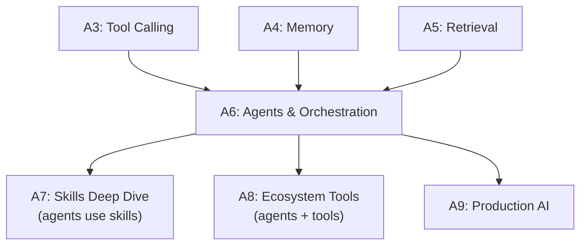

# Tier A6 — Agents & Orchestration

> Build agent loops from scratch, add planning, coordinate multiple agents, integrate MCP.

---

## Purpose

By the end of A6, you can:

- Build an agent loop from scratch (the 100-line version)
- Add planning, reflection, and stopping criteria
- Handle errors and recovery in agent loops
- Design multi-agent systems (supervisor, swarm, pipeline)
- Implement human-in-the-loop approval workflows
- Build and use MCP servers
- Evaluate agent performance (task success, cost, iterations)

A6 is where "the model responds" becomes "the model acts."

---

## Anchored Project

**A6: Multi-agent research assistant**

A system where:

1. A **Planner** agent decomposes a research question into subtasks
2. A **Researcher** agent (per subtask) retrieves information via RAG and web search tools
3. A **Writer** agent synthesizes findings into a report
4. A **Reviewer** agent critiques the report and requests revisions
5. Memory persists across agents (shared Postgres + vector store)
6. Human-in-the-loop approval for external actions (e.g., publishing)
7. Full observability: traces per agent, cost per task, iteration counts
8. Evaluation: on a fixed set of research questions, measures cost, latency, quality

**What it proves**: you can build a coordinated multi-agent system on free infrastructure.

**Deliverables**:

- `projects/06-research-assistant/` — full system
- Agent loop implementation (from scratch, no framework)
- Multi-agent coordination layer
- Human-in-the-loop approval
- Evaluation report
- README with architecture

---

## How A6 Fits the Architecture

**What it produces**: the agent patterns that underpin research assistants, coding assistants, and personal AI tools.

---

## Topics (Linear Spine)

### A6.1 — Agent Fundamentals

- **What an agent is**: LLM + tools + memory + loop + stopping criteria
  `KNOW` · `Anchor: A6-research` · `Deps: A3 tools, A4 memory` · `Fails: confusion about agent components` · `Interview: Y` · `Artifact: —` · `Mistake: thinking agents are magic (they're loops)` · `Ref: A6.2 loop` · `Theory 50/Practice 50` · `Cost: free` · `Reading: 30 min`

- **Agent vs workflow vs chain**: workflows are deterministic; agents decide steps
  `KNOW` · `Anchor: A6-research` · `Deps: A6.1 what` · `Fails: using agents for deterministic tasks (wasteful)` · `Interview: Y` · `Artifact: —` · `Mistake: agents everywhere` · `Ref: A6.4 workflows` · `Theory 60/Practice 40` · `Cost: free` · `Reading: 30 min`

- **The ReAct pattern**: reasoning + acting; think → act → observe → repeat
  `KNOW` · `Anchor: A6-research` · `Deps: A6.1 what` · `Fails: unaware of the foundational pattern` · `Interview: Y` · `Artifact: —` · `Mistake: not knowing ReAct exists` · `Ref: A6.2 loop` · `Theory 60/Practice 40` · `Cost: free` · `Reading: 30 min`

- **When NOT to use agents**: deterministic tasks, simple Q&A, cost-sensitive scenarios
  `KNOW` · `Anchor: A6-research` · `Deps: A6.1 agent-vs-workflow` · `Fails: over-engineered systems; high cost, high latency` · `Interview: Y` · `Artifact: —` · `Mistake: agents for everything` · `Ref: A9 cost` · `Theory 60/Practice 40` · `Cost: free` · `Reading: 30 min`

**Deep-dive candidates**: agent patterns overview, ReAct deep dive — generate on demand.

---

### A6.2 — Building the Agent Loop

- **The core loop**: send prompt + tools → parse tool calls → execute → feed back → repeat
  `BUILD` · `Anchor: A6-research` · `Deps: A6.1 what` · `Fails: single-shot responses; no autonomous behavior` · `Interview: Y` · `Artifact: agent-loop.ts` · `Mistake: infinite loops without caps` · `Ref: A3.3 tool-loop` · `Theory 40/Practice 60` · `Cost: free` · `Reading: 50 min`

- **State management**: what the agent knows between iterations
  `BUILD` · `Anchor: A6-research` · `Deps: A6.2 loop` · `Fails: agent forgets what it just did` · `Interview: Y` · `Artifact: state.ts` · `Mistake: stateless agents (no continuity)` · `Ref: A4 memory` · `Theory 40/Practice 60` · `Cost: free` · `Reading: 40 min`

- **Tool availability per iteration**: dynamic tool sets based on agent state
  `BUILD` · `Anchor: A6-research` · `Deps: A6.2 state` · `Fails: wrong tools available; agent confused` · `Interview: S` · `Artifact: dynamic-tools.ts` · `Mistake: all tools always available` · `Ref: A3.2 schemas` · `Theory 40/Practice 60` · `Cost: free` · `Reading: 40 min`

- **Stopping criteria**: no more tool calls, max iterations, task complete, error threshold
  `BUILD` · `Anchor: A6-research` · `Deps: A6.2 loop` · `Fails: runaway agents; infinite loops` · `Interview: Y` · `Artifact: stopping.ts` · `Mistake: no max iterations` · `Ref: A3.3 stopping` · `Theory 40/Practice 60` · `Cost: free` · `Reading: 35 min`

- **Observation and reflection**: agent inspects its own output; decides to revise
  `BUILD` · `Anchor: A6-research` · `Deps: A6.2 stopping` · `Fails: first output always final; quality caps` · `Interview: Y` · `Artifact: reflection.ts` · `Mistake: infinite reflection loops` · `Ref: A2 self-critique` · `Theory 40/Practice 60` · `Cost: free` · `Reading: 45 min`

- **Cost tracking per iteration**: tokens, latency, dollar cost per step
  `BUILD` · `Anchor: A6-research` · `Deps: A6.2 loop` · `Fails: runaway costs; no visibility` · `Interview: S` · `Artifact: cost-per-iter.ts` · `Mistake: no cost tracking` · `Ref: A9 cost` · `Theory 30/Practice 70` · `Cost: free` · `Reading: 30 min`

**Deep-dive candidates**: agent loop implementation, reflection patterns — generate on demand.

---

### A6.3 — Planning

- **Task decomposition**: break complex goal into subtasks
  `BUILD` · `Anchor: A6-research` · `Deps: A6.2 loop` · `Fails: agent tries to do everything at once` · `Interview: Y` · `Artifact: decompose.ts` · `Mistake: too fine or too coarse decomposition` · `Ref: A6.4 workflow` · `Theory 40/Practice 60` · `Cost: free` · `Reading: 45 min`

- **Plan-and-execute**: generate plan first, then execute steps
  `BUILD` · `Anchor: A6-research` · `Deps: A6.3 decompose` · `Fails: reactive agent with no strategy` · `Interview: Y` · `Artifact: plan-execute.ts` · `Mistake: plans too detailed (brittle)` · `Ref: A6.3 re-planning` · `Theory 40/Practice 60` · `Cost: free` · `Reading: 50 min`

- **Re-planning**: agent adapts plan when new information emerges
  `BUILD` · `Anchor: A6-research` · `Deps: A6.3 plan-execute` · `Fails: rigid plans fail on complexity` · `Interview: Y` · `Artifact: replan.ts` · `Mistake: infinite re-planning` · `Ref: A6.2 reflection` · `Theory 40/Practice 60` · `Cost: free` · `Reading: 45 min`

- **Hierarchical planning**: high-level plan → sub-plans → tasks
  `KNOW` · `Anchor: A6-research` · `Deps: A6.3 replan` · `Fails: no structure for complex tasks` · `Interview: S` · `Artifact: —` · `Mistake: over-hierarchy for simple tasks` · `Ref: A6.5 multi-agent` · `Theory 60/Practice 40` · `Cost: free` · `Reading: 40 min`

- **Goal trees**: alternate representation of hierarchical plans
  `KNOW` · `Anchor: A6-research` · `Deps: A6.3 hierarchical` · `Fails: unaware of alternative patterns` · `Interview: N` · `Artifact: —` · `Mistake: forcing one representation` · `Ref: A6.3 hierarchical` · `Theory 70/Practice 30` · `Cost: free` · `Reading: 30 min`

- **Plan validation**: sanity-check plans before executing
  `BUILD` · `Anchor: A6-research` · `Deps: A6.3 plan-execute` · `Fails: executing nonsensical plans` · `Interview: S` · `Artifact: plan-validate.ts` · `Mistake: no validation (agent executes anything)` · `Ref: A6.7 safety` · `Theory 40/Practice 60` · `Cost: free` · `Reading: 35 min`

**Deep-dive candidates**: plan-and-execute implementation, hierarchical planning — generate on demand.

---

### A6.4 — Workflows

- **When workflows beat agents**: deterministic sequences with known steps
  `KNOW` · `Anchor: A6-research` · `Deps: A6.3 planning` · `Fails: using agents where workflows are simpler, cheaper, faster` · `Interview: Y` · `Artifact: —` · `Mistake: agents everywhere` · `Ref: A6.1 agent-vs-workflow` · `Theory 50/Practice 50` · `Cost: free` · `Reading: 30 min`

- **Sequential workflows**: step 1 output → step 2 input
  `BUILD` · `Anchor: A6-research` · `Deps: A6.4 when` · `Fails: no structured multi-step processing` · `Interview: S` · `Artifact: sequential.ts` · `Mistake: chained prompts without error handling` · `Ref: A2 chaining` · `Theory 30/Practice 70` · `Cost: free` · `Reading: 30 min`

- **Parallel workflows**: independent steps executed concurrently
  `BUILD` · `Anchor: A6-research` · `Deps: A6.4 sequential` · `Fails: sequential execution of independent work` · `Interview: S` · `Artifact: parallel.ts` · `Mistake: parallel with hidden dependencies` · `Ref: A3.3 parallel-tools` · `Theory 30/Practice 70` · `Cost: free` · `Reading: 35 min`

- **Conditional workflows**: branching based on intermediate results
  `BUILD` · `Anchor: A6-research` · `Deps: A6.4 parallel` · `Fails: single-path workflows can't adapt` · `Interview: S` · `Artifact: conditional.ts` · `Mistake: complex conditionals (use agents instead)` · `Ref: A6.1 agent-vs-workflow` · `Theory 40/Practice 60` · `Cost: free` · `Reading: 35 min`

- **Retry and fallback in workflows**: handle step failures
  `BUILD` · `Anchor: A6-research` · `Deps: A6.4 conditional` · `Fails: one failed step kills the workflow` · `Interview: Y` · `Artifact: retry.ts` · `Mistake: no fallback paths` · `Ref: A3.4 errors, Backend T5.4` · `Theory 30/Practice 70` · `Cost: free` · `Reading: 40 min`

- **Human-in-the-loop**: pause workflow for approval at critical steps
  `BUILD` · `Anchor: A6-research` · `Deps: A6.4 conditional` · `Fails: autonomous actions without review` · `Interview: Y` · `Artifact: human-approval.ts` · `Mistake: no pause for sensitive actions` · `Ref: A6.7 safety, A9` · `Theory 40/Practice 60` · `Cost: free` · `Reading: 45 min`

**Deep-dive candidates**: workflow orchestration, human-in-the-loop patterns — generate on demand.

---

### A6.5 — Multi-Agent Systems

- **Why multi-agent**: specialization, parallel work, adversarial review
  `KNOW` · `Anchor: A6-research` · `Deps: A6.4 workflows` · `Fails: single agent hitting complexity limits` · `Interview: Y` · `Artifact: —` · `Mistake: multi-agent for simple tasks (overhead)` · `Ref: A6.5 patterns` · `Theory 50/Practice 50` · `Cost: free` · `Reading: 35 min`

- **Supervisor pattern**: one agent coordinates others
  `BUILD` · `Anchor: A6-research` · `Deps: A6.5 why` · `Fails: no coordination; chaos` · `Interview: Y` · `Artifact: supervisor.ts` · `Mistake: supervisor doing all the work` · `Ref: A6.5 pipeline` · `Theory 40/Practice 60` · `Cost: free` · `Reading: 45 min`

- **Pipeline pattern**: agents in sequence; each processes the previous output
  `BUILD` · `Anchor: A6-research` · `Deps: A6.5 why` · `Fails: no specialization flow` · `Interview: Y` · `Artifact: pipeline.ts` · `Mistake: pipelines for tasks needing parallel exploration` · `Ref: A6.4 sequential` · `Theory 30/Practice 70` · `Cost: free` · `Reading: 40 min`

- **Swarm pattern**: agents work in parallel with shared state
  `KNOW` · `Anchor: A6-research` · `Deps: A6.5 why` · `Fails: unaware of parallel-agent patterns` · `Interview: S` · `Artifact: —` · `Mistake: swarm for tasks needing coordination` · `Ref: A6.5 supervisor` · `Theory 60/Practice 40` · `Cost: free` · `Reading: 40 min`

- **Hierarchical agents**: agents managing sub-agents
  `KNOW` · `Anchor: A6-research` · `Deps: A6.5 supervisor` · `Fails: no structure for very complex tasks` · `Interview: S` · `Artifact: —` · `Mistake: over-hierarchy (communication overhead)` · `Ref: A6.3 hierarchical` · `Theory 60/Practice 40` · `Cost: free` · `Reading: 40 min`

- **Communication patterns**: message passing, shared memory, event-driven
  `BUILD` · `Anchor: A6-research` · `Deps: A6.5 supervisor` · `Fails: agents can't share state` · `Interview: S` · `Artifact: communication.ts` · `Mistake: no protocol; ad-hoc messages` · `Ref: A4 memory` · `Theory 40/Practice 60` · `Cost: free` · `Reading: 45 min`

- **Conflict resolution**: agents disagree; voting, adjudication, escalation
  `BUILD` · `Anchor: A6-research` · `Deps: A6.5 communication` · `Fails: deadlock; contradictory outputs` · `Interview: S` · `Artifact: conflict.ts` · `Mistake: no resolution mechanism` · `Ref: A6.5 supervisor` · `Theory 40/Practice 60` · `Cost: free` · `Reading: 40 min`

- **Adversarial review**: critic agent challenges primary agent's output
  `BUILD` · `Anchor: A6-research` · `Deps: A6.5 supervisor` · `Fails: quality caps at single-agent level` · `Interview: Y` · `Artifact: adversarial.ts` · `Mistake: critic too lenient or too harsh` · `Ref: A2 self-critique` · `Theory 40/Practice 60` · `Cost: free` · `Reading: 45 min`

**Deep-dive candidates**: supervisor implementation, communication patterns — generate on demand.

---

### A6.6 — MCP in Depth

- **MCP recap**: standard for connecting agents to tools, resources, prompts
  `KNOW` · `Anchor: A6-mcp` · `Deps: A3.6 mcp` · `Fails: unaware of the standard` · `Interview: Y` · `Artifact: —` · `Mistake: thinking MCP is Claude-specific` · `Ref: A3.6` · `Theory 60/Practice 40` · `Cost: free` · `Reading: 25 min`

- **MCP server resources**: exposing data (not just tools)
  `BUILD` · `Anchor: A6-mcp` · `Deps: A6.6 recap` · `Fails: only tools, no resources` · `Interview: S` · `Artifact: mcp-resources.ts` · `Mistake: conflating resources with tools` · `Ref: A7 skills` · `Theory 40/Practice 60` · `Cost: free` · `Reading: 40 min`

- **MCP prompts**: exposing prompt templates as server resources
  `BUILD` · `Anchor: A6-mcp` · `Deps: A6.6 resources` · `Fails: prompts not reusable across agents` · `Interview: N` · `Artifact: mcp-prompts.ts` · `Mistake: hardcoding prompts client-side` · `Ref: A2 prompt-lib` · `Theory 40/Practice 60` · `Cost: free` · `Reading: 35 min`

- **Remote MCP servers**: HTTP transport, auth, deployment
  `BUILD` · `Anchor: A6-mcp` · `Deps: A6.6 prompts` · `Fails: only local stdio MCP servers` · `Interview: S` · `Artifact: remote-mcp.ts` · `Mistake: no auth on remote MCP` · `Ref: A9 security` · `Theory 40/Practice 60` · `Cost: free` · `Reading: 50 min`

- **MCP security**: tool poisoning, prompt injection via resources, auth
  `BUILD` · `Anchor: A6-mcp` · `Deps: A6.6 remote` · `Fails: MCP as attack vector` · `Interview: S` · `Artifact: mcp-security.md` · `Mistake: installing MCP servers without vetting` · `Ref: A3.6 security, A7 vetting, A9 safety` · `Theory 50/Practice 50` · `Cost: free` · `Reading: 45 min`

- **MCP tooling in Antigravity/Codex/Cursor**: config, permissions, scoping
  `USE` · `Anchor: A6-mcp` · `Deps: A6.6 remote` · `Fails: no MCP servers running` · `Interview: N` · `Artifact: mcp-config.md` · `Mistake: wrong config path per agent` · `Ref: A8` · `Theory 20/Practice 80` · `Cost: free` · `Reading: 40 min`

**Deep-dive candidates**: remote MCP server deployment, MCP security model — generate on demand.

---

### A6.7 — Agent Safety & Evaluation

- **Agent safety concerns**: unintended actions, runaway costs, prompt injection via tools
  `KNOW` · `Anchor: A6-research` · `Deps: A6.6 mcp` · `Fails: agents do harmful things autonomously` · `Interview: Y` · `Artifact: —` · `Mistake: no sandboxing or approval gates` · `Ref: A3.5 safe-tools, A9 safety` · `Theory 60/Practice 40` · `Cost: free` · `Reading: 35 min`

- **Approval gates**: sensitive actions require human confirmation
  `BUILD` · `Anchor: A6-research` · `Deps: A6.7 safety` · `Fails: agents execute sensitive operations unchecked` · `Interview: Y` · `Artifact: approval-gates.ts` · `Mistake: no gates for external actions` · `Ref: A6.4 human-in-loop` · `Theory 40/Practice 60` · `Cost: free` · `Reading: 40 min`

- **Cost budgets**: cap total cost per task
  `BUILD` · `Anchor: A6-research` · `Deps: A6.2 cost-tracking` · `Fails: runaway costs on complex tasks` · `Interview: S` · `Artifact: cost-budget.ts` · `Mistake: no cap` · `Ref: A1.4 cost, A9` · `Theory 30/Practice 70` · `Cost: free` · `Reading: 35 min`

- **Task success metrics**: did the agent accomplish the goal?
  `BUILD` · `Anchor: A6-research` · `Deps: A6.7 safety` · `Fails: no way to know if agents are useful` · `Interview: Y` · `Artifact: success-metrics.ts` · `Mistake: measuring iterations but not outcomes` · `Ref: A5.8 evaluation, A9` · `Theory 40/Practice 60` · `Cost: free` · `Reading: 40 min`

- **Iteration metrics**: cost per task, steps per task, retries per task
  `BUILD` · `Anchor: A6-research` · `Deps: A6.7 success` · `Fails: no visibility into agent efficiency` · `Interview: S` · `Artifact: iteration-metrics.ts` · `Mistake: no baseline` · `Ref: A9 observability` · `Theory 30/Practice 70` · `Cost: free` · `Reading: 35 min`

- **Regression testing for agents**: fixed task set on every change
  `BUILD` · `Anchor: A6-research` · `Deps: A6.7 success` · `Fails: agent changes silently degrade` · `Interview: S` · `Artifact: regression.ts` · `Mistake: no baseline` · `Ref: A5.8 regression, A9` · `Theory 30/Practice 70` · `Cost: free` · `Reading: 40 min`

**Deep-dive candidates**: agent evaluation frameworks, approval gate patterns — generate on demand.

---

## Exit Criteria

You've completed A6 when you can:

- Build an agent loop from scratch (no framework)
- Add planning, reflection, and stopping criteria
- Distinguish when to use workflows vs agents
- Design multi-agent systems (supervisor, pipeline, adversarial review)
- Build and deploy MCP servers (local and remote)
- Add human-in-the-loop approval for sensitive actions
- Evaluate agents on task success, cost, iterations
- Implement safety measures (sandboxing, budgets, approval gates)

---

## Cross-Tier References

**Depends on**: A3 (tools, MCP), A4 (memory), A5 (retrieval), Backend T5 (retries, jobs, backoff).

**Depended on by**:

- A7 — skills are used by agents
- A8 — agent routing and ecosystem tools
- A9 — production agents at scale

---

## Common Failure Modes for the Tier as a Whole

- **No max iterations**: infinite loops.
- **No cost cap**: runaway spend.
- **No stopping criteria**: agents never finish.
- **Multi-agent for simple tasks**: overhead without benefit.
- **No sandboxing**: agents execute arbitrary actions.
- **No approval gates**: sensitive operations unchecked.
- **No shared memory protocol**: agents lose each other's state.
- **No evaluation**: no idea if agents work.
- **No reflection**: quality caps at first attempt.
- **Framework-first**: don't understand the loop underneath.

---

## Why Not?

### Why Build the Agent Loop from Scratch Instead of LangGraph / CrewAI?

- **Frameworks** — provide state machines, checkpointing, visualization. Convenient for production.
- **Building from scratch** — teaches the loop, the state, the tool integration, the failure modes. When frameworks change, you understand what's underneath.
- **Rule**: build the primitive first. Reach for frameworks when you need their specific features (visualization, persistence, complex branching).

### Why LangGraph, Not LangChain, When You Do Reach for a Framework?

- **LangChain** — high-level; chains and agents with lots of abstraction.
- **LangGraph** — lower-level; explicit state machines; better for production agents.
- **Rule**: if you use a framework, use LangGraph. It's more explicit and reliable.

### Why Workflows Before Agents?

- **Workflows** — deterministic, cheap, fast, debuggable.
- **Agents** — flexible, adaptive, but expensive and slower.
- **Rule**: start with a workflow. Convert to an agent only when the workflow can't handle the cases.

### Why Multi-Agent Systems Are Overused?

- **Multi-agent** — for specialization, parallelism, adversarial review.
- **Single-agent** — often sufficient; simpler, cheaper.
- **Rule**: single agent until you have a specific reason for more.

### Why Human-in-the-Loop Matters?

- **Autonomous agents** — do things you might not want, at scale.
- **Approval gates** — human reviews before sensitive actions.
- **Rule**: any irreversible action (send email, post content, execute shell, spend money) needs approval.

### Why MCP Over Custom Tool Integration?

- **Custom tools** — work for your agent only; not reusable.
- **MCP servers** — work across agents (Antigravity, Codex, Cursor, Claude Code); ecosystem.
- **Rule**: MCP for anything reusable. Custom for one-off.
