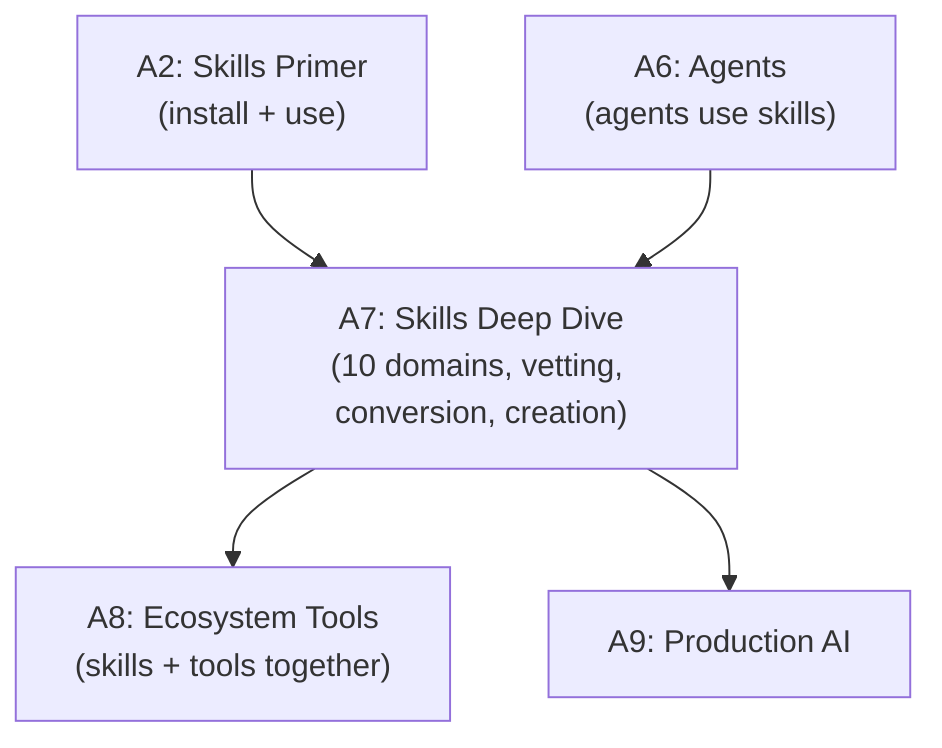

# Tier A7 — Skills Ecosystem Deep Dive

> The full skills ecosystem. 10 domains, vetting, composition, conversion between agents, building your own.

---

## Purpose

By the end of A7, you can:

- Navigate the entire skills ecosystem across 10 domains
- Evaluate any skill in 5 minutes (before installing)
- Vet skills for security (`openclaw-skill-vetter-mcp`)
- Understand progressive disclosure mechanically
- Compose skills into a layered stack
- Convert skills between agent ecosystems (Antigravity ↔ Codex ↔ Cursor ↔ Claude Code)
- Build your own skill with SKILL.md + references + scripts
- Know when to install vs build

A7 is where you go from "user of skills" to "operator and creator of the skills ecosystem."

---

## Anchored Project

**A7: Skill conversion tool + custom skill**

Two artifacts:

1. **A skill conversion tool** — a CLI or script that takes a skill from one agent ecosystem (e.g., Claude Code) and produces a version for another (e.g., Antigravity), handling paths, config, and tool references automatically. You proved this works manually; now build the tooling.

2. **A custom skill you built from scratch** — a skill solving a problem you actually have (e.g., "generate ADRs from my project's git history," "review PRs against our team's specific standards"). Includes SKILL.md, reference files, and any bundled scripts.

**What it proves**: you can navigate, evaluate, convert, and create in the skills ecosystem — the highest-leverage skill in modern AI engineering.

**Deliverables**:

- `projects/08-coding-assistant-mcp/skill-converter/` — the conversion tool
- `projects/08-coding-assistant-mcp/custom-skill/` — your own skill
- `skills-installed.md` — the full vetted skill stack with rationale
- README documenting the layered stack and conversion process

---

## How A7 Fits the Architecture

**What it produces**: the full skills capability — evaluate, vet, compose, convert, create.

---

## Topics (Linear Spine)

### A7.1 — The Skills Ecosystem Landscape

- **What skills are (deeper)**: folders with SKILL.md + reference files + scripts; auto-loaded by description match
  `KNOW` · `Anchor: A7-conversion-tool` · `Deps: A2.6 skills-primer` · `Fails: missing the ecosystem's leverage` · `Interview: Y` · `Artifact: —` · `Mistake: thinking skills are just prompts` · `Ref: A7.2 mechanics` · `Theory 40/Practice 60` · `Cost: free` · `Reading: 30 min`

- **The open standard (agentskills.io)**: format converging across agents
  `KNOW` · `Anchor: A7-conversion-tool` · `Deps: A7.1 what` · `Fails: platform-locked skills` · `Interview: S` · `Artifact: —` · `Mistake: assuming formats are incompatible` · `Ref: A7.5 conversion` · `Theory 50/Practice 50` · `Cost: free` · `Reading: 30 min`

- **Platform-specific paths**: `~/.claude/skills/`, `.codex/skills/`, `.cursor/skills/`, Antigravity's path
  `KNOW` · `Anchor: A7-conversion-tool` · `Deps: A7.1 standard` · `Fails: skills not loaded due to wrong path` · `Interview: N` · `Artifact: —` · `Mistake: not knowing where each agent looks` · `Ref: A7.5 conversion` · `Theory 30/Practice 70` · `Cost: free` · `Reading: 25 min`

- **Curated discovery sources**: `VoltAgent/awesome-agent-skills`, `BehiSecc/awesome-claude-skills`, `skills.sh` leaderboard, `mdskills.ai`, `mcp.directory`
  `USE` · `Anchor: A7-conversion-tool` · `Deps: A7.1 what` · `Fails: unaware of quality skills` · `Interview: N` · `Artifact: discovery-sources.md` · `Mistake: relying on stars alone (install telemetry better)` · `Ref: A7.4 vetting` · `Theory 20/Practice 80` · `Cost: free` · `Reading: 30 min`

- **The 10 domains overview**: frontend, backend, security, code comprehension, 3D/game, docs, testing/review, workflow, MCP, discovery
  `KNOW` · `Anchor: A7-conversion-tool` · `Deps: A7.1 discovery` · `Fails: no map of the ecosystem` · `Interview: S` · `Artifact: —` · `Mistake: installing without understanding categories` · `Ref: A7.3 domains` · `Theory 40/Practice 60` · `Cost: free` · `Reading: 30 min`

**Deep-dive candidates**: skills ecosystem map, discovery workflow — generate on demand.

---

### A7.2 — Progressive Disclosure Mechanics

- **How loading works**: name + description loaded at startup; full content on invocation
  `KNOW` · `Anchor: A7-conversion-tool` · `Deps: A7.1 what` · `Fails: confusion about context efficiency` · `Interview: Y` · `Artifact: —` · `Mistake: thinking all skills cost context always` · `Ref: A7.2 writing` · `Theory 60/Practice 40` · `Cost: free` · `Reading: 35 min`

- **Why the description matters**: it's the trigger; vague descriptions = skills never load
  `BUILD` · `Anchor: A7-conversion-tool` · `Deps: A7.2 how` · `Fails: good skills never invoked` · `Interview: Y` · `Artifact: description-patterns.md` · `Mistake: generic descriptions` · `Ref: A7.6 build` · `Theory 40/Practice 60` · `Cost: free` · `Reading: 40 min`

- **Context efficiency**: why 50 installed skills don't slow the agent
  `KNOW` · `Anchor: A7-conversion-tool` · `Deps: A7.2 how` · `Fails: bloating context with always-loaded content` · `Interview: S` · `Artifact: —` · `Mistake: putting everything in the description` · `Ref: A7.2 description` · `Theory 50/Practice 50` · `Cost: free` · `Reading: 30 min`

- **Reference files**: split SKILL.md into progressive layers (main + references/)
  `BUILD` · `Anchor: A7-conversion-tool` · `Deps: A7.2 context` · `Fails: massive SKILL.md files hurt loading` · `Interview: S` · `Artifact: reference-files.md` · `Mistake: everything in one file` · `Ref: A7.6 build` · `Theory 30/Practice 70` · `Cost: free` · `Reading: 40 min`

- **Bundled scripts**: deterministic steps as scripts; model judgment where scripts can't help
  `BUILD` · `Anchor: A7-conversion-tool` · `Deps: A7.2 references` · `Fails: model does mechanically-precise work poorly` · `Interview: S` · `Artifact: bundled-scripts.md` · `Mistake: scripts for everything (loses flexibility)` · `Ref: A7.6 build` · `Theory 40/Practice 60` · `Cost: free` · `Reading: 40 min`

**Deep-dive candidates**: description patterns, reference-file architecture — generate on demand.

---

### A7.3 — The 10 Domains

- **Frontend/UI/UX skills**: UI/UX Pro Max, Taste Skill, design-skills (Cuellar), design-auditor, frontend-design-pro
  `USE` · `Anchor: A7-conversion-tool` · `Deps: A7.2 mechanics` · `Fails: generic AI-slop design` · `Interview: Y` · `Artifact: frontend-skills.md` · `Mistake: installing all of them (overlap)` · `Ref: A7.7 stack` · `Theory 30/Practice 70` · `Cost: free` · `Reading: 45 min`

- **Backend/API skills**: Addy's api-and-interface-design, Jeffallan's schema-guard, Matt's improve-codebase-architecture, RFC skills
  `USE` · `Anchor: A7-conversion-tool` · `Deps: A7.2 mechanics` · `Fails: reinventing backend patterns` · `Interview: Y` · `Artifact: backend-skills.md` · `Mistake: ignoring existing skills` · `Ref: A7.7 stack` · `Theory 30/Practice 70` · `Cost: free` · `Reading: 45 min`

- **Security skills**: sast-skills (utkusen), llm-sast-scanner, Trail of Bits, Semgrep MCP, Snyk MCP, **openclaw-skill-vetter**
  `USE` · `Anchor: A7-conversion-tool` · `Deps: A7.2 mechanics` · `Fails: unvetted code paths; supply chain attacks` · `Interview: Y` · `Artifact: security-skills.md` · `Mistake: skipping vetting (mandatory)` · `Ref: A7.4 vetting` · `Theory 40/Practice 60` · `Cost: free` · `Reading: 50 min`

- **Codebase comprehension skills**: graphify, codebase-memory-mcp, Code Graph RAG, ast-grep, RepoMap, SocratiCode
  `USE` · `Anchor: A7-conversion-tool` · `Deps: A7.2 mechanics` · `Fails: agent re-greps the same code every time` · `Interview: Y` · `Artifact: comprehension-skills.md` · `Mistake: no code map for large repos` · `Ref: A7.7 stack` · `Theory 30/Practice 70` · `Cost: free` · `Reading: 50 min`

- **3D/game dev skills**: cc-blender-skill, Three.js Skill Package, Godot Skill, unity-game-skills, Game Developer Skill, Shader Techniques
  `USE` · `Anchor: A7-conversion-tool` · `Deps: A7.2 mechanics` · `Fails: no 3D capability` · `Interview: N` · `Artifact: 3d-skills.md` · `Mistake: installing all engines' skills (overlap)` · `Ref: A7.7 stack` · `Theory 30/Practice 70` · `Cost: local` · `Reading: 45 min`

- **Documentation skills**: Addy's documentation-and-adrs, Joel Parker Henderson's ADR Skill, mermaid-diagrams (Magnus), RFC Skills
  `USE` · `Anchor: A7-conversion-tool` · `Deps: A7.2 mechanics` · `Fails: docs rot; ADRs never written` · `Interview: S` · `Artifact: docs-skills.md` · `Mistake: generic documentation (worse than none)` · `Ref: A7.7 stack` · `Theory 30/Practice 70` · `Cost: free` · `Reading: 40 min`

- **Testing/review skills**: anthroos code-review, Matt's spec-review, agentic-pr-evaluator, pypict-test-designer, Playwright skill
  `USE` · `Anchor: A7-conversion-tool` · `Deps: A7.2 mechanics` · `Fails: no automated review; bugs ship` · `Interview: Y` · `Artifact: testing-skills.md` · `Mistake: false positives; noise` · `Ref: A7.7 stack` · `Theory 30/Practice 70` · `Cost: free` · `Reading: 50 min`

- **Workflow/planning skills**: Superpowers (obra), Matt Pocock, Addy Osmani, grill-me, write-a-prd, prd-to-issues, dev-workflow
  `USE` · `Anchor: A7-conversion-tool` · `Deps: A7.2 mechanics` · `Fails: chaotic development; no methodology` · `Interview: S` · `Artifact: workflow-skills.md` · `Mistake: installing overlapping methodologies` · `Ref: A7.7 stack` · `Theory 30/Practice 70` · `Cost: free` · `Reading: 50 min`

- **MCP servers**: Context7, Playwright CLI, Chrome DevTools, GitHub, Figma, Blender, Sequential Thinking, GitMCP
  `USE` · `Anchor: A7-conversion-tool` · `Deps: A7.2 mechanics` · `Fails: missing critical tooling` · `Interview: Y` · `Artifact: mcp-servers.md` · `Mistake: installing all (some incompatible)` · `Ref: A7.7 stack, A8` · `Theory 30/Practice 70` · `Cost: free` · `Reading: 50 min`

**Deep-dive candidates**: any specific domain (frontend, security, etc.) — generate on demand.

---

### A7.4 — Skill Vetting (Mandatory)

- **Why vetting matters**: skills can execute scripts, make network calls, read files; supply-chain attack vector (OWASP AST02)
  `KNOW` · `Anchor: A7-conversion-tool` · `Deps: A7.3 security` · `Fails: compromised agent; data exfiltration` · `Interview: S` · `Artifact: —` · `Mistake: installing popular skills without vetting` · `Ref: A7.4 workflow` · `Theory 60/Practice 40` · `Cost: free` · `Reading: 30 min`

- **`openclaw-skill-vetter-mcp`**: 41 detection rules, 0-100 risk score, BLOCK/REVIEW/CAUTION/CLEAN
  `USE` · `Anchor: A7-conversion-tool` · `Deps: A7.4 why` · `Fails: no systematic vetting` · `Interview: N` · `Artifact: vetter-config.md` · `Mistake: not using it on every install` · `Ref: A7.4 workflow` · `Theory 30/Practice 70` · `Cost: free` · `Reading: 40 min`

- **The vetting workflow**: install vetter → scan skill → review risk score → install if clean
  `BUILD` · `Anchor: A7-conversion-tool` · `Deps: A7.4 vetter` · `Fails: ad-hoc vetting; missed threats` · `Interview: N` · `Artifact: vetting-workflow.md` · `Mistake: skipping on "trusted" sources` · `Ref: A7.6 build` · `Theory 30/Practice: 70` · `Cost: free` · `Reading: 35 min`

- **Reading the risk score**: what triggers BLOCK vs REVIEW vs CAUTION vs CLEAN
  `USE` · `Anchor: A7-conversion-tool` · `Deps: A7.4 workflow` · `Fails: ignoring risk signals` · `Interview: N` · `Artifact: risk-scores.md` · `Mistake: treating REVIEW as safe` · `Ref: A7.4 custom-vetting` · `Theory 40/Practice 60` · `Cost: free` · `Reading: 30 min`

- **Custom vetting for specific domains**: extra checks for security-critical or 3D skills
  `BUILD` · `Anchor: A7-conversion-tool` · `Deps: A7.4 risk-scores` · `Fails: generic vetting misses domain-specific risks` · `Interview: N` · `Artifact: custom-vetting.md` · `Mistake: no domain awareness` · `Ref: A7.4 workflow` · `Theory 40/Practice 60` · `Cost: free` · `Reading: 35 min`

**Deep-dive candidates**: openclaw vetter setup, custom vetting rules — generate on demand.

---

### A7.5 — Skill Conversion Between Agents

- **The portable core**: what's agent-agnostic (SKILL.md body, references, scripts)
  `KNOW` · `Anchor: A7-conversion-tool` · `Deps: A7.4 vetting` · `Fails: throwing away working skills because they're for another agent` · `Interview: S` · `Artifact: —` · `Mistake: assuming skills are locked to their source agent` · `Ref: A7.5 pattern` · `Theory 50/Practice 50` · `Cost: free` · `Reading: 30 min`

- **What differs**: paths, config files, tool references, MCP server names
  `KNOW` · `Anchor: A7-conversion-tool` · `Deps: A7.5 portable` · `Fails: breaking skills during conversion` · `Interview: S` · `Artifact: differences.md` · `Mistake: not checking tool availability` · `Ref: A7.5 adaptation` · `Theory 40/Practice 60` · `Cost: free` · `Reading: 35 min`

- **The conversion pattern**: analyze source → extract pattern → adapt to target → validate
  `BUILD` · `Anchor: A7-conversion-tool` · `Deps: A7.5 differences` · `Fails: broken converted skills` · `Interview: Y` · `Artifact: conversion-pattern.md` · `Mistake: mechanical rewrite without testing` · `Ref: A7.5 tool` · `Theory 40/Practice 60` · `Cost: free` · `Reading: 45 min`

- **Building the conversion tool**: automated skill porting (Claude Code → Antigravity, Codex → Cursor, etc.)
  `BUILD` · `Anchor: A7-conversion-tool` · `Deps: A7.5 pattern` · `Fails: manual conversion doesn't scale` · `Interview: S` · `Artifact: skill-converter/` · `Mistake: tool without validation` · `Ref: A7.6 build` · `Theory 30/Practice 70` · `Cost: free` · `Reading: 60 min`

- **Validation of converted skills**: test that behavior is identical
  `BUILD` · `Anchor: A7-conversion-tool` · `Deps: A7.5 tool` · `Fails: silent regressions after conversion` · `Interview: S` · `Artifact: validation.ts` · `Mistake: no validation` · `Ref: A9 testing` · `Theory 30/Practice 70` · `Cost: free` · `Reading: 40 min`

- **Publishing converted skills**: contributing back to the community
  `KNOW` · `Anchor: A7-conversion-tool` · `Deps: A7.5 validation` · `Fails: duplicated conversion work across the community` · `Interview: N` · `Artifact: —` · `Mistake: not publishing improvements` · `Ref: A7.6 build` · `Theory 50/Practice 50` · `Cost: free` · `Reading: 30 min`

**Deep-dive candidates**: conversion tool implementation, validation patterns — generate on demand.

---

### A7.6 — Building Your Own Skill

- **When to build vs install**: 5-minute decision framework (Is there an existing one? Is it maintained? Does it fit?)
  `KNOW` · `Anchor: A7-custom-skill` · `Deps: A7.5 conversion` · `Fails: reinventing existing skills or installing inadequate ones` · `Interview: S` · `Artifact: —` · `Mistake: building what already exists or installing what doesn't fit` · `Ref: A7.6 skil-creator` · `Theory 50/Practice 50` · `Cost: free` · `Reading: 30 min`

- **The `skill-creator` pattern**: Anthropic's official meta-skill for building skills
  `USE` · `Anchor: A7-custom-skill` · `Deps: A7.6 build-vs-install` · `Fails: poorly-structured skills` · `Interview: N` · `Artifact: skill-creator-setup.md` · `Mistake: not using the standard pattern` · `Ref: A7.6 authoring` · `Theory 20/Practice 80` · `Cost: free` · `Reading: 35 min`

- **SKILL.md authoring**: frontmatter (name, description), body, examples
  `BUILD` · `Anchor: A7-custom-skill` · `Deps: A7.6 skill-creator` · `Fails: skill never loads; wrong triggers` · `Interview: Y` · `Artifact: SKILL.md` · `Mistake: vague description, no examples` · `Ref: A7.2 description` · `Theory 30/Practice 70` · `Cost: free` · `Reading: 45 min`

- **Reference files organization**: when to split; hierarchy of detail
  `BUILD` · `Anchor: A7-custom-skill` · `Deps: A7.6 authoring` · `Fails: massive SKILL.md files hurt loading` · `Interview: S` · `Artifact: references/` · `Mistake: everything in the main file` · `Ref: A7.2 references` · `Theory 30/Practice 70` · `Cost: free` · `Reading: 40 min`

- **Bundled scripts**: mechanical steps as scripts; judgment steps as instructions
  `BUILD` · `Anchor: A7-custom-skill` · `Deps: A7.6 references` · `Fails: model does deterministic work poorly` · `Interview: S` · `Artifact: scripts/` · `Mistake: scripts for everything (loses flexibility)` · `Ref: A7.2 scripts` · `Theory 40/Practice 60` · `Cost: local` · `Reading: 45 min`

- **Testing your skill**: how to validate it works correctly
  `BUILD` · `Anchor: A7-custom-skill` · `Deps: A7.6 scripts` · `Fails: skills that fail silently` · `Interview: S` · `Artifact: skill-tests.md` · `Mistake: no test cases` · `Ref: A9 testing` · `Theory 30/Practice 70` · `Cost: free` · `Reading: 40 min`

- **Portable skill design**: writing skills that work across Antigravity, Codex, Cursor, Claude Code from day one
  `BUILD` · `Anchor: A7-custom-skill` · `Deps: A7.6 testing` · `Fails: platform-locked skills` · `Interview: N` · `Artifact: portable-skill.md` · `Mistake: agent-specific assumptions` · `Ref: A7.5 conversion` · `Theory 40/Practice 60` · `Cost: free` · `Reading: 40 min`

**Deep-dive candidates**: SKILL.md authoring guide, portable skill patterns — generate on demand.

---

### A7.7 — The Layered Stack

- **Layer 1: Core workflow**: Superpowers OR Matt Pocock (pick one)
  `USE` · `Anchor: A7-conversion-tool` · `Deps: A7.6 build` · `Fails: no consistent dev methodology` · `Interview: N` · `Artifact: layer1.md` · `Mistake: installing both (conflicts)` · `Ref: A7.7 layer2` · `Theory 30/Practice 70` · `Cost: free` · `Reading: 40 min`

- **Layer 2: Domain skills**: frontend, backend, security, 3D (pick per active project)
  `USE` · `Anchor: A7-conversion-tool` · `Deps: A7.7 layer1` · `Fails: generic outputs without domain expertise` · `Interview: N` · `Artifact: layer2.md` · `Mistake: installing all domains at once` · `Ref: A7.7 layer3` · `Theory 30/Practice 70` · `Cost: free` · `Reading: 40 min`

- **Layer 3: Code comprehension**: graphify OR codebase-memory-mcp OR ast-grep (for large repos)
  `USE` · `Anchor: A7-conversion-tool` · `Deps: A7.7 layer2` · `Fails: agent re-explores the codebase every session` · `Interview: N` · `Artifact: layer3.md` · `Mistake: installing before the repo needs it` · `Ref: A7.7 layer4` · `Theory 30/Practice 70` · `Cost: free` · `Reading: 35 min`

- **Layer 4: Review**: anthroos code-review + Matt's spec-review
  `USE` · `Anchor: A7-conversion-tool` · `Deps: A7.7 layer3` · `Fails: PRs merge without review` · `Interview: N` · `Artifact: layer4.md` · `Mistake: too many overlapping reviewers` · `Ref: A7.7 layer5` · `Theory 30/Practice 70` · `Cost: free` · `Reading: 40 min`

- **Layer 5: MCP foundation**: Context7 + Playwright CLI + Chrome DevTools MCP + GitHub MCP
  `USE` · `Anchor: A7-conversion-tool` · `Deps: A7.7 layer4` · `Fails: stale library knowledge; no browser testing` · `Interview: N` · `Artifact: layer5.md` · `Mistake: MCP servers without vetting` · `Ref: A7.7 layer6` · `Theory 20/Practice 80` · `Cost: free` · `Reading: 45 min`

- **Layer 6: Discovery + vetting**: awesome lists + skills.sh + openclaw vetter
  `USE` · `Anchor: A7-conversion-tool` · `Deps: A7.7 layer5` · `Fails: unaware of new skills; unvetted installs` · `Interview: N` · `Artifact: layer6.md` · `Mistake: skipping vetting in a hurry` · `Ref: A7.4 vetting` · `Theory 30/Practice 70` · `Cost: free` · `Reading: 40 min`

- **Overlap avoidance**: don't install 200 overlapping skills; each layer picks one option
  `KNOW` · `Anchor: A7-conversion-tool` · `Deps: A7.7 layer6` · `Fails: context bloat; conflicting triggers` · `Interview: N` · `Artifact: —` · `Mistake: "just in case" installs` · `Ref: A7.7 layer1` · `Theory 40/Practice 60` · `Cost: free` · `Reading: 30 min`

- **Documenting your stack**: skills-installed.md with rationale per skill
  `BUILD` · `Anchor: A7-conversion-tool` · `Deps: A7.7 overlap` · `Fails: forgotten why skills are installed` · `Interview: N` · `Artifact: skills-installed.md` · `Mistake: no inventory` · `Ref: A7.4 vetting` · `Theory 20/Practice 80` · `Cost: free` · `Reading: 35 min`

**Deep-dive candidates**: layered stack walkthrough, personal skill inventory — generate on demand.

---

## Exit Criteria

You've completed A7 when you can:

- Navigate the 10 domains and pick the right skills for each
- Vet any skill before installing (`openclaw-skill-vetter-mcp`)
- Explain progressive disclosure mechanically
- Convert a skill from one agent ecosystem to another (and validate the result)
- Build your own skill with SKILL.md + references + scripts
- Assemble a layered, non-overlapping stack that fits your workflow
- Document your stack with rationale per skill

---

## Cross-Tier References

**Depends on**: A2 (skills primer), A6 (agents use skills), Backend T6 (testing), T4.7 (secrets).

**Depended on by**:

- A8 — ecosystem tools build on skills
- A9 — production AI deploys skills at scale

---

## Common Failure Modes for the Tier as a Whole

- **Installing without vetting**: supply-chain attack vector.
- **Installing everything**: context bloat, conflicting triggers.
- **Vague descriptions**: skills never load.
- **Platform-locked skills**: can't move between agents.
- **No conversion validation**: silent regressions.
- **Massive SKILL.md files**: hurt context.
- **No inventory**: forget what's installed and why.
- **Skipping layering**: 200 skills that overlap.

---

## Why Not?

### Why Layered Stack Instead of Installing Top Skills Individually?

- **Individual top skills** — no coherence; overlapping functions.
- **Layered stack** — one per layer; complementary; no overlap.
- **Rule**: layers, not laundry lists.

### Why Vetting Is Non-Negotiable?

- Skills can execute code, make network calls, read files.
- Malicious skills are a real supply chain vector (OWASP AST02).
- `openclaw-skill-vetter-mcp` scans for 41 attack patterns.
- **Rule**: vet before install. Always.

### Why Convert Instead of Just Using the Original Agent?

- Your primary agent is Antigravity.
- Converting unlocks the entire skills ecosystem for your workflow.
- **Rule**: convert. You already proved it works.

### Why Not Use `skill-creator` Blindly?

- `skill-creator` is a template, not a strategy.
- The hard part is deciding what problem the skill solves.
- **Rule**: start with the problem, use `skill-creator` for structure.

### Why Document Your Stack?

- A year from now, you'll forget why you installed each skill.
- `skills-installed.md` with rationale is your reference.
- **Rule**: write it once; update when you add/remove.
