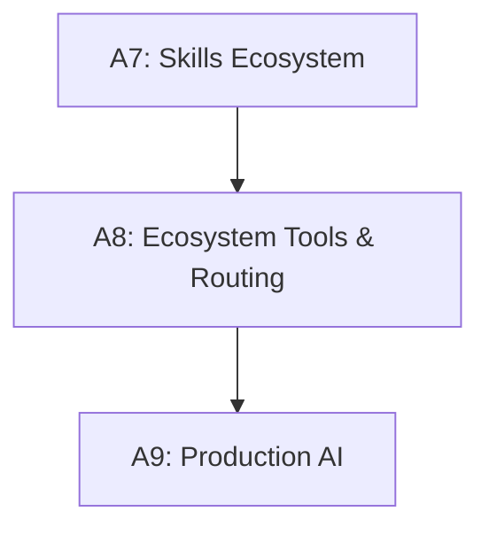

# Tier A8 — Ecosystem Tools & Agent Routing

> Understand the entire AI tool ecosystem, evaluate new tools, route tasks to the right agent.

---

## Purpose

By the end of A8, you can:

- Name and categorize every major AI tool category
- Evaluate any new tool in 5 minutes
- Choose between Antigravity, Codex, Cursor, and others for specific tasks
- Understand how terminal agents, IDEs, code review tools, and MCP servers work
- Optimize your free-tier usage across agents
- Keep track of the ecosystem as it evolves

A8 is where you go from "I use AI tools" to "I know the ecosystem and route tasks intelligently."

---

## Anchored Project

**A8: Personal AI workflow + agent routing cheatsheet**

Two artifacts:

1. **A documented personal AI workflow** — which tool for what, with rationale. Covers: coding, code review, research, docs, testing, debugging.
2. **An agent routing cheatsheet** — one page, task → agent mapping, with free-tier cost/latency notes.

**What it proves**: you have a systematic approach to the tool ecosystem, not ad-hoc tool usage.

**Deliverables**:

- `projects/10-production-ai-platform/ai-workflow.md` — your personal workflow
- `agent-routing-cheatsheet.md` — the routing guide
- `tool-evaluations.md` — your evaluations of tools you've tried

---

## How A8 Fits the Architecture

**What it produces**: the systematic tooling approach for daily work.

---

## Topics (Linear Spine)

### A8.1 — Terminal Agents

- **Antigravity**: primary agent (Jio subscription); capabilities, configuration, project setup
  `USE` · `Anchor: A8-workflow` · `Deps: A6 agents` · `Fails: unfamiliar with primary agent's capabilities` · `Interview: N` · `Artifact: antigravity-setup.md` · `Mistake: not configuring project-specific settings` · `Ref: A8.2 codex` · `Theory 20/Practice 80` · `Cost: free` · `Reading: 40 min`

- **Codex CLI**: OpenAI's terminal agent; sandboxed; free tier
  `USE` · `Anchor: A8-workflow` · `Deps: A6 agents` · `Fails: no alternate agent for tasks Antigravity handles poorly` · `Interview: N` · `Artifact: codex-setup.md` · `Mistake: ignoring sandbox benefits` · `Ref: A8.1 antigravity` · `Theory 20/Practice 80` · `Cost: free` · `Reading: 35 min`

- **Gemini CLI**: Google's open-source terminal agent; generous free tier (60 req/min, 1000/day)
  `USE` · `Anchor: A8-workflow` · `Deps: A6 agents` · `Fails: missing a free, high-quota agent` · `Interview: N` · `Artifact: gemini-cli-setup.md` · `Mistake: not exploiting generous free tier` · `Ref: A8.2` · `Theory 20/Practice 80` · `Cost: free` · `Reading: 30 min`

- **Claude Code**: Anthropic's terminal agent (awareness — requires paid subscription)
  `KNOW` · `Anchor: A8-workflow` · `Deps: A6 agents` · `Fails: unaware of the ecosystem leader` · `Interview: N` · `Artifact: —` · `Mistake: assuming you need it (you don't; Antigravity + Codex suffice)` · `Ref: A8.1 antigravity` · `Theory 50/Practice 50` · `Cost: paid-awareness` · `Reading: 25 min`

- **WrenCode**: minimal Claude Code alternative (single Python file); understand the agent loop
  `KNOW` · `Anchor: A8-workflow` · `Deps: A6 agent-loop` · `Fails: black-box understanding of how agents work` · `Interview: N` · `Artifact: —` · `Mistake: not reading the source (educational)` · `Ref: A6.2 loop` · `Theory 30/Practice 70` · `Cost: free` · `Reading: 30 min`

**Deep-dive candidates**: Antigravity setup guide, Codex CLI workflow — generate on demand.

---

### A8.2 — IDE-Integrated AI

- **Cursor**: VS Code fork with AI-native editing; Composer; free tier
  `USE` · `Anchor: A8-workflow` · `Deps: A8.1 terminal` · `Fails: missing multi-file editing capabilities` · `Interview: N` · `Artifact: cursor-setup.md` · `Mistake: using for everything (free tier limited)` · `Ref: A8.3 routing` · `Theory 20/Practice 80` · `Cost: free` · `Reading: 40 min`

- **GitHub Copilot**: original AI pair programmer; agent mode; free tier (2,000 completions/mo)
  `USE` · `Anchor: A8-workflow` · `Deps: A8.1 terminal` · `Fails: no inline completion` · `Interview: N` · `Artifact: copilot-setup.md` · `Mistake: not using autocomplete strategically` · `Ref: A8.3 routing` · `Theory 20/Practice 80` · `Cost: free` · `Reading: 30 min`

- **Cline**: open-source VS Code agent; BYOK; local model support
  `KNOW` · `Anchor: A8-workflow` · `Deps: A8.1 terminal` · `Fails: unaware of BYOK alternatives` · `Interview: N` · `Artifact: —` · `Mistake: assuming hosted-only options exist` · `Ref: A8.1` · `Theory 40/Practice 60` · `Cost: free` · `Reading: 35 min`

- **Windsurf, Zed, Kilo Code**: alternatives; when each makes sense
  `KNOW` · `Anchor: A8-workflow` · `Deps: A8.2 cursor` · `Fails: unaware of alternatives` · `Interview: N` · `Artifact: —` · `Mistake: switching IDEs constantly` · `Ref: A8.3 routing` · `Theory 50/Practice 50` · `Cost: free` · `Reading: 30 min`

- **When to use IDE-integrated vs terminal agents**: inline edits vs full-repo work
  `KNOW` · `Anchor: A8-workflow` · `Deps: A8.2 cursor` · `Fails: wrong tool for the task` · `Interview: S` · `Artifact: —` · `Mistake: forcing one tool for all cases` · `Ref: A8.3 routing` · `Theory 50/Practice 50` · `Cost: free` · `Reading: 35 min`

**Deep-dive candidates**: Cursor vs Antigravity workflow, Copilot inline patterns — generate on demand.

---

### A8.3 — Agent Routing

- **Task classification**: coding, debugging, refactoring, exploration, review, research, docs
  `KNOW` · `Anchor: A8-workflow` · `Deps: A8.2 ide` · `Fails: wrong tool for the task` · `Interview: S` · `Artifact: task-taxonomy.md` · `Mistake: one agent for everything` · `Ref: A8.3 matrix` · `Theory 40/Practice 60` · `Cost: free` · `Reading: 35 min`

- **Antigravity vs Codex vs Cursor capability matrix**: strengths, weaknesses, quotas
  `BUILD` · `Anchor: A8-workflow` · `Deps: A8.3 task` · `Fails: no systematic agent choice` · `Interview: S` · `Artifact: agent-matrix.md` · `Mistake: using Antigravity for tasks Codex handles better` · `Ref: A8.3 cheatsheet` · `Theory 30/Practice 70` · `Cost: free` · `Reading: 45 min`

- **Free tier optimization**: maximizing value across quotas
  `BUILD` · `Anchor: A8-workflow` · `Deps: A8.3 matrix` · `Fails: burning through quotas fast` · `Interview: N` · `Artifact: free-tier-strategy.md` · `Mistake: using premium agent for trivial tasks` · `Ref: A8.3 local-fallback` · `Theory 20/Practice 80` · `Cost: free` · `Reading: 40 min`

- **Local fallback with Ollama**: when free tiers run out
  `USE` · `Anchor: A8-workflow` · `Deps: A8.3 free-tier` · `Fails: no work possible when quotas exhausted` · `Interview: N` · `Artifact: ollama-fallback.md` · `Mistake: no local option ready` · `Ref: A1.2 ollama` · `Theory 20/Practice 80` · `Cost: local` · `Reading: 35 min`

- **Multi-agent workflows**: using different agents for different phases
  `BUILD` · `Anchor: A8-workflow` · `Deps: A8.3 matrix` · `Fails: no coordination; context lost between agents` · `Interview: S` · `Artifact: multi-agent.md` · `Mistake: parallel agents working on the same file` · `Ref: A6.5 multi-agent` · `Theory 40/Practice 60` · `Cost: free` · `Reading: 45 min`

- **The routing cheatsheet**: one page; task → agent mapping
  `BUILD` · `Anchor: A8-workflow` · `Deps: A8.3 multi-agent` · `Fails: no quick reference for daily decisions` · `Interview: N` · `Artifact: agent-routing-cheatsheet.md` · `Mistake: not maintaining it as tools change` · `Ref: A8.4 eval` · `Theory 20/Practice 80` · `Cost: free` · `Reading: 40 min`

**Deep-dive candidates**: agent capability matrix, free-tier strategies — generate on demand.

---

### A8.4 — Code Review Tools

- **CodeRabbit**: line-by-line PR review; best DX; free for public repos
  `USE` · `Anchor: A8-workflow` · `Deps: A8.3 routing` · `Fails: PRs merge without systematic review` · `Interview: N` · `Artifact: coderabbit-setup.md` · `Mistake: expecting it to catch >63% of issues` · `Ref: A8.4 alternatives` · `Theory 30/Practice 70` · `Cost: free` · `Reading: 35 min`

- **Greptile, Qodo, Cursor BugBot, Macroscope**: alternatives; when each fits
  `KNOW` · `Anchor: A8-workflow` · `Deps: A8.4 coderabbit` · `Fails: unaware of better options for specific repos` · `Interview: N` · `Artifact: —` · `Mistake: paying for multiple review tools` · `Ref: A8.4 open-source` · `Theory 50/Practice 50` · `Cost: free` · `Reading: 40 min`

- **Open-source review skills**: anthroos code-review, Matt's spec-review, agentic-pr-evaluator, Review Council
  `USE` · `Anchor: A8-workflow` · `Deps: A8.4 alternatives` · `Fails: no in-agent review alternative` · `Interview: N` · `Artifact: review-skills.md` · `Mistake: no integration with agent workflow` · `Ref: A7.3 testing` · `Theory 30/Practice 70` · `Cost: free` · `Reading: 40 min`

- **Complementary: Snyk, Semgrep**: security scanning alongside review
  `USE` · `Anchor: A8-workflow` · `Deps: A8.4 open-source` · `Fails: missing security-specific analysis` · `Interview: N` · `Artifact: security-scanning.md` · `Mistake: relying on AI review for security alone` · `Ref: A7.3 security` · `Theory 30/Practice 70` · `Cost: free` · `Reading: 35 min`

- **When review tools matter vs when they don't**: solo projects vs teams
  `KNOW` · `Anchor: A8-workflow` · `Deps: A8.4 security` · `Fails: over-tooling for small projects` · `Interview: N` · `Artifact: —` · `Mistake: mandatory review on trivial changes` · `Ref: A8.3 routing` · `Theory 50/Practice 50` · `Cost: free` · `Reading: 30 min`

**Deep-dive candidates**: CodeRabbit setup, review skill integration — generate on demand.

---

### A8.5 — Research & Documentation Tools

- **Perplexity**: AI search with citations; best for API/docs research
  `USE` · `Anchor: A8-workflow` · `Deps: A8.3 routing` · `Fails: manual search for library docs` · `Interview: N` · `Artifact: perplexity-workflow.md` · `Mistake: trusting answers without checking citations` · `Ref: A8.5 deepwiki` · `Theory 20/Practice 80` · `Cost: free` · `Reading: 25 min`

- **DeepWiki**: AI-generated docs for any GitHub repo
  `USE` · `Anchor: A8-workflow` · `Deps: A8.5 perplexity` · `Fails: reverse-engineering unfamiliar repos` · `Interview: N` · `Artifact: deepwiki-workflow.md` · `Mistake: treating generated docs as authoritative` · `Ref: A8.5 context7` · `Theory 20/Practice 80` · `Cost: free` · `Reading: 30 min`

- **Context7**: version-specific library docs via MCP
  `USE` · `Anchor: A8-workflow` · `Deps: A8.5 deepwiki` · `Fails: model uses stale library APIs` · `Interview: N` · `Artifact: context7-setup.md` · `Mistake: not adding to agent config` · `Ref: A7.3 mcp` · `Theory 20/Practice 80` · `Cost: free` · `Reading: 35 min`

- **Diagramming tools**: Mermaid, Excalidraw, draw.io
  `USE` · `Anchor: A8-workflow` · `Deps: A8.5 context7` · `Fails: no architecture visualization` · `Interview: N` · `Artifact: diagram-tools.md` · `Mistake: one tool for everything` · `Ref: System Design T0` · `Theory 30/Practice 70` · `Cost: free` · `Reading: 30 min`

**Deep-dive candidates**: research workflow, Context7 integration — generate on demand.

---

### A8.6 — The Evaluation Framework

- **The 5-minute assessment**: does it solve a real problem? fit my stack? free tier? lock-in? maintained?
  `BUILD` · `Anchor: A8-workflow` · `Deps: A8.5 research` · `Fails: adopting tools that don't fit; wasted effort` · `Interview: N` · `Artifact: evaluation-template.md` · `Mistake: adopting on hype` · `Ref: A8.6 red-flags` · `Theory 40/Practice 60` · `Cost: free` · `Reading: 35 min`

- **Red flags**: paid-only, single-vendor, no updates, overhyped, obscure governance
  `KNOW` · `Anchor: A8-workflow` · `Deps: A8.6 assessment` · `Fails: adopting tools that die or trap you` · `Interview: N` · `Artifact: red-flags.md` · `Mistake: ignoring warning signs` · `Ref: A8.6 green-flags` · `Theory 50/Practice 50` · `Cost: free` · `Reading: 30 min`

- **Green flags**: open source, active community, references + evals, layered design
  `KNOW` · `Anchor: A8-workflow` · `Deps: A8.6 red-flags` · `Fails: overlooking quality tools` · `Interview: N` · `Artifact: green-flags.md` · `Mistake: star count as sole criterion` · `Ref: A8.6 verdict` · `Theory 40/Practice 60` · `Cost: free` · `Reading: 30 min`

- **The verdict framework**: Adopt / Trial / Hold / Skip
  `BUILD` · `Anchor: A8-workflow` · `Deps: A8.6 green-flags` · `Fails: no systematic decisions` · `Interview: N` · `Artifact: verdict-framework.md` · `Mistake: binary adopt/reject` · `Ref: A8.6 logging` · `Theory 30/Practice 70` · `Cost: free` · `Reading: 30 min`

- **Logging evaluations**: tool-evaluations.md; when to revisit
  `BUILD` · `Anchor: A8-workflow` · `Deps: A8.6 verdict` · `Fails: forgetting why you rejected a tool` · `Interview: N` · `Artifact: tool-evaluations.md` · `Mistake: no log; re-evaluating from scratch` · `Ref: A8.7 landscape` · `Theory 20/Practice 80` · `Cost: free` · `Reading: 35 min`

**Deep-dive candidates**: evaluation template, log structure — generate on demand.

---

### A8.7 — The AI Landscape File

- **Why a living document**: ecosystem changes monthly; static curricula go stale
  `KNOW` · `Anchor: A8-workflow` · `Deps: A8.6 eval` · `Fails: unaware of new tools` · `Interview: N` · `Artifact: —` · `Mistake: assuming current tools stay optimal` · `Ref: A8.7 update` · `Theory 40/Practice 60` · `Cost: free` · `Reading: 25 min`

- **What it tracks**: tool categories, MCP servers, skill categories, model families, protocol standards
  `KNOW` · `Anchor: A8-workflow` · `Deps: A8.7 why` · `Fails: no systematic tracking` · `Interview: N` · `Artifact: —` · `Mistake: tracking everything (noise)` · `Ref: A8.7 update` · `Theory 40/Practice 60` · `Cost: free` · `Reading: 30 min`

- **The update workflow**: when a new tool emerges; how to evaluate; when to add
  `BUILD` · `Anchor: A8-workflow` · `Deps: A8.7 what` · `Fails: outdated landscape file` · `Interview: N` · `Artifact: landscape-update.md` · `Mistake: adding without evaluating` · `Ref: A8.6 assessment` · `Theory 30/Practice 70` · `Cost: free` · `Reading: 35 min`

- **When to revisit tools you've rejected**: quarterly review; tools improve
  `KNOW` · `Anchor: A8-workflow` · `Deps: A8.7 update` · `Fails: rejecting tools that later improved` · `Interview: N` · `Artifact: revisit-cadence.md` · `Mistake: one-time decisions` · `Ref: A8.6 logging` · `Theory 40/Practice 60` · `Cost: free` · `Reading: 30 min`

**Deep-dive candidates**: landscape file structure, update cadence — generate on demand.

---

## Exit Criteria

You've completed A8 when you can:

- Categorize and name the major AI tools across every category
- Evaluate any new tool in 5 minutes using the framework
- Route tasks to the right agent (Antigravity vs Codex vs Cursor)
- Optimize free-tier usage across agents
- Fall back to local Ollama when quotas exhaust
- Use code review tools (CodeRabbit) alongside in-agent review skills
- Use research tools (Perplexity, DeepWiki, Context7) effectively
- Maintain the AI Landscape file

---

## Cross-Tier References

**Depends on**: A7 (skills ecosystem), A6 (agents), Backend T6 (code review culture).

**Depended on by**:

- A9 — production AI tools at scale

---

## Common Failure Modes for the Tier as a Whole

- **One agent for everything**: wrong tool for the task.
- **Burning quotas on trivial tasks**: exhausts free tiers fast.
- **No local fallback**: can't work when quotas exhaust.
- **Adopting tools on hype**: wasted effort, integration debt.
- **No evaluation log**: re-evaluate from scratch.
- **Outdated landscape file**: unaware of new options.
- **Too many overlapping tools**: context bloat.

---

## Why Not?

### Why Antigravity as Primary Instead of Claude Code?

- **Claude Code** — excellent but requires paid subscription.
- **Antigravity** — free via Jio; comparable capabilities.
- **Rule**: use what's free. Claude Code is awareness-level.

### Why Multiple Agents Instead of One?

- **One agent** — no fallback; hit quota walls.
- **Multiple agents** — quota spreading; right tool per task; resilience.
- **Rule**: primary + secondary + local fallback.

### Why Keep a Local Ollama Fallback?

- Free tiers run out.
- Offline work needs local models.
- **Rule**: always have a local path.

### Why Evaluate Tools Systematically?

- Hype-driven adoption is common.
- Most tools don't survive 18 months.
- **Rule**: 5-minute assessment before adopting.

### Why Log Rejected Tools?

- Tools improve.
- You might need them later.
- **Rule**: log the verdict and reasoning. Revisit quarterly.

### Why the AI Landscape File?

- The ecosystem changes constantly.
- Your reference must stay current.
- **Rule**: update when something concrete changes. Not speculatively.
