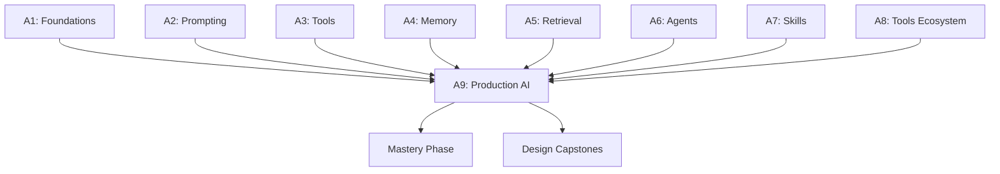

# Tier A9 — Production AI Systems

> Deploy AI applications with observability, evaluation, cost control, safety, and security.

---

## Purpose

By the end of A9, you can:

- Instrument AI applications with traces, metrics, and cost tracking
- Build evaluation pipelines that catch regressions before they ship
- Control costs through caching, routing, and budget enforcement
- Defend against prompt injection, data leaks, and unsafe tool use
- Deploy AI services with canary rollouts and rollback
- Handle rate limits, fallbacks, and multi-provider failures
- Enforce multi-tenant quotas and per-user budgets
- Comply with data residency and PII requirements

A9 is where "my AI app works on my laptop" becomes "my AI app runs in production without surprises."

---

## Anchored Project

**A9: Production AI platform**

A production-grade AI application with:

1. Full observability: traces per request, token usage, latency (TTFT + total), cost per request
2. Evaluation pipeline: fixed test set, regression detection, LLM-as-judge for quality
3. Cost controls: per-user budgets, token limits, provider routing by cost
4. Safety layers: prompt injection detection, output filtering, PII redaction
5. Security: secrets management, tool sandboxing, permission scoping
6. Deployment: canary rollout, feature flags, rollback
7. Multi-tenancy: per-tenant quotas, isolation, GDPR deletion path
8. Fallback chain: primary provider → secondary → local Ollama
9. Rate limiting: per-user, per-tenant, per-endpoint, per-provider
10. Dashboards: cost over time, error rates, p50/p95/p99 latency, eval scores

**What it proves**: you can operate an AI application in production with full control.

**Deliverables**:

- `projects/10-production-ai-platform/` — full platform
- Observability configuration (traces, metrics, dashboards)
- Evaluation pipeline
- Safety layer implementations
- README with operational runbook

---

## How A9 Fits the Architecture

**What it produces**: the production layer that makes everything else shippable.

---

## Topics (Linear Spine)

### A9.1 — Observability

- **Distributed tracing for AI**: spans per provider call, per tool, per agent iteration
  `BUILD` · `Anchor: A9-platform` · `Deps: A1` · `Fails: can't diagnose slow or failed AI requests` · `Interview: Y` · `Artifact: tracing.ts` · `Mistake: no trace context across AI operations` · `Ref: Backend T6.6, System Design T3.5.9` · `Theory 30/Practice 70` · `Cost: free` · `Reading: 45 min`

- **Token usage tracking**: input, output, cached; per request, per user, per model
  `BUILD` · `Anchor: A9-platform` · `Deps: A1.4 tokens` · `Fails: no visibility into cost drivers` · `Interview: Y` · `Artifact: token-tracking.ts` · `Mistake: counting only output tokens` · `Ref: A9.3 cost` · `Theory 30/Practice 70` · `Cost: free` · `Reading: 40 min`

- **Latency metrics**: TTFT (time-to-first-token), total latency, per-provider comparison
  `BUILD` · `Anchor: A9-platform` · `Deps: A1.4 latency` · `Fails: can't identify bottlenecks` · `Interview: Y` · `Artifact: latency-metrics.ts` · `Mistake: measuring only total latency` · `Ref: Backend T6.6` · `Theory 30/Practice 70` · `Cost: free` · `Reading: 40 min`

- **LLM-specific observability tools**: LangSmith, LangFuse, Phoenix/Arize, OpenLLMetry
  `KNOW` · `Anchor: A9-platform` · `Deps: A9.1 tracing` · `Fails: reinventing observability` · `Interview: S` · `Artifact: —` · `Mistake: assuming OpenTelemetry covers AI-specific needs` · `Ref: A9.1 tracing` · `Theory 50/Practice 50` · `Cost: free` · `Reading: 40 min`

- **Logging prompts and responses**: with PII redaction
  `BUILD` · `Anchor: A9-platform` · `Deps: A9.1 tracing` · `Fails: no debugging context; compliance issues` · `Interview: Y` · `Artifact: logging.ts` · `Mistake: logging raw PII` · `Ref: A9.5 safety, Backend T6.6` · `Theory 30/Practice 70` · `Cost: free` · `Reading: 40 min`

- **Dashboards**: cost over time, error rates, latency percentiles, eval scores, quality metrics
  `BUILD` · `Anchor: A9-platform` · `Deps: A9.1 metrics` · `Fails: no operational visibility` · `Interview: S` · `Artifact: dashboards/` · `Mistake: too many panels; unclear signals` · `Ref: Backend T6.6` · `Theory 30/Practice 70` · `Cost: free` · `Reading: 50 min`

- **Alerting**: on error rate, cost spike, latency regression, eval score drop
  `BUILD` · `Anchor: A9-platform` · `Deps: A9.1 dashboards` · `Fails: silent degradation` · `Interview: S` · `Artifact: alerts.yaml` · `Mistake: alert fatigue from too many rules` · `Ref: Backend T6.7, System Design T3.5.9` · `Theory 30/Practice 70` · `Cost: free` · `Reading: 45 min`

**Deep-dive candidates**: LLM observability stack setup, custom dashboards — generate on demand.

---

### A9.2 — Evaluation in Production

- **Offline vs online eval**: fixed test set vs real-user metrics
  `KNOW` · `Anchor: A9-platform` · `Deps: A5.8 evaluation` · `Fails: no way to measure production quality` · `Interview: Y` · `Artifact: —` · `Mistake: only offline (misses real-world drift)` · `Ref: A9.2 regression` · `Theory 50/Practice 50` · `Cost: free` · `Reading: 35 min`

- **Regression testing**: fixed test set runs on every change
  `BUILD` · `Anchor: A9-platform` · `Deps: A9.2 offline` · `Fails: silent quality regressions` · `Interview: Y` · `Artifact: regression.ts` · `Mistake: no baseline` · `Ref: A5.8 regression` · `Theory 30/Practice 70` · `Cost: free` · `Reading: 45 min`

- **LLM-as-judge at scale**: evaluator model scores every sampled request
  `BUILD` · `Anchor: A9-platform` · `Deps: A9.2 offline` · `Fails: no automated quality measurement` · `Interview: Y` · `Artifact: judge.ts` · `Mistake: weak judge model; uncalibrated rubric` · `Ref: A5.8 llm-judge` · `Theory: 40/Practice 60` · `Cost: free` · `Reading: 50 min`

- **Human review workflows**: sampling requests for human evaluation
  `KNOW` · `Anchor: A9-platform` · `Deps: A9.2 judge` · `Fails: no ground truth` · `Interview: S` · `Artifact: —` · `Mistake: human review of every request (doesn't scale)` · `Ref: A9.2 metrics` · `Theory 50/Practice 50` · `Cost: free` · `Reading: 40 min`

- **Production quality metrics**: task success, user satisfaction, correction rate
  `BUILD` · `Anchor: A9-platform` · `Deps: A9.2 judge` · `Fails: no business-level view of quality` · `Interview: S` · `Artifact: quality-metrics.ts` · `Mistake: only technical metrics (perplexity, etc.)` · `Ref: A9.1 dashboards` · `Theory 40/Practice 60` · `Cost: free` · `Reading: 45 min`

- **A/B testing prompts and models**: split traffic; measure outcomes
  `BUILD` · `Anchor: A9-platform` · `Deps: A9.2 quality-metrics` · `Fails: no data on which variant is better` · `Interview: S` · `Artifact: ab-testing.ts` · `Mistake: too many variants; too little data` · `Ref: Backend T6.5, A9.2 regression` · `Theory 40/Practice 60` · `Cost: free` · `Reading: 50 min`

- **Evaluation CI**: eval pipeline runs in CI; blocks merge on regression
  `BUILD` · `Anchor: A9-platform` · `Deps: A9.2 regression` · `Fails: regressions ship silently` · `Interview: S` · `Artifact: eval-ci.yml` · `Mistake: no CI gate` · `Ref: Backend T6.3` · `Theory 30/Practice 70` · `Cost: free` · `Reading: 40 min`

**Deep-dive candidates**: LLM-as-judge rubric design, eval CI setup — generate on demand.

---

### A9.3 — Cost Control

- **Understanding cost drivers**: input tokens, output tokens, cached tokens, per-model rates
  `KNOW` · `Anchor: A9-platform` · `Deps: A1.4 cost` · `Fails: surprise bills` · `Interview: Y` · `Artifact: —` · `Mistake: not tracking per-feature cost` · `Ref: A9.3 budgeting` · `Theory 40/Practice 60` · `Cost: free` · `Reading: 35 min`

- **Prompt caching**: provider-level prefix caching (Anthropic/OpenAI/Gemini)
  `BUILD` · `Anchor: A9-platform` · `Deps: A9.3 drivers` · `Fails: paying full cost for identical prefixes` · `Interview: Y` · `Artifact: prompt-caching.ts` · `Mistake: prompts structured to break caching` · `Ref: A4.4 prompt-caching` · `Theory 30/Practice 70` · `Cost: free` · `Reading: 45 min`

- **Semantic caching**: cache responses for semantically-similar prompts
  `BUILD` · `Anchor: A9-platform` · `Deps: A9.3 prompt-caching` · `Fails: repeated similar queries billed repeatedly` · `Interview: Y` · `Artifact: semantic-cache.ts` · `Mistake: cache hits too loose (wrong answers)` · `Ref: A5.3 embeddings` · `Theory 40/Practice 60` · `Cost: free` · `Reading: 50 min`

- **Model routing by cost**: cheaper models for simple tasks
  `BUILD` · `Anchor: A9-platform` · `Deps: A9.3 drivers` · `Fails: expensive models for trivial tasks` · `Interview: Y` · `Artifact: routing.ts` · `Mistake: routing rules that hurt quality` · `Ref: A8.3 routing` · `Theory 40/Practice 60` · `Cost: free` · `Reading: 50 min`

- **Context reduction**: summarize, truncate, drop low-value context
  `BUILD` · `Anchor: A9-platform` · `Deps: A4.4 compression` · `Fails: bloated contexts; high cost per request` · `Interview: S` · `Artifact: context-reduction.ts` · `Mistake: over-compressing critical info` · `Ref: A4.4 compression` · `Theory 30/Practice 70` · `Cost: free` · `Reading: 40 min`

- **Per-user budgets**: enforce spend caps per user/tenant
  `BUILD` · `Anchor: A9-platform` · `Deps: A9.3 drivers` · `Fails: one user drives up costs` · `Interview: Y` · `Artifact: budgets.ts` · `Mistake: no enforcement (soft alerts only)` · `Ref: A9.6 multi-tenancy` · `Theory 30/Practice 70` · `Cost: free` · `Reading: 45 min`

- **Cost forecasting**: predict monthly cost based on usage trends
  `KNOW` · `Anchor: A9-platform` · `Deps: A9.3 budgets` · `Fails: unaware of cost trajectory` · `Interview: N` · `Artifact: —` · `Mistake: no forecasting; reactive only` · `Ref: A9.1 dashboards` · `Theory 50/Practice 50` · `Cost: free` · `Reading: 35 min`

**Deep-dive candidates**: semantic cache implementation, model routing strategies — generate on demand.

---

### A9.4 — Fallback & Resilience

- **Provider fallback chain**: primary → secondary → local
  `BUILD` · `Anchor: A9-platform` · `Deps: A9.3 cost` · `Fails: service down when primary provider is unavailable` · `Interview: Y` · `Artifact: fallback.ts` · `Mistake: silent fallback without logging` · `Ref: A1.4 fallback` · `Theory 30/Practice 70` · `Cost: free` · `Reading: 45 min`

- **Circuit breakers per provider**: stop hammering a struggling provider
  `BUILD` · `Anchor: A9-platform` · `Deps: A9.4 fallback` · `Fails: cascading failures` · `Interview: Y` · `Artifact: circuit-breaker.ts` · `Mistake: no half-open state` · `Ref: Backend T5.4, System Design T3.5.3` · `Theory 40/Practice 60` · `Cost: free` · `Reading: 45 min`

- **Rate limit handling**: per-provider 429 handling; backoff; queueing
  `BUILD` · `Anchor: A9-platform` · `Deps: A1.4 rate-limits` · `Fails: hard failures on free-tier limits` · `Interview: Y` · `Artifact: rate-limit-handling.ts` · `Mistake: no queue for rate-limited requests` · `Ref: Backend T3c.5, T5.4` · `Theory 30/Practice 70` · `Cost: free` · `Reading: 45 min`

- **Timeout and retry policies**: per-provider, per-operation
  `BUILD` · `Anchor: A9-platform` · `Deps: A9.4 rate-limit` · `Fails: hanging requests; retry storms` · `Interview: Y` · `Artifact: timeouts.ts` · `Mistake: no timeout` · `Ref: A1.4 timeouts` · `Theory 30/Practice 70` · `Cost: free` · `Reading: 40 min`

- **Graceful degradation**: cached responses, reduced quality, deferred answers
  `BUILD` · `Anchor: A9-platform` · `Deps: A9.4 fallback` · `Fails: total failure instead of partial success` · `Interview: S` · `Artifact: degradation.ts` · `Mistake: no fallback path` · `Ref: Backend T5.4, System Design T3.5.3` · `Theory 40/Practice 60` · `Cost: free` · `Reading: 45 min`

- **Queueing under load**: accept requests, process asynchronously, notify
  `BUILD` · `Anchor: A9-platform` · `Deps: A9.4 rate-limit` · `Fails: sync request path can't handle bursts` · `Interview: S` · `Artifact: queueing.ts` · `Mistake: no queue; immediate 503s` · `Ref: Backend T5.2, T5.10` · `Theory 30/Practice 70` · `Cost: free` · `Reading: 50 min`

**Deep-dive candidates**: fallback architecture, degradation patterns — generate on demand.

---

### A9.5 — Safety & Security

- **Prompt injection defense in production**: input sanitization, output validation, privilege separation
  `BUILD` · `Anchor: A9-platform` · `Deps: A2.5 injection` · `Fails: jailbreaks; data exfiltration; unauthorized actions` · `Interview: Y` · `Artifact: injection-defense.ts` · `Mistake: single-layer defense` · `Ref: A2.5, A3.5` · `Theory 50/Practice 50` · `Cost: free` · `Reading: 50 min`

- **PII detection and redaction**: identify and redact sensitive data before logging or storing
  `BUILD` · `Anchor: A9-platform` · `Deps: A9.1 logging` · `Fails: compliance violations; leaked user data` · `Interview: Y` · `Artifact: pii-redaction.ts` · `Mistake: regex-only PII detection (misses edge cases)` · `Ref: Backend T6.6` · `Theory 40/Practice 60` · `Cost: free` · `Reading: 50 min`

- **Output filtering**: content moderation, format validation, guardrails
  `BUILD` · `Anchor: A9-platform` · `Deps: A9.5 injection-defense` · `Fails: unsafe outputs; compliance issues` · `Interview: Y` · `Artifact: output-filter.ts` · `Mistake: no filtering` · `Ref: A2.5 output-filter` · `Theory 40/Practice 60` · `Cost: free` · `Reading: 45 min`

- **Tool permissions and sandboxing**: least privilege; per-tool scopes; user consent
  `BUILD` · `Anchor: A9-platform` · `Deps: A3.5 safe-tools` · `Fails: over-privileged tools; unauthorized actions` · `Interview: Y` · `Artifact: tool-permissions.ts` · `Mistake: all tools always available` · `Ref: A3.5, A6.7` · `Theory 40/Practice 60` · `Cost: free` · `Reading: 50 min`

- **Secrets management**: API keys, DB credentials, tool secrets
  `BUILD` · `Anchor: A9-platform` · `Deps: A3.5 secrets` · `Fails: leaked secrets via logs, prompts, or tool outputs` · `Interview: Y` · `Artifact: secrets.ts` · `Mistake: hardcoding; passing via prompts` · `Ref: Backend T4.7` · `Theory 40/Practice 60` · `Cost: free` · `Reading: 45 min`

- **Content moderation**: OpenAI moderation, Llama Guard, custom filters
  `USE` · `Anchor: A9-platform` · `Deps: A9.5 output-filter` · `Fails: unsafe content reaches users` · `Interview: S` · `Artifact: moderation.ts` · `Mistake: relying on the model to self-moderate` · `Ref: A2.5` · `Theory 30/Practice 70` · `Cost: free` · `Reading: 40 min`

- **Security audits of skills and MCP servers**: vetting before install; scanning periodically
  `BUILD` · `Anchor: A9-platform` · `Deps: A7.4 vetting` · `Fails: compromised agent via malicious skill` · `Interview: S` · `Artifact: skill-audit.md` · `Mistake: one-time vetting only` · `Ref: A7.4, A8.4` · `Theory 40/Practice 60` · `Cost: free` · `Reading: 40 min`

**Deep-dive candidates**: injection defense in depth, PII detection patterns — generate on demand.

---

### A9.6 — Multi-Tenancy & Compliance

- **Per-tenant isolation**: separate prompts, memory, cost tracking, rate limits
  `BUILD` · `Anchor: A9-platform` · `Deps: A4.6 multi-user` · `Fails: cross-tenant leaks` · `Interview: Y` · `Artifact: tenant-isolation.ts` · `Mistake: global config for all tenants` · `Ref: Backend T7.7, System Design T3.5.5` · `Theory 40/Practice 60` · `Cost: free` · `Reading: 50 min`

- **Per-tenant quotas**: token limits, request limits, cost budgets
  `BUILD` · `Anchor: A9-platform` · `Deps: A9.6 isolation` · `Fails: one tenant exhausts shared resources` · `Interview: Y` · `Artifact: tenant-quotas.ts` · `Mistake: same limits for all tenants` · `Ref: Backend T7.7 quotas` · `Theory 30/Practice 70` · `Cost: free` · `Reading: 45 min`

- **GDPR right to access/deletion**: export and delete user data on request
  `BUILD` · `Anchor: A9-platform` · `Deps: A4.6 gdpr` · `Fails: compliance violations` · `Interview: S` · `Artifact: gdpr.ts` · `Mistake: no deletion path` · `Ref: A4.6 gdpr` · `Theory 40/Practice 60` · `Cost: free` · `Reading: 50 min`

- **Data residency**: region-aware data storage and processing
  `KNOW` · `Anchor: A9-platform` · `Deps: A9.6 gdpr` · `Fails: regulatory violations for cross-border data` · `Interview: S` · `Artifact: —` · `Mistake: single-region assumption` · `Ref: System Design T3.5.10` · `Theory 50/Practice 50` · `Cost: free` · `Reading: 40 min`

- **Audit logging**: immutable log of AI operations for compliance
  `BUILD` · `Anchor: A9-platform` · `Deps: A9.5 secrets` · `Fails: no audit trail; compliance failures` · `Interview: S` · `Artifact: audit-log.ts` · `Mistake: mutable logs; no retention policy` · `Ref: Backend T4.5` · `Theory 40/Practice 60` · `Cost: free` · `Reading: 45 min`

- **Terms of service and usage policies**: user consent, acceptable use
  `KNOW` · `Anchor: A9-platform` · `Deps: A9.6 audit` · `Fails: legal exposure` · `Interview: N` · `Artifact: —` · `Mistake: no policy documentation` · `Ref: A9.6 gdpr` · `Theory 70/Practice 30` · `Cost: free` · `Reading: 30 min`

**Deep-dive candidates**: multi-tenant AI patterns, GDPR compliance implementation — generate on demand.

---

### A9.7 — Deployment

- **Canary rollouts for AI**: 1% → 10% → 100% traffic to new model/prompt
  `BUILD` · `Anchor: A9-platform` · `Deps: A9.2 A/B testing` · `Fails: regressions ship to all users` · `Interview: S` · `Artifact: canary.ts` · `Mistake: no canary (big-bang deploys)` · `Ref: Backend T6.5` · `Theory 30/Practice 70` · `Cost: free` · `Reading: 45 min`

- **Feature flags for prompts**: enable/disable features without redeployment
  `BUILD` · `Anchor: A9-platform` · `Deps: A9.7 canary` · `Fails: no kill switch for bad prompts` · `Interview: S` · `Artifact: feature-flags.ts` · `Mistake: hardcoded prompt versions` · `Ref: Backend T6.5` · `Theory 30/Practice 70` · `Cost: free` · `Reading: 40 min`

- **Model version pinning**: pin exact model versions; don't rely on `latest`
  `BUILD` · `Anchor: A9-platform` · `Deps: A9.7 canary` · `Fails: silent model upgrades break behavior` · `Interview: S` · `Artifact: model-pinning.ts` · `Mistake: `latest` tags` · `Ref: A1.2 providers` · `Theory 30/Practice 70` · `Cost: free` · `Reading: 35 min`

- **Rollback**: previous model, previous prompt, previous code
  `BUILD` · `Anchor: A9-platform` · `Deps: A9.7 model-pinning` · `Fails: no way to undo a bad change` · `Interview: Y` · `Artifact: rollback.md` · `Mistake: no rollback plan` · `Ref: Backend T6.3` · `Theory 30/Practice 70` · `Cost: free` · `Reading: 40 min`

- **Streaming deployments**: zero-downtime updates for streaming services
  `KNOW` · `Anchor: A9-platform` · `Deps: A9.7 rollback` · `Fails: connection drops during deploy` · `Interview: S` · `Artifact: —` · `Mistake: no connection draining` · `Ref: Backend T5.9` · `Theory 40/Practice 60` · `Cost: free` · `Reading: 40 min`

- **Cost of deployment**: model warmup, cache population, first-request latency
  `KNOW` · `Anchor: A9-platform` · `Deps: A9.7 canary` · `Fails: cold-start cost spike` · `Interview: N` · `Artifact: —` · `Mistake: no warmup` · `Ref: A9.3 cost` · `Theory 50/Practice 50` · `Cost: free` · `Reading: 35 min`

**Deep-dive candidates**: canary deployment patterns, feature flag integration — generate on demand.

---

### A9.8 — Operational Runbook

- **Common failure modes**: provider outage, rate limit, latency spike, cost spike, quality regression
  `BUILD` · `Anchor: A9-platform` · `Deps: A9.7 deployment` · `Fails: chaotic incident response` · `Interview: S` · `Artifact: failure-modes.md` · `Mistake: no documentation` · `Ref: Backend T6.7` · `Theory 30/Practice 70` · `Cost: free` · `Reading: 45 min`

- **Diagnostic commands**: how to investigate each failure mode
  `BUILD` · `Anchor: A9-platform` · `Deps: A9.8 failure-modes` · `Fails: slow diagnosis` · `Interview: N` · `Artifact: diagnostics.md` · `Mistake: ad-hoc debugging` · `Ref: A9.1 observability` · `Theory 30/Practice 70` · `Cost: free` · `Reading: 40 min`

- **Mitigation playbooks**: actions per failure mode
  `BUILD` · `Anchor: A9-platform` · `Deps: A9.8 diagnostics` · `Fails: no rapid response` · `Interview: S` · `Artifact: mitigation.md` · `Mistake: no runbook` · `Ref: Backend T6.7 runbook` · `Theory 30/Practice 70` · `Cost: free` · `Reading: 45 min`

- **On-call practices**: rotation, escalation, alerting thresholds
  `KNOW` · `Anchor: A9-platform` · `Deps: A9.8 mitigation` · `Fails: no incident response structure` · `Interview: N` · `Artifact: —` · `Mistake: everyone on-call all the time` · `Ref: Backend T6.7` · `Theory 50/Practice 50` · `Cost: free` · `Reading: 35 min`

- **Postmortems**: blameless review after incidents
  `BUILD` · `Anchor: A9-platform` · `Deps: A9.8 on-call` · `Fails: same incident repeats` · `Interview: S` · `Artifact: postmortem-template.md` · `Mistake: no action items` · `Ref: Backend T6.7 postmortem` · `Theory 30/Practice 70` · `Cost: free` · `Reading: 40 min`

**Deep-dive candidates**: runbook structure, postmortem discipline — generate on demand.

---

## Exit Criteria

You've completed A9 when you can:

- Instrument an AI service with traces, metrics, cost tracking, and dashboards
- Build an evaluation pipeline that catches regressions
- Implement cost controls (caching, routing, budgets)
- Deploy with fallback chains, circuit breakers, graceful degradation
- Defend against prompt injection, PII leaks, unsafe tools
- Enforce multi-tenant quotas and compliance
- Ship with canary rollouts and rollback
- Write and maintain an operational runbook

---

## Cross-Tier References

**Depends on**: A1 (providers), A2 (prompts), A3 (tools), A4 (memory), A5 (retrieval), A6 (agents), A7 (skills), A8 (tools ecosystem), Backend T6 (observability, deployment), System Design T3.5 (scale patterns).

**Depended on by**:

- Mastery Phase apps
- Design Capstones

---

## Common Failure Modes for the Tier as a Whole

- **No tracing**: can't diagnose AI failures.
- **No token tracking**: cost surprises.
- **No eval pipeline**: silent regressions.
- **No cost controls**: runaway spend.
- **No fallback chain**: provider outage = service outage.
- **Single-layer injection defense**: bypassed by determined attackers.
- **No PII redaction**: compliance violations.
- **No multi-tenant isolation**: cross-tenant leaks.
- **No canary**: regressions ship to all users.
- **No runbook**: chaotic incidents.
- **No postmortems**: same failures repeat.

---

## Why Not?

### Why OpenTelemetry + Custom AI Metrics Instead of a Dedicated LLM Observability Platform?

- **Dedicated platforms** (LangSmith, LangFuse) — great UI, but vendor lock-in, sometimes paid.
- **OpenTelemetry + custom** — you own the data, works with any backend, learn the mechanics.
- **Rule**: build the primitive first. Add a platform when you need features OTel doesn't cover.

### Why LLM-as-Judge at Production Scale?

- **Human review** — doesn't scale; expensive; slow.
- **Exact match** — only works for classification.
- **LLM-as-judge** — automated, scalable, good enough with calibration.
- **Rule**: sample + judge + human-verify periodically.

### Why Semantic Caching?

- **Prompt caching** (provider-level) — only works for identical prefixes.
- **Semantic caching** — works for semantically similar queries ("What is the capital of France?" vs "France's capital?").
- **Rule**: both. Prompt caching for prefixes. Semantic caching for query patterns.

### Why Provider Fallback Chain?

- **Single provider** — every provider has outages and rate limits.
- **Fallback chain** — resilient to provider-level failures.
- **Rule**: primary + secondary + local. Log every fallback.

### Why Multi-Layer Injection Defense?

- **Single layer** (input sanitization) — bypassed by clever inputs.
- **Layers** — input + output validation + tool sandboxing + privilege separation + logging.
- **Rule**: assume one layer fails. Have the next.

### Why Per-User Budgets?

- **No budgets** — one abusive or buggy user drives up costs.
- **Soft alerts** — see the cost, can't stop it.
- **Hard budgets** — enforce limits; degrade gracefully.
- **Rule**: soft alert at 80%, hard cap at 100%.

### Why Canary for AI?

- **Big-bang deploy** — regressions visible to all users immediately.
- **Canary** — 1% exposure; measure eval scores; expand or rollback.
- **Rule**: never ship a new model or prompt to 100% without canary.

### Why Runbook + Postmortems?

- **No runbook** — every incident is reinvented.
- **Postmortems** — institutional learning; prevent recurrence.
- **Rule**: every alert links to a runbook. Every incident produces a postmortem.
